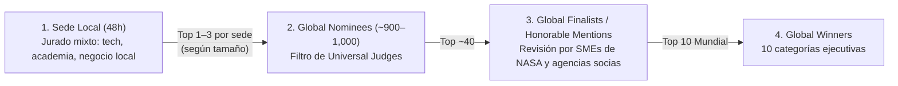

# 00.2 · Ingeniería Inversa de Ganadores Globales y Estrategia Local vs. Global

> **Rol activo:** *Ex-Jurado Ejecutivo de NASA Space Apps + Director de Estrategia Competitiva*.

---

## 1. Cómo Funciona el Embudo Real de Evaluación de Space Apps

### La diferencia crítica entre el Jurado Local y el Jurado Global (NASA SMEs)
| Dimensión | Jurado de Sede Local | Jurado Global (SMEs de NASA, ESA, JAXA, CSA, ISRO…) |
|---|---|---|
| **Tiempo por proyecto** | 3–5 min de pitch en vivo o video + demo rápida | Revisión asíncrona: **video de 30 s / 2–3 min + página del proyecto + repo + demo funcional sin login** |
| **Qué los enamora** | Impacto visual inmediato, conexión con el **territorio local** ("pusimos a nuestro país en el mapa de NASA"), claridad narrativa y prototipo que se mueve en vivo. | **Rigor científico impecable**, uso real y verificable de datasets de NASA/socios, honestidad sobre limitaciones físicas, novedad metodológica y utilidad real para misiones. |
| **Error mortal típico** | Presentación aburrida llena de fórmulas sin demo visual ni conexión humana. | *Science-washing*: mapas bonitos con números inventados, confundir mares basálticos con tierras altas del Polo Sur Lunar, o usar IA como caja negra sin validación. |

---

## 2. Anatomía de Ganadores Globales Recientes (2024–2025)

> **Actualización 13-nov-2026:** los ganadores **2025** de esta tabla (*SpaceGenes+*, *Resonant Exoplanets*) están verificados contra la página oficial; la lista completa de los 10 ganadores 2025 está en [`04_ganadores_2025_global_y_chile.md`](04_ganadores_2025_global_y_chile.md). Las filas **2024** no se re-verificaron en esa pasada. La rúbrica y las fechas vigentes están en [`03_rubrica_oficial_global_2026.md`](03_rubrica_oficial_global_2026.md); el embudo de abajo es orientativo (en 2025 hubo **45 finalistas** y **23 menciones honrosas**, no ~40).

Estudiamos ganadores mundiales verificados de desafíos planetarios, datos satelitales y ciencia para extraer su patrón ganador:

| Proyecto Ganador | Categoría Mundial | Qué construyeron | Patrón replicable para nosotros |
|---|---|---|---|
| **SkyShield (*WMPGang*, Canadá — 2024)** | *Best Use of Science* | Planetario/orrery 3D interactivo basado en física real de meteoroides y NEOs para calcular riesgo de colisión satelital. | **Física exacta + visualización 3D interactiva en navegador** (nuestro motor astronómico de iluminación rasante polar). |
| **WaterWise (*GaamaRamma*, EE. UU. — 2024)** | *Best Use of Data* | Herramienta de decisión agrícola cruzando múltiples capas de NASA Earth Observation y OpenET. | **Fusión limpia de múltiples capas reales de NASA Earthdata** orientadas a una decisión práctica concreta. |
| **42 QuakeHeroes (Brasil — 2024)** | *Best Use of Technology* | Red neuronal para detectar sismos lunares y marcianos (*moonquakes/marsquakes*) sobre datos planetarios reales. | **Validación cuantitativa rigurosa** sobre datos planetarios crudos. |
| **SpaceGenes+ (Alemania — 2025)** | *Best Use of Science* | Motor de conocimiento interactivo + dashboard sobre impacto molecular de radiación y microgravedad rumbo a Luna y Marte. | **Traducir literatura científica compleja en un motor de decisión visual** para planificadores de misión. |
| **Resonant Exoplanets (2025)** | *Best Use of Data* | Pipeline automatizado que filtra catálogos masivos de telescopios (JWST, etc.) para priorizar candidatos. | **Escaneo global sistemático** que filtra millones de píxeles para descubrir candidatos ocultos. |

---

## 3. Las 10 Categorías Globales de Space Apps y a Cuáles Apuntamos

1. 🏆 **Best Use of Science** *(Objetivo Primario #1)*: La solución que hace el uso más válido y sofisticado del método científico (nuestro índice multidimensional **PAFI**, distinción anortosita vs. basalto, geometría solar esférica y *back-testing* contra análogos reales).
2. 🏆 **Best Use of Data** *(Objetivo Primario #2)*: La que mejor cruza datos abiertos terrestres y planetarios (LOLA + Diviner + MOLA + SWIM + MODIS + Copernicus DEM + ESA CCI Permafrost + GLiM + inventarios de glaciares).
3. 🏆 **Best Mission Concept** *(Objetivo Secundario #1)*: La solución con mayor realismo operativo para próximas misiones espaciales (nuestro **Optimizador de Portafolio de Campañas Análogas** para *Artemis III* e *ILRS / Marte*).
4. 🌍 **Galactic Impact / Global Connection**: Democratizar el acceso a infraestructura natural de pruebas espaciales para países emergentes del Sur Global (Sudamérica, Asia Central, África).
5. ✨ **Most Inspirational**: La capa narrativa (*Pasaporte Planetario*: cada ciudadano descubre qué rincón de la Luna o Marte existe en su región y por qué debemos proteger esos ecosistemas extremos).

---

## 4. Estrategia Dual: Cómo Ganar en Local **Y** Ganar en Global con el Mismo Producto

No hagas dos proyectos distintos; construí **una sola arquitectura con dos modos de entrada narrativa**:

- **Modo Sede Local (ej. Argentina / LatAm):**
  - Abrís mostrando cómo el algoritmo global de NASA escanea toda la Tierra sin sesgos y, de manera emergente y matemática, coloca a la **Puna Catamarqueña/Salteña**, **Campo de Piedra Pómez**, **Payunia (Mendoza)** y los **Glaciares de Roca de los Andes Centrales (San Juan/Mendoza)** en el **Top 1 % mundial** para pruebas específicas de Marte y la Luna — superando en accesibilidad logística a la Antártida o el Ártico canadiense.
  - Impacto emocional y estratégico en el jurado local: *"Nuestro territorio es un laboratorio espacial de clase mundial validado con datos de NASA"*.

- **Modo Evaluación Global (NASA SMEs):**
  - Abrís con el problema de ingeniería de sistemas de *Artemis III* y *Mars Exploration Zones*: ningún sitio terrestre imita todo; por eso creamos el primer **Atlas Abierto de Fidelidad Multidimensional y Espacio-Temporal**, validado con *back-testing* sobre 20 sitios oficiales de NASA/ESA/CNSA/ISRO/IKI (mediana en el percentil >96) y capaz de descubrir **gemelos ocultos globales** (anortosita ártica en Groenlandia/Lofoten con luz rasante invernal, permafrost de Yakutia, evaporitas de Qaidam, jarosita de Kachchh y glaciares de roca andinos).
