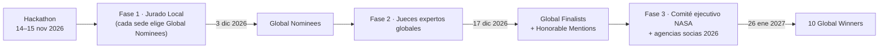

# 00.3 · Rúbrica Oficial Global 2026, Reglas de Elegibilidad y Requisitos de Entrega

> **Fuente primaria leída el 13-nov-2026** (víspera del hackathon) directamente en `spaceappschallenge.org`: *Judging & Awards Guide* y *Project Submission Guide* (ambas con fecha **12-nov-2026**), *Terms & Conditions* (`/legal/`) y la página del desafío. Las citas en inglés son textuales y cortas; el resto es traducción/paráfrasis fiel.
> **Regla del equipo:** este documento manda sobre cualquier otro del repo si hay contradicción.

---

## 0. Resumen ejecutivo (Pirámide de Minto)

**Respuesta:** la misma rúbrica de 5 criterios (escala 1–5) se usa **en todos los niveles**: jurado local, jurado global y comité ejecutivo. Ganar en Chile y ganar global exige lo mismo en esencia; lo que cambia es *quién* juzga y *en qué formato* ve el proyecto.

1. **Puertas duras (descalifican):** inglés en toda la página de proyecto, demo de **≤30 s o ≤7 diapositivas**, enlaces públicos sin login, todos los miembros en la misma sede, envío antes del **domingo 15-nov 23:59 hora local**, al menos **un dato/recurso NASA**, citar **todas** las fuentes, sin menores de 18 identificables en el material, sin logos/marcas NASA en contenido generado con IA.
2. **Puntaje (1–5 × 5 criterios):** *Impact, Creativity, Validity, Relevance, Presentation*. La guía insiste en dar a *Presentation* el mismo peso que a los otros cuatro.
3. **Premios globales:** 10 categorías; el comité ejecutivo de NASA + agencias socias asigna cada finalista a una.

---

## 1. Los 5 criterios oficiales (escala 1-to-5 en cada uno)

| Criterio | Qué mide (paráfrasis fiel) | Cómo luce un **5** según la guía | Qué evidencia tiene que ver el juez en NUESTRO proyecto |
|---|---|---|---|
| **Impact** | Tamaño del problema que aborda y alcance del efecto: desde pocos usuarios hasta una audiencia amplia. | Problema significativo, alcance extenso, inspira o beneficia a mucha gente, "could change the world". | Quién usa la herramienta (planificadores de misión + estudiantes/familias), cuántos, qué decisión mejora y una cifra de alcance creíble. |
| **Creativity** | Originalidad: concepto nuevo o mejora significativa de ideas existentes. | Enfoque "groundbreaking" nunca intentado, que desafía métodos convencionales. | Lo que **nadie más hizo**: p. ej. análogo por dimensión + brecha irreducible explícita + modo educativo jugable sobre el mismo dato. |
| **Validity** | Base científica y factibilidad técnica/funcional; potencial de funcionar en el mundo real; **usabilidad y facilidad de uso** también cuentan. | Científicamente sólido, técnicamente factible, "fully developed", listo para implementar, muy usable. | Método reproducible, back-testing contra análogos conocidos, límites declarados, demo que funciona sin instalar nada. |
| **Relevance** | Responde **completa y directamente** al desafío elegido e integra datos NASA **como componente central**, no como adorno. | Datos NASA integrales al éxito del proyecto; uso de datos bien ejecutado. | Cada pantalla muestra qué dataset NASA/socio alimenta el resultado (LRO/LOLA/Diviner, Earthdata, PDS…). |
| **Presentation** | Claridad al comunicar desafío, solución e importancia; storytelling atractivo y estructurado. **Se evalúa con la demo y con el proyecto completo.** | Presentación pulida, estructurada y convincente. | Demo de 30 s impecable + página de proyecto clara + historia SCR. |

> Cita textual de la guía: *"remember to pay equal attention to the final criterion: presentation."*
> La guía de entrega aclara que la demo **influye**, pero que *"the majority of judges' evaluation will be based on your project submission"* → la **página de proyecto escrita** pesa más que la demo.

---

## 2. Embudo y calendario 2026 (oficial)

- **Fase 1 (local):** el *Local Lead* recluta, entrena y organiza a los jueces locales, que usan **los criterios de NASA** para elegir quién avanza. Los premios locales (como los de Caja La Araucana) son **independientes** del proceso global: *"Regardless of Local Judging results, only officially submitted Global Nominees will be considered"*.
- **Fase 2:** jueces expertos puntúan a todos los nominados con los mismos 5 criterios → finalistas y menciones honrosas (las menciones *"were ranked highly … for their ingenuity and creativity"*).
- **Fase 3:** cada juez ejecutivo evalúa cada finalista y lo nomina a una de las 10 categorías.
- Proyectos del tipo *Create Your Own Challenge* **no** son elegibles para juzgamiento global (dato de ediciones anteriores; en 2026 hay 14 desafíos oficiales).

### Las 10 categorías globales (definición oficial abreviada)
| Premio | Lo que premia | Encaje con una plataforma educativa de análogos |
|---|---|---|
| Best Use of Science | Uso más válido del método científico | Alto si el modelo de similitud es reproducible y honesto con sus límites |
| Best Use of Data | Hacer accesibles los datos espaciales o usarlos de forma única | **Alto**: hacer accesible LRO/Earthdata a estudiantes es literalmente esto |
| Best Use of Technology | Uso más innovador de tecnología | Medio |
| Galactic Impact | Mayor potencial de mejorar la vida en la Tierra o el universo | Medio |
| Best Mission Concept | Concepto y diseño más plausibles | Medio-bajo para un enfoque educativo |
| Most Inspirational | "captures our hearts" | **Alto** si la historia humana es real |
| Best Storytelling | Comunica creativamente el potencial de los datos abiertos mediante storytelling | **Alto** (lo ganó *HerCode Space* en 2025 con un cuento para niños) |
| Global Connection | Conecta personas alrededor del mundo con tecnología | Medio-alto si comparamos análogos de varios continentes |
| Art & Technology | Combina habilidades técnicas y creativas | **Alto** con la estética papel-cartón por capas (ver §6) |
| Local Impact | Mayor potencial de cambio en la comunidad local | **Alto**: puente directo con la lectura de La Araucana (QUEÑARIS, Perú, lo ganó en 2025) |

---

## 3. Puertas duras de elegibilidad (si falla una, no hay juzgamiento global)

| # | Requisito | Fuente | Estado |
|---|---|---|---|
| 1 | Responder a **uno de los 14 desafíos oficiales 2026** | Judging Guide | ☐ |
| 2 | Todos los miembros registrados, **en la misma sede** (no en lista de espera), visibles en la pestaña *Members*. **1–6 personas** por equipo en sede local | Judging Guide | ☐ |
| 3 | Completar **todos** los campos obligatorios de la página de proyecto | Judging Guide | ☐ |
| 4 | Demo: **video ≤30 s** o **≤7 diapositivas** (incluye portada e intro). *"Projects that exceed these limits will not be eligible for Global Judging."* | Submission Guide | ☐ |
| 5 | **Inglés** en la página y en todo material enlazado. Video puede hablarse en español **con subtítulos en inglés**; las diapositivas deben estar en inglés | Ambas | ☐ |
| 6 | Enlaces públicos **sin contraseña, permiso ni registro**; probar en ventana privada | Submission Guide | ☐ |
| 7 | Clic en **"Submit for Judging"** antes del **domingo 15-nov-2026, 23:59 hora local de la sede**. Solo cuenta el último envío guardado | Submission Guide | ☐ |
| 8 | Marcar las dos casillas: términos + **obra original con todas las fuentes externas listadas en References** | Judging Guide | ☐ |
| 9 | Usar **al menos un dato o recurso NASA** (requisito para premio global) | Submission Guide | ☐ |
| 10 | **Sin nombres, voces ni rostros reconocibles de menores de 18** en demo y proyecto | Submission Guide + T&C | ☐ |
| 11 | Contenido original con licencia **OSI** (si no se declara, NASA lo distribuye como **Apache-2.0**); materiales de terceros deben ser abiertos y su licencia declarada | T&C | ☐ |
| 12 | Política de **restricción con China**: no participar, colaborar ni coordinar con entidades chinas en relación con el hackathon; NASA revisa la elegibilidad | Judging Guide + T&C | ☐ |

### Reglas de "Super Intelligence (SI)" — así llama NASA a la IA en 2026
- Se permite usar IA (ML, chatbots, generación de imágenes, LLMs) para **acelerar**, pero **no para idear cómo resolver el desafío**: *"SI should not be used to (come up with your idea of how to solve the challenge)."*
- **Imágenes y videos generados con IA: marca de agua visible obligatoria.** Audio, código y datos: declararlo en el texto descriptivo y en los metadatos.
- El contenido generado **no puede usar, contener ni modificar marcas NASA** (logos, banderas, identificadores de misión).
- La respuesta del formulario sobre SI no la ven los jueces, pero **sí ven las marcas de agua y declaraciones**, y evalúan *"originality, intent, and execution"* de lo asistido por IA.

> ⚠️ **Implicancias directas para nosotros**
> 1. La imagen de referencia papel-cartón **contiene el logo de NASA** y parece generada con IA → **no puede ir en la entrega** tal cual. Hay que rehacer el estilo sin marcas NASA y, si se genera con IA, con marca de agua visible.
> 2. El repo `nasa-ciencia-abierta` y nuestros logos propios se pueden mostrar como trabajo previo **independiente**, nunca con la insignia de NASA ni sugiriendo patrocinio.
> 3. Plataforma educativa ≠ mostrar niños: en el video **no aparecen menores reconocibles** (usar ilustraciones, manos, voz adulta).
> 4. **Datos CNSA/China:** la regla habla de *colaborar o coordinar* con entidades chinas, no de leer un paper. Aun así, registrarse en portales del gobierno chino para bajar datos es una zona gris. **Recomendación:** el núcleo usa NASA + agencias socias 2026; dejar CNSA solo como cita bibliográfica y consultarlo al *Local Lead*.

---

## 4. Campos de la página de proyecto (lo que el juez lee primero)

| Campo | Qué pide | Consejo |
|---|---|---|
| **Project Name** | Nombre | Corto + promesa: "*X — what you gain*" |
| **High-Level Project Summary** | Qué desarrollaron, cómo responde al desafío, por qué importa | 3 frases SCR. Es lo primero que lee el juez global |
| **Link to Project Demo** | Video ≤30 s o ≤7 slides, link público | Subtítulos en inglés quemados en el video |
| **Link to Final Project** | Sitio web, repo o carpeta pública | Web estática que cargue sin login; pedir clasificación FortiGuard (recomendado por NASA) |
| **Detailed Project Description** | Qué hace, cómo funciona, beneficios, qué esperan lograr, herramientas y lenguajes | Incluir método, fórmula de similitud, limitaciones y back-testing |
| **Use of Super Intelligence (SI)** | Si usaron IA y cómo | Honestidad total; no lo ven los jueces pero sí las marcas de agua |
| **NASA Data** | Datos y recursos NASA específicos usados | Nombre exacto del producto + URL + qué variable se usó y para qué |
| **Space Agency Partner Data and Other References** | Todos los datos, código, textos e imágenes usados, con licencia | Lista exhaustiva; omitir una fuente puede costar la nominación |

**Agencias socias 2026** (se recomienda usar sus datos): Angola, Bahrein, Brasil (AEB), **CSA**, **ESA**, **ISRO**, Italia (ASI), **JAXA**, **KASA** (Corea), MBRSC (EAU), **CONAE (Argentina)**, Nigeria, **Paraguay**, Senegal, España (AEE), Turquía y **UK Space Agency**. *CNSA y Roscosmos no figuran.*

---

## 5. Guion oficial del video de 30 s (Submission Guide)

| Tiempo | Contenido que pide NASA |
|---|---|
| 0:00 | Nombre y equipo |
| 0:02 | Qué desafío abordan y qué los inspiró |
| 0:05 | Título del proyecto + *tagline* |
| 0:10 | Cómo funciona: imágenes o prototipo, experiencia de usuario, **cómo los datos abiertos de NASA y agencias socias lo hicieron posible** |
| 0:20–0:30 | El futuro: qué puede hacer por las personas, el mundo y más allá |

Si eligen diapositivas (máx. 7): imagen del proyecto, experiencia de usuario, cómo los datos NASA/socios lo hacen posible, nombre del equipo, nombres de los miembros y desafío elegido. Fuente legible y poco texto.

---

## 6. Lo que el desafío de análogos pide literalmente (y lo que castiga)

Página oficial: *Identify Earth Locations that Analog the Permanent Moon Base Locations and Mars* — dificultad **Beginner/Youth, Intermediate y Advanced** (es uno de los pocos desafíos abiertos a los tres niveles, lo que **legitima un enfoque educativo**).

**Lo que suma (paráfrasis de *Objectives* y *Potential Considerations*):**
- Explicar **qué es análogo, cuánto y qué no**; un análogo "no tiene que calzar en todo".
- Pensar más allá del parecido visual; usar **múltiples datasets**.
- Considerar **procesos**, no solo lugares (tormentas de polvo, sedimentación, dinámica de hielo…).
- **Escala:** un cráter, valle o tubo específico puede ser mejor análogo que un desierto entero.
- Conectar el análogo con la exploración: qué instrumento probar, qué riesgo reduce.
- **Reconocer los límites de la Tierra**: gravedad reducida, vacío lunar, atmósfera marciana delgada, radiación.
- Formatos aceptados explícitamente: informe, mapa, app, **historia, juego**, ranking de similitud, ML… y *"to educate the public"*.
- *"Surprise us."*

**Lo que resta:**
- *"The goal is not simply to rediscover well-known analog sites"*. La página nombra **Antártida, Desierto de Atacama, Islandia y Hawái** como sitios *"already widely studied"*.

> **So what para un equipo de Antofagasta:** Atacama sirve como **control conocido para back-testing** (demuestra que el método funciona), pero el titular tiene que ser un **sitio o proceso poco estudiado** (p. ej. Cráter Monturaqui, Salar de Gorbea, glaciares rocosos del inventario DGA, Pali Aike) o un **método** que encuentre nuevos análogos en cualquier lugar.

**Recursos oficiales del desafío:** NASA Earthdata Search, NASA Worldview, PDS, LRO (LROC, LOLA, Diviner, LEND, Mini-RF), Diviner polar products; CSA RADARSAT (RCM, RADARSAT-1, tutorial SAR en Python), ESA Copernicus Data Space + Open Science Catalog, JAXA G-Portal.

---

## 7. Los 14 desafíos 2026 y su afinidad con una plataforma educativa

| Desafío 2026 | Dificultad | Afinidad educativa | Comentario |
|---|---|---|---|
| **Identify Earth Locations that Analog… Moon & Mars** | B/Y · I · A | ⭐⭐⭐ | **Nuestro desafío.** Admite juego/historia/educación pública; todo el I+D del repo apunta aquí |
| Build a Junior Astronaut Mission Trainer | B/Y · I | ⭐⭐⭐ | Juego para gestionar una base lunar/marciana (soporte vital, radiación, energía, comida). Alternativa si el foco pasa a ser 100 % educativo |
| Space Mission Design Game | B/Y · I | ⭐⭐⭐ | Juego de diseño de misión completa con trade-offs |
| Abandoned but not Forgotten (equipos NASA abandonados) | B/Y · I | ⭐⭐⭐ | Storytelling para escolares |
| The Earth Information Jukebox | B/Y · I | ⭐⭐ | Sonificación (accesibilidad) |
| Lunar Landing Site Navigator | I · A | ⭐⭐ | Pide herramienta para *"mission planners, educators, and the public"*: comparte motor solar con nuestro Chrono-Luna |
| Interplanetary Survival Guide: Martian Map | I | ⭐ | Mapa por capas de una ruta marciana |
| Planet X and SPHEREx | A | ⭐ | Herramienta pública del cielo |
| Be An Earth System Trend Detective! · Dancing with the SARs · Field Shift · Harmonization MODIS/VIIRS · Flame in Freefall · Health Monitoring | I · A | ⭐ | Fuera de nuestro foco |

> **Decisión recomendada:** quedarse en el desafío de análogos con **doble rol** (Modo Explorador educativo + Modo Misión científico). El riesgo a vigilar es *Relevance*: si la parte educativa deja de **identificar y caracterizar análogos con datos**, el proyecto se lee como "app educativa genérica" y baja el puntaje. La educación es **el canal**; la caracterización de análogos es **el contenido**.

---

## Fuentes (leídas el 13-nov-2026)
- [Judging & Awards Guide](https://www.spaceappschallenge.org/resources/judging-awards-guide/) (actualizada 12-nov-2026)
- [Project Submission Guide](https://www.spaceappschallenge.org/resources/project-submission-guide/) (actualizada 12-nov-2026)
- [Terms & Conditions / Legal](https://www.spaceappschallenge.org/legal/)
- [2026 Challenges](https://www.spaceappschallenge.org/2026/challenges/) · [Desafío de análogos](https://www.spaceappschallenge.org/2026/challenges/permanent-moon-base-locations-and-mars/) · [Recursos del desafío](https://www.spaceappschallenge.org/2026/challenges/permanent-moon-base-locations-and-mars/?tab=resources)
