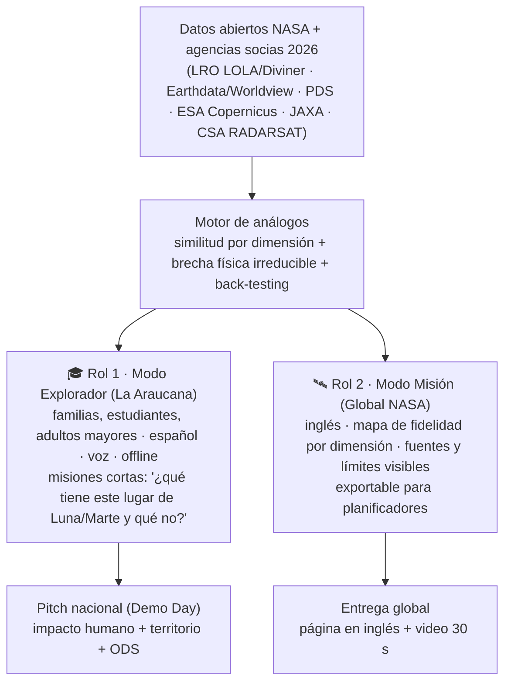

# 00.5 · Lente Caja La Araucana (Local/Nacional) + Estrategia de Doble Rol Educativo

> **Honestidad primero:** Caja La Araucana **no ha publicado una rúbrica de jurado local** en las fuentes que pudimos leer (13-nov-2026; su página `laaraucana.cl/hackaton-laaraucana-2026` no cargó). Lo que sí publicó son sus **objetivos oficiales** para Space Apps (§0, hallazgo de Isabeau Valverde). El resto es una lente **inferida** a partir de la regla de que los jueces locales usan los criterios NASA, las declaraciones de sus gerentes y quién ganó en Chile en 2024–2025. **Confirmar con la Local Lead el sábado temprano** (preguntas en §8).

---

## 0. Objetivos oficiales de La Araucana para Space Apps (VERIFICADO)

Fuente: caso *"NASA Space Apps Challenge Chile: Ciencia, innovación y colaboración global desde el territorio"*, publicado por **Caja de Compensación La Araucana** como responsable de la iniciativa en la plataforma Conecta del **Pacto Global Chile** (vigencia 2024–2026). Leído el 13-nov-2026.

| # | Objetivo oficial | Cómo lo demuestra nuestro proyecto (sin inventar resultados) |
|---|---|---|
| 1 | **Democratizar el acceso a ciencia de frontera** | Datos NASA/USGS abiertos convertidos en una comparación que cualquiera entiende, gratis, sin cuenta y en 3 idiomas |
| 2 | **Desarrollar competencias STEAM y empleabilidad** | Micro-reto "¿Dónde probarías un rover?" que enseña a leer pendientes, relieve y límites; el propio equipo aprende GIS y ciencia de datos |
| 3 | **Generar soluciones con aplicación local** | Sectores de la región de Antofagasta caracterizados con datos para ensayos de exploración robótica |
| 4 | **Consolidar una red interregional de innovación** | El método es abierto y replicable: otras sedes o comunidades pueden sumar su "nodo" (la *lattice*) |

**Metas ODS que la propia iniciativa declara impactar:** **4.3** (acceso a formación técnica y superior), **4.4** (competencias técnicas para el empleo), **9.5** (investigación científica y capacidad tecnológica), **17.3**, **17.16** y **17.17** (alianzas). Usar **estas** metas en el pitch local.

**Continuidad que ofrece La Araucana:** en 2026 vinculó a equipos de 2025 con *Despega tu Futuro* en FIDAE y tres startups fueron seleccionadas para pilotos y pasantías con la Fuerza Aérea de Chile. Un proyecto con camino de continuidad (piloto, ensayo de campo) encaja con lo que ya hacen.

---

## 1. Hechos verificados sobre la edición chilena 2026

| Dato | Valor | Fuente |
|---|---|---|
| Fechas | 14–15 nov 2026 | Página oficial sede Antofagasta |
| Organiza en Chile | **Caja La Araucana** (3er año), aliada este año con **American Spaces** (Embajada de EE. UU.) | Tour Innovación, 2-nov-2026 |
| Sedes y cupos en `spaceappschallenge.org` | Santiago (240), Concepción (100), Temuco (100), Antofagasta (60), Valparaíso (50), Quemchi (35), Punta Arenas (30) | Página *2026 Local Events* |
| Sede Antofagasta | **UCN Casa Central**, Angamos 0610; alianza La Araucana + UCN + American Space; Local Lead: Astrid Morales | Página de la sede |
| Formato local | Charlas + talleres + mentores por desafío + **Demo Day final ante jurado local** | Página de la sede |
| Participantes | Desde 13 años (menores con tutor); individuales o equipos | Página de la sede |
| Premios locales | "mentorías, premios y visibilidad internacional" (sin detalle). En 2024–2025 la prensa mencionó visita a instalaciones de NASA; no confirmado para 2026 | Página de la sede; prensa 2024–2025 |
| Categorías en 2024–2025 | Principiante, Intermedio, Avanzado (no confirmado para 2026) | UCN, Emol, prensa 2024 |

---

## 2. Qué valora La Araucana (evidencia textual de sus voceros)

| Señal pública | Quién | Lo que implica para el jurado local |
|---|---|---|
| El bienestar de afiliados y familias "es integral"; acceder a conocimientos y potenciar talentos | Francisco Sepúlveda, gerente general (nov-2026) | **Personas en el centro**: la plataforma debe servir a familias reales, no solo a científicos |
| "reducir brechas … sin importar dónde vivan" | Sepúlveda (nov-2026) | **Inclusión territorial y digital**: regiones, baja conectividad, accesibilidad |
| "acercando especialmente a las nuevas generaciones" | Sepúlveda (nov-2026) | **Vocación STEM juvenil** → encaja con el rol educativo |
| Las propuestas deben recoger "las necesidades y oportunidades de sus territorios" | Nikolaj Gregorcic, **gerente de Impacto Social y Sostenibilidad** | **Pertinencia territorial** + **sostenibilidad** (es un área con gerencia propia) |
| Agenda conjunta para aprendizaje "en distintas etapas de la vida" | La Araucana + American Spaces | **Aprendizaje a lo largo de la vida**: niños, jóvenes, adultos y adultos mayores |
| "poner en el centro a las personas y generar soluciones que aporten valor a sus vidas y bienestar" | Sepúlveda (Emol, oct-2025) | El "So what?" debe responder: ¿mejora la vida de alguien? |
| Participa el **PM de Educación y Pro Empleo** en la alianza | Tour Innovación, nov-2026 | **Empleabilidad/habilidades** como resultado deseable |
| American Spaces: inglés, estudio y emprendimiento | Embajada EE. UU. | Proyecto **bilingüe** suma (y la entrega global igual exige inglés) |
| **300 becas Technovation Girls** (programación e IA para niñas y adolescentes de 13 a 17 años) | Prensa, 2025–2026 | **STEAM con foco de género** es una línea activa de la Caja |
| **Becas STEM-STEAM para mujeres** (3.ª versión) dentro de su programa de becas | Prensa, 2026 | Equipo diverso y contenidos que inviten a mujeres a STEM suman narrativa |
| ODS destacados por Sustainable Fitch: **ODS 8, 9 y 10**; adherida al **Pacto Global** de la ONU | Sustainable Fitch / Pacto Global Chile | Hablar en **su** idioma ODS: trabajo decente, innovación, reducción de desigualdades |

---

## 3. Rúbrica inferida La Araucana ↔ Rúbrica NASA (cruce MECE)

Los jueces locales **deben** puntuar con los 5 criterios NASA; la lente La Araucana cambia **qué evidencia los convence** dentro de cada criterio.

| Criterio NASA (1–5) | Evidencia que convence al **juez global** | Evidencia que convence al **jurado La Araucana** (inferido) | Una sola pieza que sirve a ambos |
|---|---|---|---|
| **Impact** | Utilidad para misiones Artemis/Marte; método escalable al planeta | Familias, estudiantes y regiones que aprenden y ganan oportunidades; reducción de brechas | Métrica doble: "N sitios caracterizados" + "N personas que aprenden en ≤5 min sin instalar nada" |
| **Creativity** | Método nuevo de similitud por dimensión + brecha irreducible | Experiencia que nadie ha visto: papel-cartón por capas, jugable, con identidad local | Modo Explorador jugable **sobre el mismo motor científico** |
| **Validity** | Back-testing, límites físicos declarados, reproducibilidad | Que funcione en vivo, en el celular, también con mala conexión | Demo desplegada, offline-first, con fuentes rotuladas |
| **Relevance** | Datos NASA en el núcleo; responde literalmente al desafío | Responde a necesidades del territorio (Antofagasta/norte de Chile) | Análogos chilenos poco estudiados + comparación global |
| **Presentation** | Página en inglés + video 30 s impecable | Pitch en vivo emocionante, claro, con demo y un usuario real | Misma narrativa SCR en dos idiomas y dos duraciones |

**Ejes transversales probables en el jurado local** (no son criterios NASA, pero suben *Impact*): ODS / sostenibilidad, inclusión y accesibilidad, educación y empleabilidad, bilingüismo.

---

## 4. Diseño del producto con 2 roles (una arquitectura, dos puertas)

**Reglas de diseño para que el doble rol no reste puntos:**
1. **El mismo dato alimenta ambos modos.** Si el Modo Explorador muestra algo, debe venir del motor (Relevance).
2. **Cada misión educativa caracteriza un análogo real** con al menos un dataset NASA rotulado.
3. **Siempre mostrar "en qué NO se parece"** (gravedad 1/6 g o 0,38 g, vacío, atmósfera de CO₂ de ~0,6 kPa, radiación, frío criogénico PSR): es educación científica honesta **y** exigencia del desafío.
4. **Atacama = control; titular = sitio o proceso poco estudiado** (§6 de [`03_rubrica_oficial_global_2026.md`](03_rubrica_oficial_global_2026.md)).
5. **Accesibilidad real:** alto contraste, texto alternativo, navegación por teclado, lectura en voz, funciona en móvil de gama baja.
6. **Menores:** la plataforma puede ser para niños, pero en video y capturas **no aparecen menores reconocibles**.

---

## 5. Dos pitches, una historia (SCR)

| | **Pitch nacional (Demo Day La Araucana)** | **Entrega global (NASA)** |
|---|---|---|
| Idioma | Español (diapositivas bilingües suman con American Spaces) | **Inglés** obligatorio; video en español solo con subtítulos en inglés |
| Duración | No publicada → preparar **3 min + 2 min de preguntas** y versión de 90 s | **≤30 s** de video o **≤7** diapositivas (excederse = no elegible) |
| Abre con | Una persona de la región y su brecha (sin menores identificables) | El problema de misión: ningún sitio terrestre imita todo |
| Núcleo | Demo en vivo del Modo Explorador → salto al Modo Misión | Captura del Modo Misión + método + datos NASA |
| Cierre | ODS, regiones, empleabilidad, siguiente paso con UCN/La Araucana | "What it could do for people, the world, and beyond" |
| Prueba | Mentor de la UCN que validó el enfoque; usuarios que lo probaron en el evento | Back-testing contra análogos conocidos; fuentes citadas |

**Estructura sugerida de 3 min (local):** 0:00 gancho humano → 0:20 situación/complicación → 0:45 demo en vivo Modo Explorador → 1:45 Modo Misión: dato NASA + límites → 2:20 impacto (ODS, regiones, carbono) → 2:45 equipo y siguiente paso.

---

## 6. ODS (Agenda 2030) y Huella de Carbono: qué es obligatorio y qué es diferencial

**Verificado:** ni la *Judging Guide* ni la *Submission Guide* 2026 exigen ODS ni huella de carbono. **No son criterios oficiales.**
**Verificado (fuentes secundarias):** La Araucana adhiere al Pacto Global y Sustainable Fitch destaca su aporte a los **ODS 8, 9 y 10** → abrir la diapositiva ODS con **esos tres** y sumar ODS 4 y 13 como propios del proyecto. Sus **bases propias del hackatón 2026 no se pudieron leer**: `laaraucana.cl/hackaton-laaraucana-2026` tiene protección anti-bots y no carga ni en navegador automatizado; hay que pedirlas a la Local Lead.
**Inferido:** La Araucana tiene una **Gerencia de Impacto Social y Sostenibilidad** que participa en el evento, así que sostenibilidad y ODS probablemente suman ante el jurado local, dentro de *Impact*.

| ODS | Cómo lo toca la plataforma | Métrica simple y honesta |
|---|---|---|
| **ODS 4 – Educación de calidad** | Modo Explorador gratuito, en español, para varias edades | Personas que completan una misión; % de aciertos antes/después |
| **ODS 10 – Reducción de desigualdades** | Offline-first, voz, móvil de gama baja, regiones | Peso inicial de la página (KB); funciona sin conexión: sí/no |
| **ODS 9 – Industria, innovación e infraestructura** | Datos abiertos espaciales accesibles para la región | N.º de datasets NASA/socios integrados |
| **ODS 8 – Trabajo decente** (eje Pro Empleo) | Habilidades STEM/datos; perfiles de trabajo en campañas análogas | Enunciarlo como potencial, **sin inventar cifras** |
| **ODS 13 – Acción climática** | Entrenar cerca en vez de volar a análogos polares lejanos; web liviana | gCO₂e por visita (SCI) + tCO₂e evitadas por campaña (estimación con supuestos declarados) |
| **ODS 17 – Alianzas** | Datos multiagencia + academia local + La Araucana | Socios nombrados |

**Huella de carbono, versión defendible en 48 h:** medir el sitio con la especificación **SCI (ISO/IEC 21031:2024)** o la librería abierta **CO2.js** (Green Web Foundation), declarar supuestos y no prometer "carbono cero" absoluto. Un número pequeño y verificable vale más que un sello grandilocuente. El precedente es *FarmHubGlobal* (mención honrosa 2025), que destacó por reutilizar datos existentes en vez de adquisiciones nuevas energívoras.

---

## 7. Identidad visual papel-cartón por capas (sin riesgo de descalificación)

- **Concepto:** diorama de papel con profundidad (capas que se desplazan en *parallax* al mover el cursor o inclinar el móvil), sombras suaves entre capas y texturas de cartulina. Luna, Tierra y Marte como "escenarios de papel" que se abren por capas geológicas: **la capa revela el dato**.
- **Por qué funciona:** atrae a familias (La Araucana), es memorable para los jueces de Art & Technology y Storytelling, y las capas son una metáfora literal de las **dimensiones de analogía**.
- **Cumplimiento:**
  - ❌ Nada de insignia NASA (*meatball*), *worm* ni identificadores de misión en arte propio o generado con IA. La imagen de referencia actual **incluye el logo de NASA → no usarla en la entrega**.
  - ✅ Construir las capas con **SVG/CSS propios** (más liviano, accesible y sin problema de derechos).
  - ✅ Si alguna capa se genera con IA: **marca de agua visible** y declaración en el texto.
  - ✅ Logos propios (equipo, `nasa-ciencia-abierta`) como trabajo previo independiente, sin sugerir patrocinio de NASA.
  - ✅ Toda textura, tipografía o ícono de terceros: licencia abierta y citado en *References*.

---

## 8. Preguntas para la Local Lead (sábado 14, antes del mediodía)

1. ¿Hay rúbrica local de La Araucana además de los 5 criterios NASA? ¿Con qué pesos?
2. ¿Se mantienen las categorías Principiante / Intermedio / Avanzado? ¿Cómo se asigna la nuestra?
3. ¿Formato y duración exactos del Demo Day? ¿Hay preguntas del jurado? ¿Proyector o pantalla para la demo en vivo?
4. ¿Cuántos proyectos de la sede pasan a *Global Nominees* y quién los envía?
5. ¿Qué premios locales hay en 2026 y con qué criterio se otorgan?
6. ¿Hay alguna restricción para usar datos de agencias que no son socias 2026 (p. ej. CNSA)?
7. ¿Hora límite local del Demo Day? (la entrega global cierra el domingo 23:59, pero el juzgamiento local puede ser antes).

---

## Fuentes
- [Sede Antofagasta 2026](https://www.spaceappschallenge.org/2026/local-events/antofagasta/) · [Sedes 2026](https://www.spaceappschallenge.org/2026/local-events/)
- [Tour Innovación, 2-nov-2026: Caja La Araucana y American Spaces en siete ciudades](https://www.tourinnovacion.cl/eventos/caja-la-araucana-y-american-spaces-fortalecen-el-despliegue-del-nasa-space-apps-challenge-en-siete-ciudades-de-chile/)
- [Emol, 10-oct-2025](https://www.emol.com/noticias/Tendencias/2025/10/10/1180131/hackaton-la-araucana-nasa.html) · [UCN 2025](https://www.ucn.cl/comunicaciones-ucn/noticias/abiertas-las-postulaciones-al-nasa-space-apps-challenge-que-se-realizara-en-la-ucn/)
- [Judging & Awards Guide 2026](https://www.spaceappschallenge.org/resources/judging-awards-guide/) · [Project Submission Guide 2026](https://www.spaceappschallenge.org/resources/project-submission-guide/)
- [Honorable Mentions 2025 (FarmHubGlobal, Home Alone)](https://www.spaceappschallenge.org/2025/awards/honorable-mentions/)
- [Portal Educa: Caja La Araucana y Technovation Girls, becas de programación](https://portaleduca.cl/ninas-en-stem-caja-la-araucana-y-technovation-girls-lanzan-mas-de-300-becas-de-programacion-en-valparaiso-y-biobio/) · [El Nortero: becas La Araucana 2026](https://www.elnortero.cl/noticia/becas-de-estudio-la-araucana-2026/becas-de-hasta-170-mil-para-estudiantes-destacados-asi-se-)
- [Pacto Global Chile: La Araucana y Sustainable Fitch](https://www.pactoglobal.cl/la-araucana-obtiene-la-nota-mas-alta-en-el-ambito-social-de-latinoamerica-en-clasificacion-sustainable-fitch/) · [UN Global Compact: La Araucana C.C.A.F.](https://unglobalcompact.org/participation/report/cop/detail/481448)
- [Bases y rúbrica Nómada (cruce de rúbricas)](06_rubrica_nomada_usqai_y_cruce.md)
- [Pacto Global Chile · Conecta: caso NASA Space Apps Challenge Chile (Caja La Araucana)](https://conecta.pactoglobal.cl/casos-de-empresas/nasa-space-apps-challenge-chile-ciencia-innovacion-y-colaboracion-global-desde-el-territorio/) — objetivos oficiales y metas ODS (hallazgo de Isabeau Valverde)
