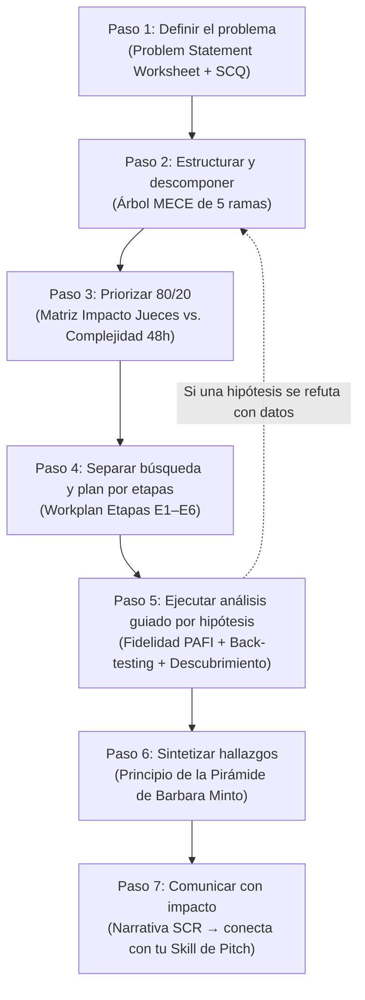
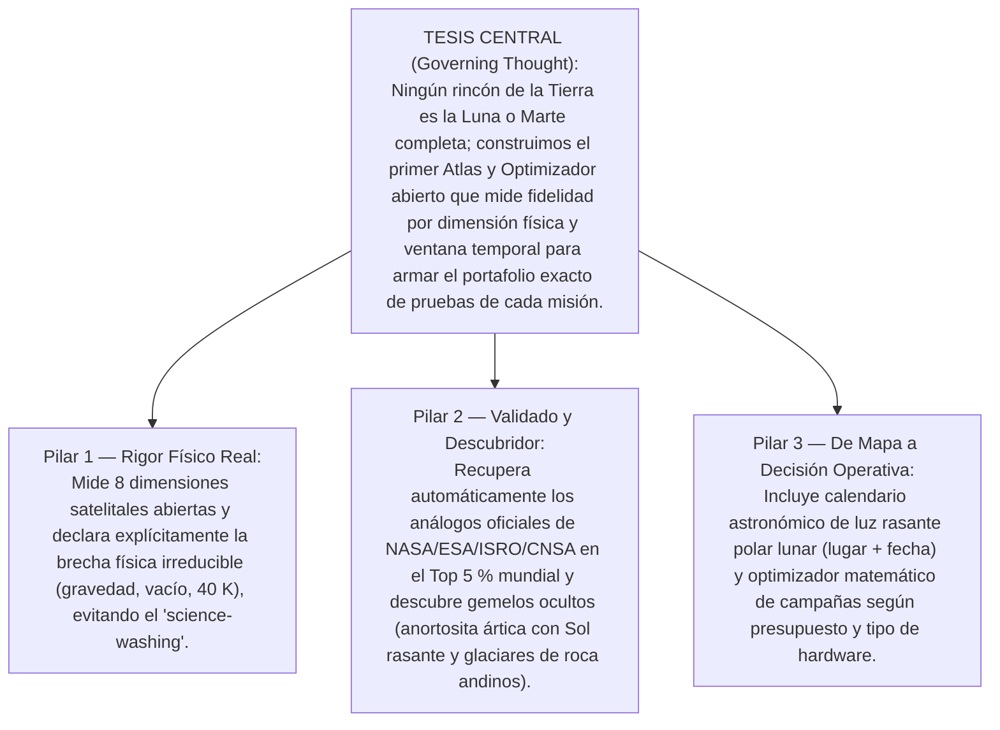

# 01.1 · Método McKinsey Aplicado y Separación de Búsqueda por Etapas

> **Rol activo:** *Senior Engagement Manager (McKinsey & Company — Aerospace & Defense Practice) + Principal Investigator (NASA Planetary Analogs)*.

---

## 1. Por qué usamos el Método McKinsey para "Afilar el Hacha"
En un hackathon de 48 horas, el 90 % de los equipos cae en dos trampas mortales:
1. **"Hervir el océano" (*Boiling the Ocean*):** Descargar terabytes de datos satelitales sin saber qué hipótesis quieren demostrar.
2. **"Solución en busca de problema":** Elegir una tecnología de moda ("hagamos un chatbot" o "entrenemos una CNN") sin entender la física de los sitios lunares y marcianos.

El método estructurado de **McKinsey & Company** evita ambas trampas mediante **7 pasos secuenciales iterativos**, guiados desde el minuto cero por **hipótesis falsables**, descomposición **MECE** (*Mutually Exclusive, Collectively Exhaustive*) y priorización **Pareto 80/20**.

---

## 2. Separación Estratégica de la Investigación y Búsqueda por Etapas

Para no mezclar ruido con señal, dividimos toda la recolección de información y ejecución en **6 etapas estancas**, donde la salida de cada etapa alimenta exactamente a la siguiente:

| Etapa | Nombre Operativo | Pregunta que Responde | Regiones / Fuentes que Consulta | Entregable de Salida |
|---|---|---|---|---|
| **Etapa 1** | **Frontera Extraterrestre (*Target Profiling*)** | ¿Qué condiciones físicas exactas existen en las bases permanentes de la Luna y Marte? | NASA (*Artemis III*, *HLS2/EZ*, *SWIM*), CNSA/Rusia (*ILRS*, *Chang'e-7*, *Tianwen-1*), ISRO (*Chandrayaan-3*), ESA (*Oxia Planum*), JAXA (*LUPEX*). | Vectores físicos de referencia ($\vec{r}_{\text{Luna}}, \vec{r}_{\text{Marte}}$) + tabla de brechas físicas irreducibles. → Docs `02.1` y `02.2`. |
| **Etapa 2** | **Benchmark Global de Análogos (*Ground-Truth*)** | ¿Qué lugares de la Tierra ya usan las agencias espaciales del mundo y por qué? | EE. UU./Canadá, Europa, China, India, Rusia, Japón, Medio Oriente, África, Oceanía, Antártida y Latinoamérica (en 12 idiomas). | Base de verdad terreno (*Ground-Truth* de 50+ sitios) para validar nuestro modelo (*back-testing*) y detectar vacíos geográficos. → Doc `02.3`. |
| **Etapa 3** | **Inventario de Sensores y Datos Abiertos (*Data Scouting*)** | ¿Con qué capas satelitales y librerías libres podemos medir las mismas variables en toda la Tierra? | Google Earth Engine, NASA Earthdata, PDS, Moon/Mars Trek WMTS, Copernicus, ESA CCI, IANIGLA, JAXA DARTS, CNSA CLEP, ISRO PRADAN. | Tabla maestra variable ↔ sensor ↔ resolución ↔ ID de colección libre. → Doc `02.4`. |
| **Etapa 4** | **Ingeniería de Métodos Cuantitativos (*Method Scouting*)** | ¿Qué matemáticas e IA convierten capas dispares en una medida científicamente defendible? | Literatura MIT/Stanford/ESA sobre MCDA-AHP, ESI inverso, SAM espectral, escalamiento $\pi$, embeddings fundacionales y optimización *Set Cover*. | Ecuación del **PAFI (*Planetary Analog Fidelity Index*)** + motor astronómico de luz rasante. → Doc `02.5`. |
| **Etapa 5** | **Divergencia Multi-Rol (*Expert Brainstorming*)** | ¿Qué ángulos disruptivos no verá el 99 % de los competidores? | Simulación de roles: NASA Flight Director, MIT EAPS/Media Lab, Stanford d.school, Consorcio Internacional, Agencia Creativa y Abogado del Diablo. | Banco de >35 ideas agrupadas por afinidad + *insights* contraintuitivos. → Doc `03.1`. |
| **Etapa 6** | **Convergencia y Selección de Cartera (*Solution Architecture*)** | ¿Qué propuestas concretas compiten mejor en sede Local y en ronda Global? | Rúbrica oficial de Space Apps + ingeniería inversa de Global Winners 2024–2025. | 8 propuestas detalladas + matriz de decisión ponderada + arquitectura y roadmap 48h. → Docs `04.*` y `05.*`. |

---

## 3. Los 5 Principios Innegociables de McKinsey durante todo el Proyecto

1. **MECE (*Mutually Exclusive, Collectively Exhaustive*):** Cada categoría de nuestro índice mide un fenómeno físico distinto (sin doble conteo oculto) y el conjunto cubre todos los factores relevantes de una misión superficial.
2. **Pensamiento Guiado por Hipótesis (*Day-One Answer*):** No exploramos a ciegas; formulamos una tesis desde el Día 1 y diseñamos cada experimento de datos para confirmarla o refutarla rápido.
3. **Regla 80/20 (Ley de Pareto):** 8 capas geofísicas limpias a $1\text{ km}$ + geometría solar exacta entregan el 90 % del rigor científico en el 20 % del tiempo de cómputo.
4. **Prueba del *"So What?"* (¿Y qué cambia esto?):** Nunca mostramos un mapa por estética; cada capa responde una decisión de ingeniería real (*"¿Dónde pruebo el taladro criogénico de Starship en julio con presupuesto universitario?"*).
5. **Síntesis Piramidal (Principio de Barbara Minto):** Empezamos siempre por la conclusión ejecutiva respaldada por 3 pilares independientes y evidencia cuantitativa verificable.

---

## 4. Pirámide de Minto Lista para Conectar con tu Skill de Pitch

### Guion base SCR (*Situation – Complication – Resolution*) para inyectar a tu Skill de Pitch
- **Situación (*Situation*):** En la próxima década, la humanidad establecerá bases permanentes en el Polo Sur Lunar (*Artemis*, *ILRS*) y preparará zonas de aterrizaje humano en Marte (*Arcadia*, *Phlegra*). Antes de arriesgar vidas y miles de millones de dólares, cada rover, taladro y traje debe probarse en la Tierra.
- **Complicación (*Complication*):** Hoy elegimos análogos terrestres con criterios fragmentados, cualitativos y sesgados históricamente hacia misiones ecuatoriales del siglo XX. Peor aún: el Polo Sur Lunar es corteza **anortosítica** con **Sol rasante a $1^\circ$**, no un mar basáltico ecuatorial, y Marte humano exige **hielo enterrado bajo suelo hiperárido**. Ningún sitio único en la Tierra reúne todo.
- **Resolución (*Resolution*):** Creamos **TerraTwin / PAFI**, una plataforma abierta impulsada por datos de NASA y agencias globales que descompone cualquier sitio lunar o marciano en su huella física multidimensional, valida su precisión recuperando los análogos históricos, descubre nuevos laboratorios naturales en todo el planeta (incluyendo el Sur Global) y calcula **dónde y en qué semana exacta del año** entrenar cada subsistema de misión.
