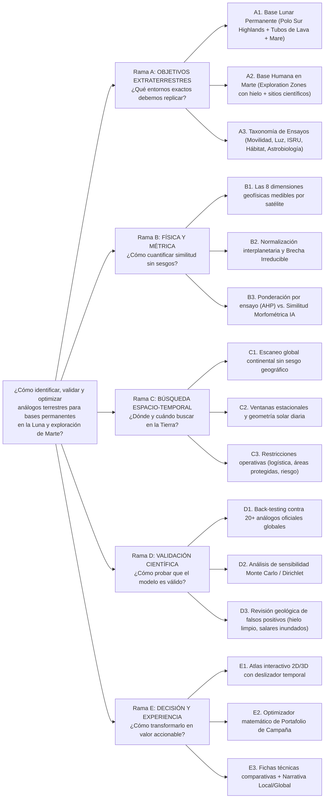

# 01.3 · Árbol de Problemas MECE (*Issue Tree*) y Mapeo a Etapas

> **Rol activo:** *Associate Principal (McKinsey) + Arquitecto de Sistemas Planetarios (MIT EAPS)*.

---

## 1. Diagrama General del Árbol MECE (3 Niveles)

---

## 2. Desglose Operativo Nivel por Nivel (Con Etapa Asignada)

### Rama A — ¿Qué entornos extraterrestres y qué ensayos debemos replicar? *(Etapa 1)*
- **A1. Arquetipos Lunares de Base Permanente:**
  - *A1.1 Crestas y mesetas iluminadas del Polo Sur* (*Mons Mouton*, *Malapert Massif*, *Nobile Rim*, *Shackleton Rim*): corteza de **tierras altas (anortosita ferroana)**, pendientes moderadas en cima pero abruptas en flancos, Sol rasante $0^\circ\text{–}2^\circ$, temperaturas $\sim 210\text{–}290\text{ K}$ en períodos iluminados.
  - *A1.2 Regiones en Sombra Permanente (PSRs)* (*Cabeus*, *Haworth*, *Shackleton interior*, *Faustini*): trampas criogénicas ($40\text{–}90\text{ K}$) con hielo de agua mezclado en regolito poroso, oscuridad perpetua (solo luz reflejada por paredes del cráter).
  - *A1.3 Mares basálticos y tubos de lava subsuperficiales* (*Mare Tranquillitatis pit*, *Marius Hills skylight*): escudo natural contra radiación y micrometeoritos, temperatura interna estable ($\sim 250\text{–}290\text{ K}$ en tubos ecuatoriales lunares), basalto toleítico.
- **A2. Arquetipos Marcianos de Base y Exploración:**
  - *A2.1 Llanuras de latitud media con láminas de hielo somero* (*Arcadia Planitia*, *Utopia Planitia*): relieve plano, regolito seco sobre hielo masivo a $<1\text{–}5\text{ m}$, polígonos de contracción térmica.
  - *A2.2 Sistemas montañosos con glaciares cubiertos de detritos* (*Phlegra Montes*, *Deuteronilus Mensae*): mantos detríticos lobulados (*LDAs*), alta diversidad geológica en radio de $100\text{ km}$.
  - *A2.3 Paleolagos, deltas y cuencas de sulfatos/filosilicatos* (*Jezero*, *Gale*, *Oxia Planum*, *Meridiani*): arcillas Fe/Mg, carbonatos, jarosita, sulfatos hidratados, preservación de biofirmas.
- **A3. Matriz de Propósitos de Prueba (*Mission Test Modes*):**
  1. Tracción, locomoción y desgaste mecánico de rovers.
  2. Percepción visual, LiDAR y energía solar bajo iluminación rasante polar.
  3. Perforación criogénica y extracción de agua ISRU.
  4. Sinterizado / impresión 3D de infraestructura con regolito local.
  5. Detección astrobiológica y calibración espectral.
  6. Operaciones EVA humanas, retardo de comunicaciones y aislamiento en hábitat.

---

### Rama B — ¿Cómo medir científicamente la fidelidad de analogía? *(Etapas 3 y 4)*
- **B1. Selección MECE de Variables Observables (8 Dimensiones Ortogonales):**
  1. **Geomorfometría ($D_{\text{topo}}$):** Pendiente media, rugosidad (TRI), curvatura e índice de posición topográfica.
  2. **Litología y Mineralogía ($D_{\text{lito}}$):** Afinidad composicional (anortosita/plutónica félsica-intermedia cálcica, basalto máfico, evaporitas/sulfatos, brechas de impacto, piroclastos).
  3. **Régimen Térmico ($D_{\text{term}}$):** Temperatura superficial media/mínima (LST) y amplitud térmica diurna ($\Delta T_{\text{diurna}}$).
  4. **Hiperaridez y Ausencia de Agua Líquida ($D_{\text{arid}}$):** Índice de aridez ($P/\text{PET} \to 0$) y humedad superficial del suelo.
  5. **Esterilidad Biológica Superficial ($D_{\text{est}}$):** Ausencia total de cubierta vegetal fotosintética ($\text{NDVI} \le 0.05$, clase *Bare/Sparse* en WorldCover).
  6. **Criosfera y Volátiles Subsuperficiales ($D_{\text{crio}}$):** Fracción/probabilidad de permafrost continuo y presencia de hielo enterrado bajo detritos (glaciares de roca / permafrost seco).
  7. **Geometría de Iluminación y Estrés Radiativo UV ($D_{\text{luz}}$):** Elevación solar máxima diaria, persistencia de sombras largas e irradiancia UV-B superficial (controlada por altitud y columna de ozono).
  8. **Aislamiento y Factibilidad Operativa ($D_{\text{op}}$):** Distancia/tiempo a centros urbanos (para simulaciones psicológicas EVA) balanceado contra viabilidad logística y estatus legal ambiental.
- **B2. Homogeneización de Escalas y Brecha Irreducible:**
  - Igualar la resolución espacial (p. ej. comparar DEM terrestre remuestreado a la misma escala métrica que LOLA o MOLA/HRSC para no sesgar pendientes).
  - Separar $\text{PAFI}_{\text{relativo}} \in [0,1]$ (qué tan cerca está del límite terrestre óptimo) de $\Delta_{\text{irreducible}}$ (distancia física entre el óptimo terrestre y el planeta destino).
- **B3. Motores de Agregación Complementarios:**
  - *Motor Explicable (MCDA-AHP + Media Geométrica Penalizada)*: transparente para ingenieros de sistemas.
  - *Motor Descubridor (Búsqueda Vectorial en Embeddings Morfométricos / Satelitales)*: detecta texturas geomorfológicas gemelas sin reglas rígidas manuales.

---

### Rama C — ¿Dónde y cuándo escanear la Tierra? *(Etapas 2, 3 y 5)*
- **C1. Cobertura Espacial Verdaderamente Global:** Evitar el sesgo histórico hacia EE. UU./Europa escaneando sistemáticamente Andes Áridos, Meseta Tibetana/Qaidam, Himalaya Trans-Indio (Ladakh), Siberia Oriental (Yakutia/Kamchatka), Groenlandia, África (Danakil/Namib/Sahara volcánico), Medio Oriente (Lut/Dhofar), Australia interior y Antártida.
- **C2. Cobertura Temporal ($t \in \{1..365\}$):** Evaluar cómo cambian iluminación solar, temperatura superficial y nieve estacional mes a mes. *(Ojo con los falsos positivos: un terreno excelente en roca que en invierno queda sepultado bajo $2\text{ m}$ de nieve húmeda pierde fidelidad de regolito aunque gane fidelidad de iluminación).*
- **C3. Filtros de Realismo Operativo:** Marcar sitios bajo el Tratado Antártico o Parques Nacionales estrictos (aptos para ciencia no invasiva / teledetección, restringidos para movimiento pesado de suelos o sinterizado ISRU).

---

### Rama D — ¿Cómo auditar la validez científica del sistema? *(Etapa 5)*
- **D1. Benchmark Cuantitativo (*Ground-Truth Recall*):** Medir el percentil obtenido por un conjunto curado de 20 sitios oficiales de NASA, ESA, CNSA, ISRO, JAXA y Roscosmos.
- **D2. Ablación y Sensibilidad:** Probar que el top de sitios no colapsa ante variaciones razonables ($\pm 20\%$) en los pesos de los expertos.
- **D3. Filtro Anti-Alucinación Geológica:** Excluir automáticamente glaciares blancos limpios cuando se busca regolito oscuro, lagos abiertos cuando se busca suelo seco, o dunas vegetadas.

---

### Rama E — ¿Cómo empaquetarlo para ganar en sede Local y Global? *(Etapa 6)*
- **E1. Interfaz Visual Instantánea:** Comparador planeta ↔ Tierra con curvas de nivel, radar de 8 ejes y selector de fecha.
- **E2. Optimizador de Campaña:** Dado un presupuesto/región y una lista de subsistemas a probar, sugiere la combinación mínima óptima de sitios terrestres.
- **E3. Narrativa Dual:** Caso estrella local (Andes/Puna) integrado orgánicamente dentro de una herramienta planetaria universal.

---

## 3. Auditoría Rigurosa de Cumplimiento MECE

| Prueba de Calidad McKinsey | Verificación | Ajuste Aplicado |
|---|---|---|
| **¿Exclusividad mutua entre ramas A–E?** | ✅ Sí | *Qué imitar* (A) $\neq$ *Fórmula matemática* (B) $\neq$ *Dominio espacio-temporal* (C) $\neq$ *Pruebas de validez* (D) $\neq$ *Producto/UI* (E). |
| **¿Exclusividad mutua entre las 8 variables de B1?** | ✅ Controlada | *Aridez* ($P/\text{PET}$) y *Esterilidad vegetal* ($\text{NDVI}$) correlacionan en climas templados, pero **no** en polos/alta montaña (donde un suelo puede ser frío y estéril pero cubierto de nieve húmeda). Mantenerlas separadas evita falsos positivos polares. |
| **¿Exhaustividad colectiva?** | ✅ Sí | Incluye superficie + subsuelo somero (hielo/tubos de lava) + atmósfera/radiación + geometría orbital/luz + logística humana. |
