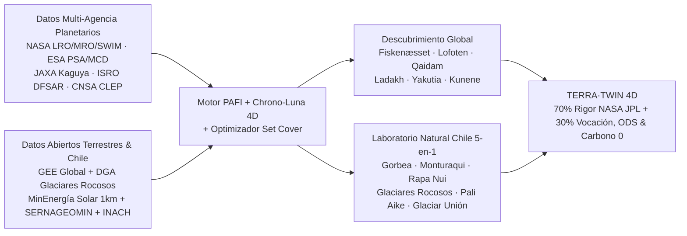

# 02.8 · Brechas No Abordadas en Chile y a Nivel Global (Ventaja Asimétrica para Ganar)

> **Rol activo:** *Consorcio NASA Astrobiology / LPI + MIT EAPS + SERNAGEOMIN / INACH / DGA Chile + McKinsey Strategy Practice*.
> **Foco estricto en el desafío oficial NASA Space Apps 2026:** *"Use open Earth, Moon, and Mars data from NASA and other space agencies to identify and characterize new terrestrial analogs for future bases or landing sites, drawing on deserts, polar regions, volcanic and arid terrains, caves, and other environments that share conditions with the lunar or Martian surface, then present your findings as a map, visualization, or other tool."*

---

## 1. Diagnóstico Ejecutivo: ¿Qué NO se está abordando en Chile?

Cuando equipos de hackathons, medios o incluso campañas internacionales piensan en **Chile como análogo planetario**, el **95 % cae en el mismo monocultivo geográfico**: apuntan únicamente a **San Pedro de Atacama / Estación Yungay** como "desierto seco parecido a Marte".

Sin embargo, al cruzar los datos satelitales multi-agencia con los **catastros públicos abiertos del Estado de Chile**, descubrimos una **asimetría estratégica extraordinaria**: **Chile es uno de los únicos países de la Tierra que contiene los 5 ambientes exigidos textualmente por el prompt de NASA (*desiertos, regiones polares, terrenos volcánicos, terrenos áridos y cuevas/tubos de lava*) dentro de una misma columna meridiana ($17.5^\circ\text{S}$ a $90^\circ\text{S}$)**, y la mayoría están **sub-caracterizados cuantitativamente como análogos de bases permanentes en la Luna y Marte**.

### Matriz de las 7 Brechas Chilenas No Abordadas (Nuestros "Océanos Azules" Locales → Globales)

| # | Brecha No Abordada en Chile | Sitios Chilenos Sub-Caracterizados (Coordenadas) | Ambiente del Prompt NASA | Qué Simula Exactamente (Luna / Marte) | Datos Abiertos Chilenos + Globales para Caracterizarlo |
|---|---|---|---|---|---|
| **C1** | **Salares Ácidos Naturales ($\text{pH } 1.8\text{–}4.0$) vs. Salares Alcalinos Comunes** | **Salar de Gorbea** ($25.40^\circ\text{S}, 68.67^\circ\text{W}$, $\sim 3{,}950\text{ m}$) y **Salar Ignorado** ($25.49^\circ\text{S}, 68.62^\circ\text{W}$, Región de Atacama) | *Arid terrains / Deserts* | **Marte (*Meridiani Planum, Cráter Gale, Mawrth Vallis*):** mientras casi todos los salares andinos son neutros/alcalinos, Gorbea e Ignorado tienen salmueras **hiperácidas sulfatadas** que precipitan **jarosita, alunita, yeso y óxidos de Fe** bajo radiación UV extrema — gemelo geoquímico vivo del Marte Hespérico sin contaminación minera industrial (a diferencia de Río Tinto). | `COPERNICUS/S2_SR_HARMONIZED` (índices hierro/sulfatos), `NASA/ASTER_GED`, SERNAGEOMIN Mapa Geológico $1:1{.}000{.}000$, CRISM Mars (`ode.rsl.wustl.edu`). |
| **C2** | **Cráter de Impacto Hiperveloz en Suelo Hiperárido** | **Cráter Monturaqui** ($23.93^\circ\text{S}, 68.26^\circ\text{W}$, $\sim 3{,}015\text{ m}$, Región de Antofagasta; diámetro $\sim 370\text{ m}$, profundidad $34\text{ m}$) | *Deserts / Impact craters* | **Luna (*Cráteres simples en regolito seco*) y Marte (*Cráteres de escala decamétrica-hectométrica en tierras altas*):** excavado en granito paleozoico cubierto por ignimbrita pliocena con **impactitas vesiculares y vidrio de choque rico en Fe-Ni**, conservado sin erosión fluvial moderna ni bosque. Casi ausente en herramientas digitales de Space Apps. | `COPERNICUS/DEM/GLO30`, `JAXA/ALOS/AW3D30`, `Sentinel-1 SAR` (rugosidad del borde de eyección) vs. `LRO LOLA` ($5\text{ m}$) y `HiRISE DTM` ($1\text{ m}$). |
| **C3** | **Cuevas Volcánicas y Tubos de Lava Basálticos Insulares y Andinos** | **Rapa Nui / Isla de Pascua** (*Campo de lava Roiho: Ana Te Pahu, Ana Kakenga, Ana Kionga*, $27.12^\circ\text{S}, 109.41^\circ\text{W}$) + **Cuevas basálticas del Volcán Villarrica / Challupén** ($39.42^\circ\text{S}, 71.93^\circ\text{W}$) | ***Caves* & *Volcanic terrains*** | **Luna (*Mare Tranquillitatis Pit, Marius Hills Skylight*) y Marte (*Tubos de lava de Tharsis/Pavonis Mons*):** refugios naturales de **protección contra radiación cósmica (GCR/SPE), micrometeoritos y amortiguación térmica ($\Delta T \to 0$)** para hábitats presurizados o inflables. En Chile casi nadie conecta el sistema espeleológico volcánico de Rapa Nui o los Andes del Sur con bases lunares. | Catastro espeleológico/volcánico SERNAGEOMIN, `GLO-30`, `LROC NAC Pit DTMs` y radar `LRO Mini-RF` / `Chandrayaan-2 DFSAR`. |
| **C4** | **Vulcanismo Basáltico Subpolar de Escoria, Maares y Viento Extremo** | **Campo Volcánico Pali Aike** ($52.00^\circ\text{S}, 69.75^\circ\text{W}$, Región de Magallanes, $\sim 3{,}000\text{ km}^2$) | *Volcanic + Sub-polar + Caves* | **Marte (*Elysium / Cráteres freatomagmáticos con interacción hielo-magma*) y Luna (*Mare basáltico en latitud alta con Sol invernal bajo*):** conos de escoria fresca, **maares basálticos**, coladas de lava aa/pahoehoe, pequeños tubos de lava y deflación eólica patagónica extrema con acceso directo por ruta pavimentada (Ruta CH-255 desde Punta Arenas). | IDE Chile (`geoportal.cl`), `ERA5-Land` (rachas de viento), `Sentinel-1 VV/VH`, `MODIS LST` y `THEMIS` inercia térmica marciana. |
| **C5** | **Miles de Glaciares Rocosos (*Rock Glaciers*) Cartografiados Oficialmente para Perforación ISRU** | **Glaciares Rocosos del Norte Chico y Andes Centrales de Chile** (*Cuencas Huasco, Elqui, Limarí, Aconcagua y Cajón del Maipo / Laguna Negra*, $27^\circ\text{S}\text{–}34^\circ\text{S}$, $3{,}500\text{–}5{,}000\text{ m}$) | *Polar/Cryospheric & Arid high-altitude* | **Marte (*Arcadia Planitia, Phlegra Montes, Deuteronilus Mensae*):** hielo masivo protegido bajo una **capa seca de clastos y bloques ($0.5\text{–}3\text{ m}$)** — el **problema #1 de ingeniería ISRU** para extraer agua potable y propelente ($\text{CH}_4/\text{LOX}$) en Marte. El **Inventario Público de Glaciares DGA (IPG2022)** tiene $>26{,}000$ polígonos abiertos (incluyendo miles de glaciares rocosos a $<3\text{ h}$ de Santiago!), pero ningún equipo chileno o global lo ha cruzado con el mapa **NASA SWIM** de Marte. | **DGA Chile IPG2022 (Shapefile abierto)** + **NASA SWIM (`swim.psi.edu`)** + `ESA CCI Permafrost` + `Oxford Accessibility`. |
| **C6** | **Análogo Polar Interior Antártico con Nunataks Desnudos y Sol Rasante $360^\circ$** | **Glaciar Unión — Estación Polar Científica Conjunta (INACH, Chile)** ($79.77^\circ\text{S}, 82.87^\circ\text{W}$, Montes Ellsworth / Heritage Range) | ***Polar regions*** | **Polo Sur Lunar (*Artemis III — Shackleton, Mons Mouton, Malapert*):** a casi **$80^\circ\text{S}$**, combina hielo azul barrido por vientos catabáticos (usado como pista natural de aterrizaje pesado), afloramientos rocosos desnudos (*nunataks*) y **geometría solar rasante polar** real. Es una de las únicas 3 bases del interior profundo antártico y un diferenciador soberano único de Chile. | **REMA Antártida $2\text{ m}/8\text{ m}$ (`UMN/PGC/REMA/V1_1/8m`)**, metadatos abiertos **INACH**, `Skyfield` efemérides `DE440` vs. `LRO LOLA Illumination`. |
| **C7** | **Radiación Solar/UV Hiper-Resuelta ($1\text{ km}$) y Costras de Perclorato Natural** | **Altiplano de Antofagasta y Atacama: Chajnantor / ALMA** ($23.02^\circ\text{S}, 67.75^\circ\text{W}$, $5{,}058\text{ m}$), **Ojos del Salado** ($6{,}893\text{ m}$) y **Pampa del Tamarugal / María Elena** | *Deserts & Extreme atmospheric environments* | **Marte (*Flujo UV germicida, sequedad atmosférica PWV $<1\text{ mm}$, toxicidad de percloratos $\text{ClO}_4^-$ en regolito*) y Luna (*Energía solar en picos de luz eterna*):** Chile posee las concentraciones naturales más altas del planeta de **perclorato ($\text{ClO}_4^-$)** asociadas a nitratos en Atacama — el mismo compuesto tóxico ($0.3\text{–}1\%$) detectado por *Phoenix* y *Curiosity* en Marte! | **API Explorador Solar MinEnergía / U. de Chile (`api.minenergia.cl`, grilla $1\text{ km}$)** + `Sentinel-5P UV/O3` + literatura geoquímica abierta. |

---

## 2. ¿Qué NO se está abordando a Nivel Global en este Desafío?

Tras auditar la literatura científica mundial (NASA, ESA, CNSA, ISRO, JAXA, IKI-RAS) y los proyectos ganadores históricos de NASA Space Apps, identificamos **7 puntos ciegos globales** donde el estado del arte actual falla o está fragmentado:

1. **Ceguera Petrológica del Polo Sur Lunar (*El Sesgo del Basalto*):**
   - El 90 % de los catálogos y simulantes comerciales históricos modelan *mares basálticos ecuatoriales* (Apollo 11/12, Hawái, Islandia). Pero las bases permanentes del Polo Sur Lunar (*Artemis III*, *ILRS China-Rusia*, *Chandrayaan-4/LUPEX*) se asentarán sobre **Tierras Altas de Anortosita Ferroana ($\text{An}_{80\text{–}95}$)**: roca clara de alto albedo ($0.16\text{–}0.28$), menor FeO/TiO₂ y mecánica abrasiva distinta. Cruzar los mapas globales de **plagioclasa de JAXA Kaguya (MI)** con macizos anortosíticos terrestres desnudos (**Fiskenæsset** en Groenlandia, **Lofoten** en Noruega, **Sittampundi** en India, **Kunene** en Namibia/Angola, **Nain** en Canadá) es una innovación de nivel *paper* científico.
2. **Ausencia de Indexación 4D Espacio-Temporal (*Dónde + En Qué Semana*):**
   - Todos los atlas actuales de análogos son **mapas estáticos 2D**. Ninguna herramienta abierta calcula en qué **días exactos del año** un terreno terrestre de alta latitud está simultáneamente **(a)** con elevación solar rasante $0.2^\circ \le \alpha_\odot \le 2.5^\circ$ (como *Connecting Ridge* o *Shackleton*) y **(b)** libre de manto níveo espeso (`MODIS MOD10A2`) que tape las rocas y cráteres.
3. **Desconexión entre Mapas Orbitales de Hielo Marciano (`SWIM` / `Zhurong` / `SHARAD`) e Inventarios Criogénicos Terrestres:**
   - Existen mapas de hielo marciano (*SWIM*) por un lado e inventarios glaciológicos terrestres (*RGI 7.0*, *DGA Chile*, *IANIGLA Argentina*, *ESA CCI Permafrost*) por otro, pero **no existe un puente cuantitativo abierto** que empareje espesor de sobrecarga detrítica seca + régimen térmico para diseñar taladros ISRU.
4. **Fusión Radar Subsuperficial de PSRs Lunares (`Chandrayaan-2 DFSAR` + `LRO Mini-RF` + `ShadowCam`):**
   - Dentro de las Regiones Permanentemente Sombreadas (PSRs), las cámaras ópticas normales ven negro absoluto. Casi ningún equipo occidental integra el radar polarimétrico de doble banda L+S **DFSAR de ISRO** (`pradan.issdc.gov.in`, que distingue rugosidad rocosa vs. hielo poroso hasta varios metros de profundidad) junto con **ShadowCam (KARI/NASA)** para buscar análogos terrestres de bloque/permafrost.
5. **Omisión de Riesgos Bio-Químicos Reales para Humanos (*Percloratos + Polvo Electro-Abrasivo*):**
   - Los análogos visuales ignoran la química reactiva: en Marte el polvo contiene **$0.3\text{–}1\%$ de percloratos** (disruptor tiroideo humano, pero también recurso de $\text{O}_2$ y oxidante) y sulfatos ácidos; en la Luna el polvo vítreo (*agglutinates*) daña sellos y pulmones. Incluir una capa geoquímica de oxidantes/salinidad extrema (Atacama, Qaidam Dalangtan, Matanomadh, Río Tinto, Gorbea) eleva radicalmente el valor para medicina espacial e ingeniería EVA.
6. **Optimización Multi-Sitio y Huella de Carbono Logística ($\text{tCO}_2\text{e}$):**
   - Ningún sitio en la Tierra tiene $100\%$ de fidelidad lunar o marciana. Las agencias hoy eligen sitios por inercia institucional, enviando toneladas de carga en avión transcontinental cuando existe un análogo con $\ge 90\%$ de fidelidad PAFI en el mismo continente. Nadie ha formulado la selección de análogos como un **problema matemático *Set Cover* multi-objetivo (Fidelidad $\times$ Costo $\times$ Emisiones $\text{CO}_2$ evitadas)**.
7. **Brecha Social, Cognitiva y de Gobernanza Local (*"Parachute Science"*):**
   - Históricamente, expediciones espaciales aterrizan en desiertos o tierras indígenas (Atacama, Puna, Ladakh, Navajo/Arizona, Groenlandia) sin dejar capacidades locales, sin accesibilidad para baja alfabetización digital y sin proteger ecosistemas extremófilos irreemplazables (estromatolitos, costras criptobióticas). Convertir a las comunidades locales en **Custodios Científicos de Análogos Planetarios** cierra una deuda ética global alineada con **UNOOSA Space4SDGs**.

---

## 3. Cómo Capitalizamos Ambas Brechas en Nuestro Proyecto

1. **Para ganar la Sede Local en Chile:** demostramos con datos satelitales reales que Chile no es solo "San Pedro de Atacama", sino un **corredor planetario completo de 5 ambientes** (Gorbea ácido, Monturaqui impacto, Rapa Nui/Villarrica cuevas de lava, Glaciares Rocosos DGA para ISRU marciano, Pali Aike subpolar y Glaciar Unión antártico).
2. **Para ganar el Top 10 Global de NASA:** la misma matemática sin sesgo descubre gemelos en los **6 continentes** (Groenlandia, Noruega, China, India, Rusia, Namibia, Argentina, EE.UU., Antártida) usando datos abiertos de **7 agencias espaciales**.
