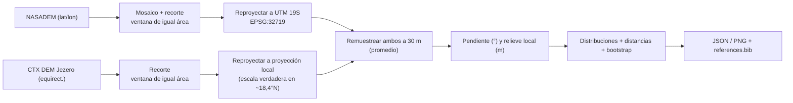

# Datos abiertos para caracterizar análogos terrestres de la Luna y Marte desde Atacama: inventario, preparación y comparación de modelos de elevación

**Documento técnico de datos · NASA International Space Apps Challenge 2026 · Sede Antofagasta**
Desafío: *Identify Earth Locations that Analog the Permanent Moon Base Locations and Mars*
Versión 1.0 · 14 de noviembre de 2026 · Lattices Team

> Fichas oficiales verificadas el 14-nov-2026: NASADEM en NASA Earthdata y el DEM de Jezero en USGS Astropedia. El resto de los productos proviene de la pestaña *Resources* del desafío (leída el 13-nov) y del catálogo del repositorio; se marca **[verificar]** donde falta confirmar un detalle en su ficha oficial.

---

## Abstract (English, para la página de proyecto)

We document the open datasets, processing steps and statistical comparison used to characterize terrestrial analogs of the Moon and Mars in the Atacama Desert. The core comparison pairs **NASADEM** (NASA, 1 arc-second, ~30 m) over sectors of the Antofagasta Region with the **Mars 2020 Science Investigation CTX DEM Mosaic of Jezero crater** (USGS, 20 m/pixel). Both elevation models are projected to metric grids, resampled to a common 30 m spacing, and converted to slope and local relief. Similarity is reported per dimension as a distance between distributions (two-sample Kolmogorov–Smirnov and Wasserstein-1) with block-bootstrap confidence intervals, never as a single undefined percentage. We state the irreducible physical gap explicitly (gravity 0.38 g on Mars and ~0.16 g on the Moon, a ~0.6 kPa CO₂ atmosphere on Mars, surface radiation, temperature) and list the limits of each dataset.

---

## 1. Introducción

Los análogos terrestres permiten probar equipos y métodos antes de volar. El desafío pide **identificar y caracterizar** lugares de la Tierra útiles para bases lunares o sitios de aterrizaje en Marte, explicando **qué es análogo, cuánto y qué no**, y advierte que el Desierto de Atacama ya está muy estudiado.

Este documento fija **qué datos usamos, cómo se preparan y cómo se comparan**, para que cualquier persona pueda reproducir el resultado. La dimensión del P0 es la **topografía** (pendiente y relieve local), relevante para la movilidad de rovers, la selección de sitios de aterrizaje y la planificación de ensayos de campo.

---

## 2. Inventario de datos

### 2.1 Núcleo del P0 (verificado)

| | Tierra | Marte |
|---|---|---|
| **Producto** | **NASADEM Merged DEM Global 1 arc second V001** (`NASADEM_HGT`) | **Mars 2020 Science Investigation CTX DEM Mosaic** (Jezero) |
| **Proveedor** | NASA JPL; distribuye LP DAAC | USGS Astrogeology Science Center (originador: PDS) |
| **Origen** | Reprocesamiento de la misión SRTM (transbordador Endeavour, STS-99, febrero de 2000), con apoyo de ASTER GDEM, ICESat/GLAS y AW3D30 para geolocalización y relleno de vacíos | Pares estéreo de la cámara CTX (Mars Reconnaissance Orbiter) procesados con Ames Stereo Pipeline; ajuste vertical a MOLA |
| **Espaciamiento** | 1 segundo de arco ≈ **30,9 m norte-sur**; en 23°S ≈ **28,5 m este-oeste** | **20 m/píxel** (no confundir con las imágenes CTX de ~6 m; el ortomosaico asociado es de 5 m) |
| **Cobertura** | Casi global, 60°N–56°S; teselas de 1°×1° | Cráter Jezero: lat 17,58°–19,29°N, lon 76,99°–78,58°E; 4456 × 5067 píxeles |
| **Formato** | HGT (también NetCDF4 como `NASADEM_NC`); capas DEM, NUM (número de escenas) y máscara de agua | GeoTIFF de 32 bits, 1 banda, **87 MB** |
| **Referencia vertical** | Geoide | Ajustado verticalmente a MOLA |
| **Proyección** | Geográfica (lat/lon) | **Equirectangular**, planetocéntrica, longitud positiva al este, radio 3 396 160 m |
| **Acceso** | NASA Earthdata Search (requiere cuenta Earthdata gratuita); también Google Earth Engine `NASA/NASADEM_HGT/001` | Descarga directa sin login: `planetarymaps.usgs.gov/mosaic/mars2020_trn/CTX/ScienceInvestigationMaps_JPL/M20_JezeroCrater_CTXDEM_20m.tif` |
| **Licencia** | Abierto, sin restricción (EOSDIS Data Use and Citation Guidance) | Dominio público; "please cite authors" |
| **DOI / cita** | `10.5067/MEaSUREs/NASADEM/NASADEM_HGT.001` | Calef (USGS, 2021); ver referencias |

**Teselas NASADEM para los sectores propuestos** (el nombre indica la esquina inferior izquierda):

| Sector | Coordenadas aproximadas **[verificar en QGIS]** | Tesela |
|---|---|---|
| Cordillera de la Sal / Valle de la Luna | ~22,9°S, 68,3°O | `s23w069` |
| Yungay (control conocido) | ~24,1°S, 69,9°O | `s25w070` |

### 2.2 Datos complementarios

| Uso | Producto | Resolución | Acceso | Estado |
|---|---|---|---|---|
| Detalle en Jezero (P1) | Mars 2020 Terrain Relative Navigation **HiRISE DTM Mosaic** | ~1 m | USGS Astropedia | producto relacionado listado por USGS; resolución **[verificar]** |
| Ortoimagen de Jezero | Science Investigation **CTX orthomosaic** | 5 m | USGS Astropedia | verificado (ficha del DEM) |
| Marte global | **MOLA MEGDR** | ~463 m (128 píxeles/grado) | PDS Geosciences | **[verificar]** |
| Luna (P2) | **LRO LOLA** DEM polares y globales | hasta ~5 m en polos | PDS / LRO ⭐ | **[verificar] producto exacto** |
| Luna, temperatura | **LRO Diviner** productos polares | variable | PDS / UCLA ⭐ | recomendado por el desafío |
| Mapas base de la Tierra | **NASA Worldview / GIBS** (WMTS) | variable | sin login ⭐ | recomendado por el desafío |
| Mapas base de Marte y la Luna | **Mars Trek / Moon Trek** (WMTS) | variable | sin login | — |
| Agencias socias ⭐ | **Copernicus DEM GLO-30** (ESA) · **ALOS AW3D30** vía G-Portal (JAXA) · **RADARSAT** (CSA) | ~30 m / ~30 m / radar | portales de cada agencia | validación cruzada; suma en *Relevance* |

⭐ = recurso listado en la pestaña *Resources* del desafío.

**Plan B de acceso:** si Earthdata falla, usar NASADEM desde Google Earth Engine, o Copernicus GLO-30 (ESA, agencia socia 2026) para validar.

---

## 3. Preparación de los datos

1. **Áreas comparables.** Ventanas de la **misma extensión física** (por ejemplo, 10 × 10 km) en ambos cuerpos. Comparar un desierto entero con un cráter no tiene sentido; el desafío pide considerar la escala.
2. **Unidades métricas.** NASADEM viene en grados: se reproyecta a **UTM zona 19S (EPSG:32719)**.
3. **Cuidado con la proyección de Marte.** El mosaico de Jezero es equirectangular planetocéntrico. Si su latitud de escala verdadera es 0° (lo sugiere el nombre del producto TRN original, `latTs0`; **[verificar]** en la etiqueta PDS4), la distancia este-oeste real en Jezero (~18,4°N) es ≈ 20 m × cos(18,4°) ≈ **19,0 m**, no 20 m. Calcular pendientes sin corregirlo introduce un sesgo sistemático. Solución: reproyectar a una proyección local de Marte con escala verdadera en la latitud del sitio, o corregir `dx` por cos(latitud).
4. **Escala común.** Remuestrear **ambos a 30 m** con promedio (`gdalwarp -r average`). Bajar Marte de 20 a 30 m evita inventar detalle en la Tierra.
5. **Vacíos y bordes.** Excluir píxeles sin dato (capa NUM de NASADEM y `nodata` del GeoTIFF) y una franja de borde de 1 píxel tras calcular gradientes.
6. **Referencia vertical.** Geoide en la Tierra y ajuste a MOLA en Marte. **No afecta** pendiente ni relieve local, que dependen de diferencias de altura.

---

## 4. Métricas por dimensión

| Métrica | Definición | Por qué importa |
|---|---|---|
| **Pendiente** (°) | arctan(√((∂z/∂x)² + (∂z/∂y)²)), con diferencias centrales en metros | Movilidad de rovers, estabilidad de aterrizaje |
| **Relieve local** (m) | máximo − mínimo de elevación en una ventana móvil (p. ej., 300 × 300 m) | Rugosidad a escala de operación |
| **Perfil topográfico** | elevación a lo largo de una traza de igual longitud | Comunicación visual |

Las métricas se reportan **por dimensión**. No se combinan en un índice único sin mostrar el desglose.

---

## 5. Comparación estadística

Para cada métrica se comparan las distribuciones Tierra y Marte:

- **Kolmogorov–Smirnov de dos muestras** (`scipy.stats.ks_2samp`): máxima diferencia entre distribuciones acumuladas, de 0 a 1.
- **Wasserstein-1** (`scipy.stats.wasserstein_distance`): "cuánto hay que mover" una distribución para obtener la otra, **en las unidades de la métrica** (grados o metros). Es más fácil de explicar al público.
- **Incertidumbre:** intervalo del 95 % con **bootstrap por bloques**. Los píxeles vecinos **no son independientes** (autocorrelación espacial); por eso no se usa el valor p de KS sobre todos los píxeles, que sería engañosamente pequeño. Se remuestrean bloques (p. ej., 10 × 10 píxeles) en lugar de píxeles sueltos.
- **Sensibilidad a la escala:** repetir a 30, 60 y 90 m y mostrar cómo cambia el resultado.
- **Control:** el mismo procedimiento sobre un sector conocido (Yungay). Si el método no lo reconoce como comparable, el método debe revisarse antes de usarlo en un sector nuevo.

**Cómo se comunica:** *"La distribución de pendientes del sector X difiere de la de Jezero en W grados (IC 95 %: a–b)."* Nunca *"X es 87 % igual a Marte"*.

---

## 6. Limitaciones

### 6.1 De los datos
- **NASADEM** representa la superficie del año 2000 y tiene vacíos rellenados con otras fuentes (ver capa NUM). Su resolución no resuelve objetos de menos de ~100 m: el **cráter Monturaqui** (~350–370 m de diámetro) queda con muy pocos píxeles.
- **CTX DEM** es un mosaico de varios modelos estéreo con ajuste horizontal manual en partes; su precisión vertical depende del control con MOLA.
- **Escalas distintas** de origen (20 m frente a ~30 m): por eso el remuestreo es obligatorio.

### 6.2 Brecha física irreducible (decirla siempre)

| Dimensión | Tierra (Atacama) | Marte | Luna |
|---|---|---|---|
| Gravedad | 1 g | **0,38 g** | **~0,16 g** |
| Atmósfera | ~1 atm al nivel del mar (menos en altura) | **~0,6 kPa de CO₂** | vacío |
| Radiación en superficie | protegida por atmósfera y magnetosfera | Curiosity/RAD midió **~0,64 mSv por día** (Hassler et al., 2014) | sin atmósfera ni magnetosfera |
| Temperatura | extremos diarios del desierto | mucho más fría en promedio | extremos mucho mayores; regiones en sombra permanente muy frías |

La topografía puede ser comparable; **estas condiciones no**. El análogo sirve para ensayar movilidad, navegación y planificación, no para reproducir el ambiente.

---

## 7. Reproducibilidad y licencias

- Código abierto (MIT o Apache-2.0) con los scripts de preparación y comparación.
- Cada archivo derivado (JSON, PNG) guarda: producto de origen, versión o DOI, fecha de descarga, ventana, resolución y parámetros.
- Bibliografía única en `references.bib`, citada en el campo *References* de la entrega a NASA.
- Uso de IA declarado en `AI_DISCLOSURE.md`. La IA no genera datos ni resultados.

---

## 8. Herramientas

| Paso | Herramienta |
|---|---|
| Lectura, reproyección y remuestreo | `rasterio`, GDAL (`gdalwarp`), `pyproj` |
| Pendiente y relieve | `numpy` (o `gdaldem slope` para verificar) |
| Estadística | `scipy.stats` (`ks_2samp`, `wasserstein_distance`), bootstrap con `numpy` |
| Revisión visual | QGIS |
| Visualización web | Plotly.js / Observable Plot, MapLibre GL |

---

## Referencias

**Datos**
- NASA JPL (2020). *NASADEM Merged DEM Global 1 arc second V001* [Data set]. NASA Land Processes Distributed Active Archive Center. https://doi.org/10.5067/MEaSUREs/NASADEM/NASADEM_HGT.001
- Calef, F. (2021). *Mars 2020 Science Investigation CTX DEM Mosaic*. USGS Astrogeology Science Center / Planetary Data System. https://astrogeology.usgs.gov/search/map/mars_2020_science_investigation_ctx_dem_mosaic
- Fergason, R. L. et al. (2020). *Mars 2020 Terrain Relative Navigation Flight Product Generation: Digital Terrain Model and Orthorectified Image Mosaics.* 51st Lunar and Planetary Science Conference. https://doi.org/10.5066/P906QQT8

**Instrumentos y contexto científico**
- Malin, M. C. et al. (2007). *Context Camera Investigation on board the Mars Reconnaissance Orbiter.* *Journal of Geophysical Research*, 112, E05S04. https://doi.org/10.1029/2006JE002808
- Mangold, N. et al. (2021). *Perseverance rover reveals an ancient delta-lake system and flood deposits at Jezero crater, Mars.* *Science*. https://doi.org/10.1126/science.abl4051
- Beyer, R. A. et al. (2020). *NeoGeographyToolkit/StereoPipeline 2.7.0.* Zenodo. https://doi.org/10.5281/zenodo.3963341
- Hassler, D. M. et al. (2014). *Mars' Surface Radiation Environment Measured with the Mars Science Laboratory's Curiosity Rover.* *Science*, 343(6169).
- Navarro-González, R. et al. (2003). *Mars-like soils in the Atacama Desert, Chile, and the dry limit of microbial life.* *Science*, 302(5647).

**Software**
- Virtanen, P. et al. (2020). *SciPy 1.0: fundamental algorithms for scientific computing in Python.* *Nature Methods*, 17, 261–272.
- GDAL/OGR contributors. *GDAL/OGR Geospatial Data Abstraction software Library.* Open Source Geospatial Foundation. https://gdal.org

**Reglas del desafío**
- NASA Space Apps Challenge (2026). *Identify Earth Locations that Analog the Permanent Moon Base Locations and Mars* (página y pestaña *Resources*). https://www.spaceappschallenge.org/2026/challenges/permanent-moon-base-locations-and-mars/
