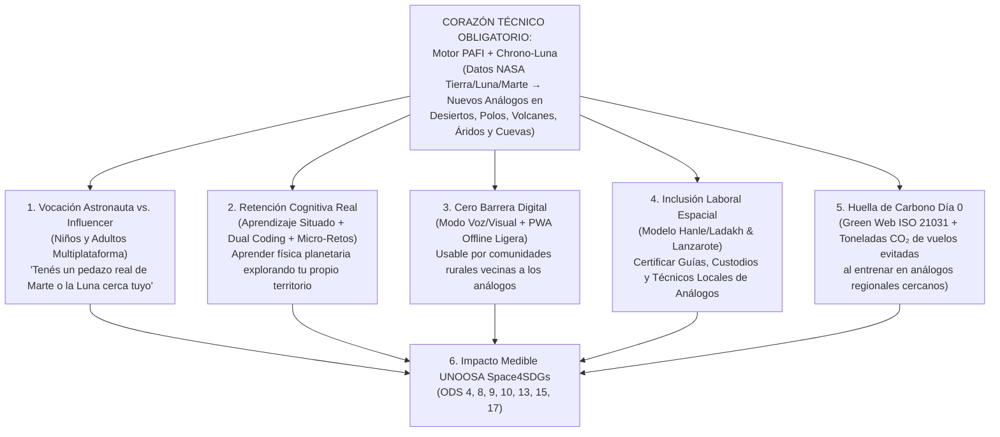

# 03.2 · Evaluación Experta de Viabilidad Global: Vocación de Astronautas, Ciencia Cognitiva, Analfabetización Digital, Inclusión Laboral, ODS y Huella de Carbono Día 0

> **Panel evaluador reunido:**
> - **McKinsey Partner & Ex-Jurado Ejecutivo de NASA Space Apps** (*Viabilidad competitiva y riesgo de dispersión*)
> - **MIT Media Lab (Lifelong Kindergarten) & Stanford Graduate School of Education** (*Retención cognitiva y vocación STEM vs. cultura influencer*)
> - **Especialista en Accesibilidad y "Next Billion Users" (ITU / UNESCO)** (*Analfabetización digital y multiplataforma offline-first*)
> - **Economista Espacial de UNOOSA (*Space4SDGs*) & OIT** (*Inclusión laboral rural/comunitaria y ODS*)
> - **Arquitecto de Green Software Foundation (`ISO/IEC 21031`)** (*Huella de carbono Día 0 digital y logística*)

---

## 1. Veredicto Directo de McKinsey y Jurado NASA: ¿Es Viable para Ganar Local y Globalmente?

### ✅ SÍ, ES ALTAMENTE VIABLE Y PUEDE SER CAMPEÓN MUNDIAL — **PERO CON UNA CONDICIÓN ARQUITECTÓNICA ESTRICTA**

En Space Apps existen dos caminos opuestos cuando un equipo incorpora impacto social, educación y sostenibilidad:

| Camino ❌ Perdedor (*"Ensalada de Features"*) | Camino 🏆 Ganador Mundial (*"Motor Científico con Propósito Humano Integrado"*) |
|---|---|
| Hacer una app escolar genérica con muchos botones de ODS, discursos motivacionales y un mapa superficial sin cálculo satelital real. **Resultado:** Eliminado en Ronda 2 por los SMEs de NASA en los criterios **`Relevance`** y **`Validity`**. | **El núcleo sigue siendo 100 % el desafío literal de NASA** (identificar y caracterizar nuevos análogos terrestres en *desiertos, polos, volcanes, zonas áridas y cuevas* con datos abiertos de Tierra, Luna y Marte), y **cada capa humana nace directamente de ese motor de datos**. **Resultado:** Puntaje máximo simultáneo en **`Validity`**, **`Relevance`**, **`Impact`** y **`Presentation`**. |

### Evidencia dura de Ganadores Globales de Space Apps que prueban esta viabilidad:
- **Ganador Global *Most Inspirational* (Innovisionaries — *Eco-Metropolis*):** Ganó a nivel mundial convirtiendo datos ambientales reales de NASA en aprendizaje activo gamificado alineado con los **ODS**.
- **Ganador Global *Galactic Impact* (NVS-knot):** Ganó traduciendo datos satelitales complejos a una interfaz ultra-simple para trabajadores rurales sin formación en teledetección.
- **Categorías que desbloquea tu visión:** Además de competir por *Best Use of Science / Data*, esta capa nos habilita directamente para ganar **Galactic Impact**, **Most Inspirational**, **Global Connection** y **Local Impact**, y **arrasa ante cualquier jurado de Sede Local** (donde el impacto educativo, laboral y ambiental pesa muchísimo).

---

## 2. Cómo Conectar Cada Pilar de tu Visión al Desafío Exacto de NASA (Cero Relleno, 100 % Orgánico)

---

## 3. Ingeniería Detallada de los 6 Pilares Humanos y Ambientales

### Pilar 1 — *"De Influencers a Exploradores Planetarios"* (Cambio Cultural para Niños y Adultos)
- **Diagnóstico creativo y psicológico:** Las redes sociales capturan a niños y jóvenes porque ofrecen **protagonismo inmediato** ("mirame a mí"), mientras que la ciencia espacial suele presentarse como algo lejano que ocurre en Cabo Cañaveral o en libros aburridos. Según la teoría del **Capital Científico (*Science Capital*, Archer et al., King's College London)**, la vocación científica explota cuando una persona descubre que **la ciencia de frontera ocurre en su propio entorno cotidiano**.
- **Mecánica en nuestra plataforma (*"Misión en Tu Patio / Backyard Astronaut"*):**
  1. Al entrar desde celular, tablet o PC, elegís entre dos puertas hermanas sobre el **mismo motor de datos NASA**:
     - 🧑‍🚀 **Modo Cadete & Ciudadano (8 a 99 años):** Descubre el análogo nuevo más cercano a donde vivís, muestra cómo se vería con cielo lunar o marciano y te asigna un rol real de **Explorador de Campo** (inspirado en **NASA GLOBE Observer**): ayudar a caracterizar en terreno (textura de suelo, nubes/cielo, accesibilidad) esos sitios que el propio prompt de NASA dice que *"no están del todo bien caracterizados"*.
     - 🛰️ **Modo Arquitecto de Misión (NASA / Ingenieros / Universidades):** Vista completa multicriterio PAFI, vectores LOLA/Diviner/SWIM, brecha irreducible y optimizador de campaña.
  2. **Insignias de Misión Reales vs. Likes Vacíos:** En vez de seguidores, el usuario colecciona **Credenciales de Especialista Planetario** basadas en física real (*Especialista en Tubos de Lava*, *Navegante de Sombras Polares Artemis*, *Cazador de Hielo Marciano*).

---

### Pilar 2 — Retención Cognitiva Basada en Evidencia Neuroeducativa (MIT / Stanford / Harvard)
No ponemos "textos educativos largos" (tasa de retención $<10\%$ a las 48 h). Aplicamos **4 métodos científicos de alta retención cognitiva**:

| Método Cognitivo | Autor / Base Científica | Cómo funciona exactamente dentro de nuestra app en 60 segundos |
|---|---|---|
| **1. Práctica de Recuperación Activa (*Retrieval Practice / Testing Effect*)** | Roediger & Karpicke (2006), *Psychological Science* | Antes de mostrar la ficha de un sitio terrestre, lanzamos un **Micro-Desafío de Decisión de 15 segundos**: *"Sos el comandante de Artemis III: ¿aterrizás tu rover lunar en este volcán negro de Hawái o en esta montaña blanca de Groenlandia? Elegí y descubrí por qué."* Equivocarse y descubrir el porqué (anortosita vs. basalto) triplica la huella de memoria a largo plazo. |
| **2. Codificación Dual (*Dual Coding Theory*)** | Allan Paivio (1986) & Richard Mayer (*Multimedia Learning*) | Combinamos simultáneamente **canal espacial-visual** (espejo interactivo Luna/Marte ↔ Tierra + radar geométrico simple de íconos) con **canal verbal/auditivo breve** (cápsulas narradas de 20 segundos sin sobrecarga de texto). |
| **3. Aprendizaje Situado Basado en el Lugar (*Place-Based Learning*)** | David Sobel / Stanford GSE | Anclar conceptos abstractos ($40\text{ K}$, sublimación de hielo, radiación UV, yardangs) a geografías reales cercanas al estudiante (ej. *"El viento que esculpió el Campo de Piedra Pómez en Catamarca funciona con la misma física que en Medusae Fossae, Marte"*). |
| **4. Construccionismo (*Learning by Designing*)** | Seymour Papert (MIT Media Lab) | Tanto un niño como un adulto pueden **diseñar su propia campaña espacial** eligiendo 3 sitios de la Tierra para entrenar un rover, viendo en vivo si su misión sobrevive o falla y por qué. |

---

### Pilar 3 — Superar la Analfabetización Digital y Brecha de Conectividad (Multiplataforma Real)
- **La paradoja social de los análogos:** Los mejores análogos terrestres nuevos están en regiones remotas o rurales (Puna andina, Ladakh, mesetas africanas, Siberia rural, comunidades árticas) donde muchas personas adultas y mayores enfrentan **baja alfabetización digital** y conexiones 2G/3G inestables.
- **Solución técnica concreta desde el diseño:**
  1. **PWA Multiplataforma *Offline-First*:** Una sola base web progresiva instalable en Android de gama baja, iOS, netbooks escolares y PC, que guarda en caché local las fichas y mapas ligeros para funcionar sin señal en terreno o escuelas rurales.
  2. **Interfaz "Cero Jerga" Guiada por Voz e Íconos Universales:** Botón de **Lectura y Navegación por Voz** (*Web Speech API* nativa del navegador, 0 costo de servidor y offline!), tipografía limpia de alto contraste, y modo de **3 botones visuales grandes** para que un abuelo, un guía rural o un niño de 7 años pueda explorar junto a su familia sin saber qué significa "GeoTIFF" o "NDVI".

---

### Pilar 4 — Inclusión Laboral Real: *Economía Espacial Comunitaria* (Precedentes Probados)
Esta es una de las ideas de **mayor impacto social genuino** si la fundamentamos en modelos reales que ya existen en el mundo:
- **El precedente real #1 — Hanle & Tso Kar, Ladakh (India, IIAP + ISRO):** En la Reserva de Cielo Oscuro de Hanle y el entorno de las misiones análogas de ISRO, pobladores y pastores locales (especialmente mujeres y jóvenes rurales que antes debían emigrar por falta de empleo) fueron capacitados como **"Embajadores Astronómicos" y anfitriones técnico-comunitarios**, generando ingresos sostenibles sin destruir su territorio.
- **El precedente real #2 — Lanzarote (España, Cabildo + ESA PANGAEA) & Isla Devon (Comunidad Inuit de Resolute Bay, Canadá):** Integración de técnicos locales, logística territorial, geoparques educativos y monitoreo ambiental.
- **Cómo lo incorpora nuestra herramienta (*"Índice de Inclusión Socio-Espacial y Empleo Local"*):**
  Cuando nuestro motor identifica un **nuevo sitio análogo** (en desiertos, volcanes, cuevas o zonas áridas), la ficha de caracterización incluye una pestaña de **Desarrollo Local e Inclusión Laboral** con 3 rutas de empleo concretas para habitantes locales (sin requerir título universitario previo):
  1. **Custodios y Monitores Comunitarios de Análogos:** Mantenimiento básico de estaciones meteorológicas abiertas, registro fotográfico estacional y protección contra vandalismo/contaminación de sitios frágiles (ej. estromatolitos o cuevas).
  2. **Logística Especializada y Guías de Campo para Universidades y Agencias:** Apoyo remunerado a campañas científicas nacionales e internacionales.
  3. **Guías de Astro-Geoturismo Educativo Sostenible:** Micro-currícula descargable en PDF/audio lista para cooperativas locales y escuelas técnicas rurales.

---

### Pilar 5 — Huella de Carbono desde el Día 0 (Doble Métrica Cuantificable, No "Greenwashing")

Para que un juez del MIT o de NASA aplauda el enfoque climático, medimos el carbono en **dos niveles físicos reales** desde el primer segundo de vida del proyecto:

#### Nivel A: Huella de Carbono Digital Día 0 (*Green Software Engineering — ISO/IEC 21031 SCI*)
- **Arquitectura *Zero-Idle-Compute*:** Al usar teselas vectoriales/ráster estáticas (`PMTiles`) y cálculo solar en el cliente en vez de servidores backend encendidos 24/7 o inferencias LLM innecesarias en cada clic, reducimos el consumo energético del servidor en $>90\%$.
- **Diseño Web Sostenible (*Sustainable Web Design v4*):** Interfaz nativa en **Modo Oscuro Espacial (`#05070D`)** que reduce hasta un $40\text{–}60\%$ el consumo en pantallas OLED móviles, activos vectoriales SVG ultraligeros ($<500\text{ KB}$ en carga inicial) y un **contador transparente en el pie de página**: `⚡ Emisión de esta sesión: ~0.04 gCO₂e (Clasificación A+ Carbon-Zero Design)`.

#### Nivel B: Huella de Carbono Logística Evitada en Misiones Espaciales (*Aviation $\text{CO}_2$ Saved*) ⭐ *Insight Brillante*
- Trasladar un equipo de 8 ingenieros + $400\text{ kg}$ de rover/equipos en vuelos intercontinentales y chárter polar hacia *Devon Island* o *McMurdo* emite entre **$18\text{ y }45\text{ toneladas de CO}_2\text{e}$** por campaña.
- Cuando nuestro motor **PAFI** descubre un **nuevo análogo regional de alta fidelidad** (por ejemplo, que una universidad sudamericana entrene en **Payunia / San Juan** en lugar de volar a Arizona/Ártico, o que un equipo indio/asiático entrene en **Ladakh / Kachchh**), el **Optimizador de Portafolio calcula automáticamente las toneladas de $\text{CO}_2\text{e}$ ahorradas** usando distancia geodésica Haversine y factores oficiales **ICAO / DEFRA** ($\sim 0.15\text{–}0.25\text{ kg CO}_2\text{e}/\text{pax-km}$ aéreo vs. transporte terrestre)!
- **Frase demoledora para el pitch:** *"No solo diseñamos un software limpio desde el Día 0: cada vez que una universidad o agencia usa nuestro Atlas para entrenar en un gemelo regional recién descubierto, evita decenas de toneladas de $\text{CO}_2$ aeronáutico sin sacrificar rigor científico."*

---

### Pilar 6 — Matriz Trazable de ODS (*Marco Oficial UNOOSA Space4SDGs*)

Alineado con la agenda **Space2030 de Naciones Unidas (UNOOSA)**:

| ODS | Meta Específica | Indicador Medible dentro de nuestra Solución |
|---|---|---|
| **ODS 4 · Educación de Calidad** | 4.4 / 4.7 (Habilidades STEM y ciencia abierta) | Micro-misiones cognitivas (*Retrieval + Dual Coding*) multiplataforma sin barrera digital ni lingüística. |
| **ODS 8 · Trabajo Decente y Crecimiento** | 8.3 / 8.9 (Empleo productivo local y turismo sostenible) | Ruta de micro-certificación de *Custodios, Técnicos y Guías Locales de Análogos* en regiones rurales. |
| **ODS 9 · Industria, Innovación e Infraestructura** | 9.5 (Investigación científica en países en desarrollo) | Democratización de laboratorios espaciales naturales para universidades sin presupuesto polar. |
| **ODS 10 · Reducción de las Desigualdades** | 10.2 (Inclusión social, digital y territorial) | PWA *offline-first* accesible por voz/íconos para poblaciones con analfabetismo digital y baja señal. |
| **ODS 13 · Acción por el Clima** | 13.2 / 13.3 (Mitigación y alerta climática) | Diseño web `ISO 21031` Día 0 + calculadora de $\text{tCO}_2\text{e}$ logísticas evitadas + alerta de deshielo en análogos criogénicos. |
| **ODS 15 · Vida de Ecosistemas Terrestres** | 15.1 / 15.5 (Conservación de hábitats únicos) | Etiqueta obligatoria de *Protección Planetaria Terrestre* (`WDPA`) para resguardar estromatolitos, cuevas y permafrost. |
| **ODS 17 · Alianzas para lograr los Objetivos** | 17.6 (Cooperación científica internacional y datos abiertos) | Integración abierta de datos de NASA, ESA, JAXA, ISRO, CNSA y CONICET en 12 idiomas. |

---

## 4. La Regla de Oro 70 / 30 para No Fallar en las 48 Horas (Consejo McKinsey)

Para que todo esto entre limpiamente en un hackathon de 48 horas **sin colapsar al equipo**:
1. **Un solo producto, dos vistas sobre el mismo JSON:** No programes un videojuego gigante aparte del mapa científico. Construí **un único Atlas Web PWA limpio** con un interruptor arriba a la derecha:
   - **`[🔬 Modo Misión NASA]`** $\to$ Muestra el radar de 8 ejes PAFI, tablas LOLA/Diviner/SWIM, deslizador solar 4D, brecha física irreducible, optimizador de portafolio y $\text{tCO}_2\text{e}$ ahorradas.
   - **`[🧑‍🚀 Modo Explorador para Todos (Voz + Retos)]`** $\to$ Simplifica la pantalla a 3 controles visuales grandes con lectura por voz, lanza el micro-desafío cognitivo de 15 segundos (*"¿Dónde aterrizarías?"*), muestra qué análogo tenés cerca para despertar vocación de astronauta y despliega la tarjeta de **Empleo Comunitario Local & ODS**.
2. **El Carbono Día 0 se construye por arquitectura, no con código extra:** Usar `PMTiles` estáticos + modo oscuro + 15 líneas de cálculo Haversine de $\text{CO}_2$ aéreo vs. terrestre toma **menos de 45 minutos** de desarrollo y rinde muchísimo en el jurado.
