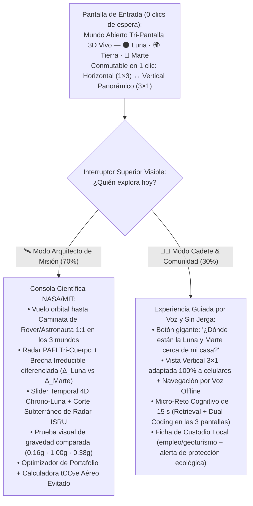

# 03.3 · Identidad de Marca con Raíz Local Proyectada al Mundo: Naming, Logo y Arquitectura UX/UI

> **Rol activo:** *Creative Director (IDEO / Pentagram / MIT Media Lab) + Investigador de Astronomía Ancestral Chilena (Cosmovisiones Lickanantay-Kunza, Mapuche, Aymara y Rapa Nui) + Lead Product Designer (Apple / NASA JPL Ops Lab)*.
> **Premisa estratégica:** Los proyectos que ganan **NASA Space Apps a nivel Global** tienen una identidad que cumple dos reglas simultáneas: **(1) Alma cultural irrepetible** (en un segundo se nota que nació desde la capital astronómica y extrema del hemisferio sur, Chile) y **(2) Claridad tecnológica universal** (un juez de NASA en Houston o Tokio puede pronunciarlo a la primera y entender qué hace en 3 segundos).

---

## 1. Raíces Lingüísticas y Astronómicas Locales (Diccionario de Inspiración Chilena)

Antes de bautizar el proyecto, rescatamos palabras auténticas de los pueblos originarios que habitan exactamente los territorios análogos de Chile (Atacama, Altiplano, Andes del Sur, Rapa Nui y Patagonia):

| Lengua / Pueblo | Palabra Original | Significado Auténtico | Conexión Directa con Nuestro Desafío |
|---|---|---|---|
| **Kunza** *(Pueblo Lickanantay — Atacama)* | **`Hôiri`** *(pron. Ói-ri)* | **Tierra, suelo, médano** | El suelo hiperárido de Atacama donde la Tierra se vuelve Marte y Luna. |
| **Kunza** *(Lickanantay — Atacama)* | **`Ckamor`** / **`Cahmor`** | **La Luna** (*Mama Luna*) | Vínculo ancestral entre los salares/volcanes atacameños y la Luna. |
| **Kunza** *(Lickanantay — Atacama)* | **`Áhlar`** | **Estrella / Astro** (*`Áhlar cappin`* = Planeta) | Fonética limpia global ("Á-lar") que une cielo profundo y exploración planetaria. |
| **Kunza** *(Lickanantay — Atacama)* | **`Cáichi`** / **`Puri`** | **Piedra** / **Agua** | La dualidad exacta de las bases permanentes: **roca protectora + agua oculta (ISRU)**. |
| **Kunza / Mundo Andino** | **`Lickan`** / **`Likana`** | **Territorio, pueblo, tierra habitada** | Transformar parajes extremos en hogares habitables para la humanidad. |
| **Quechua / Aymara** *(Andes)* | **`Apacheta`** | **Hito cónico de piedras en pasos altos** | Señal ancestral que marca la **ruta segura** en desiertos y cumbres extremas: ¡la metáfora perfecta de un análogo terrestre preparando el viaje a Marte! |
| **Mapudungun** *(Pueblo Mapuche — Sur)* | **`Kuyén`** / **`Wenu Mapu`** | **Luna** / **La Tierra de Arriba (Cosmos)** | Conecta los tubos de lava y volcanes del sur (Villarrica) con el cosmos. |
| **Rapa Nui** *(Isla de Pascua)* | **`Ana`** + **`Mahina`** / **`Hetu'u`** | **Cueva de lava** + **Luna** / **Estrella** | Ej. *Ana Te Pahu*: las cuevas volcánicas reales de Rapa Nui como refugios lunares. |

### 1.1 Los 8 Nombres Ancestrales de la Luna a lo Largo de Chile (Norte a Antártica)

| Pueblo / Lengua | Nombre de la Luna | Pronunciación aprox. | Terreno Análogo Chileno que Conecta |
|---|---|---|---|
| **Lickanantay (*Kunza*)** · Atacama | **`Ckahmor`** / **`Ckamor`** | *Ka-mór* | Desierto hiperárido, *Salar ácido de Gorbea*, *Cráter Monturaqui* y *Chajnantor*. |
| **Mapuche (*Mapudungun*)** · Centro-Sur | **`Küyen`** / **`Küyeṉ`** | *Kü-yén* | Volcanes activos y cuevas basálticas del sur (*Villarrica / Challupén*). |
| **Quechua** · Cordillera Andina | **`Killa`** *(`Mama Killa`)* | *Kí-ya / Kí-lla* | Alta cumbre (*Ojos del Salado*) y corredor de *Glaciares Rocosos*. |
| **Aymara** · Altiplano Norte | **`Phaxsi`** *(`Mama Phaxsi`)* | *Páj-si* | Salares y mesetas altiplánicas sobre los $4{,}000\text{ m}$. |
| **Rapa Nui** · Polinesia Chilena | **`Mahina`** | *Ma-hí-na* | Sistemas de tubos y cuevas de lava (*Ana Te Pahu / Roiho*). |
| **Selk'nam** · Tierra del Fuego | **`Kreeh`** / **`Kré`** | *Kré / Krij* | Campo volcánico subpolar *Pali Aike* ($52^\circ\text{S}$) y estepa magallánica. |
| **Yagán (*Yámana*)** · Cabo de Hornos | **`Hanúxa`** / **`Hanúha`** | *Ja-nú-ja* | Puerta austral subantártica rumbo a *Glaciar Unión* ($79.8^\circ\text{S}$). |
| **Kawésqar** · Patagonia Occidental | **`Ak'éwek-sélas`** / **`Arkaksélas`** | *A-ké-wek sé-las* | Grandes campos de hielo y fiordos periglaciales australes. |

---

## 2. Las 7 Mejores Propuestas de Nombre para Votar con el Equipo

Diseñamos **7 opciones de marca** que combinan un **Nombre Propio con Identidad Local** + un **Descriptor Técnico en Inglés** (fórmula probada en startups de Silicon Valley y misiones espaciales):

| # | Nombre de Marca Propuesto | Origen e Identidad | Acrónimo / Subtítulo Técnico en Inglés | Por Qué Enamora en Chile y en NASA Global |
|---|---|---|---|---|
| **1** | **ÁHLAR 4D** ⭐ *(Recomendado #1)* | **Kunza** (`Áhlar` = Astro / Estrella) | ***A**nalog **H**abitat & **L**anding **A**tlas **R**esearch — 4D Planetary Twin Engine* | Corto (2 sílabas), suena futurista como un laboratorio del MIT, funciona perfecto en inglés/español y rinde homenaje directo al cielo y desierto Lickanantay de Atacama. |
| **2** | **HÔIRI** *(Hôiri Space)* ⭐ | **Kunza** (`Hôiri` = Suelo / Tierra) | *Earth-to-Moon & Mars Analog Intelligence* | Fonética minimalista tipo Silicon Valley (*"OY-ree"*). Mensaje poético brutal: *"Para pisar el suelo de la Luna y Marte, primero entendamos Hôiri (nuestro suelo)"*. |
| **3** | **LIKANA · TWIN** ⭐ | **Kunza** (`Lickan` = Territorio habitable) + guiño directo a tu ecosistema `Likan` | *4D Planetary Base Analog & Community Atlas* | Une la idea de **territorio habitable** en ambientes extremos con inclusión de comunidades locales (*Lickanantay*). Fácil de pronunciar en los 5 continentes. |
| **4** | **APACHETA 4D** | **Andino (Chile/Andes)** (`Apacheta` = hito de piedra que guía al viajero en la alta montaña) | *Waypoints on Earth for Permanent Bases on the Moon & Mars* | **Storytelling inolvidable para el pitch:** *"Durante milenios, los pueblos andinos levantaron apachetas de piedra para cruzar el desierto más árido del mundo sin perderse. Hoy construimos una Apacheta digital hacia la Luna y Marte."* |
| **5** | **CKAMOR** *(Ckamor Atlas)* | **Kunza** (`Ckamor` = La Luna) | *Lunar South Pole & Martian Cryosphere Analog Engine* | Identidad 100 % nortina y astronómica; ideal si el equipo decide poner el foco principal en *Artemis III / Chrono-Luna*. |
| **6** | **KUYÉN · MAPU** | **Mapudungun** (`Kuyén` = Luna, `Mapu` = Tierra) | *Twin Worlds Geospatial Discovery Platform* | Literalmente **"Luna · Tierra"** en la lengua originaria más hablada de Chile; abraza tanto los glaciares y volcanes del centro-sur/Patagonia como el norte. |
| **7** | **PURI · CÁICHI** *(o **PURICA**)* | **Kunza** (`Puri` = Agua + `Cáichi` = Piedra) | *Rock & Subsurface Water-Ice Analog Finder* | Resume en una sola palabra la ecuación física de supervivencia de una base permanente: **encontrar agua (`Puri`) escondida dentro de la piedra (`Cáichi`)**. |

> 💡 **Tip de Agencia Creativa:** Cualquiera de los nombres elegidos se escribe acompañado del subtítulo funcional **`| 4D Planetary Analog Atlas`** para que el jurado entienda la herramienta en **0,5 segundos** apenas abre la pantalla.

---

## 3. Diseño de Logo e Identidad Visual (Estética NASA JPL × Patagonia/Atacama × Carbon-Zero)

### 3.1 Concepto Geométrico del Isotipo ("El Trilito Planetario")
Un isotipo vectorial minimalista de trazos limpios que funciona desde $16\times 16\text{ px}$ (favicon) hasta una camiseta del equipo, fusionando **3 símbolos en una sola figura geométrica**:
1. **Silueta Exterior — El Volcán / Apacheta Andina ($\triangle$):** Un triángulo truncado de proporción áurea inspirado en el cono perfecto del **Volcán Licancabur / Ojos del Salado** y en las **apachetas** de ruta.
2. **Corte de Luz — El Arco Rasante del Polo Sur Lunar ($1.5^\circ$):** Un haz diagonal fino que ilumina solo el borde superior izquierdo mientras deja el interior en sombra profunda (*Región Permanentemente Sombreada — PSR*), evocando el motor **Chrono-Luna 4D**.
3. **Núcleo Interior — Claraboya de Cueva / Cráter con Hielo ($\bigcirc$):** Un círculo concéntrico dividido horizontalmente: mitad superior **blanco anortosita lunar**, mitad inferior **cian hielo subsuperficial (`SWIM`)** sobre **ocre marciano de Atacama/Gorbea**, simbolizando simultáneamente un cráter de impacto (*Monturaqui/Shackleton*), una claraboya de tubo de lava (*Rapa Nui*) y la pupila de un niño mirando al espacio.

```text
           /\            ← Cumbre Andina / Apacheta + Pico de Luz Eterna (1.5° Sol rasante)
          /  \
         / ◐  \          ← Cráter / Skylight de Cueva: Anortosita Lunar + Hielo SWIM
        /______\         ← Horizonte partido: Tierra Extrema (abajo) ↔ Luna/Marte (arriba)
       Á H L A R  4 D
```

### 3.2 Paleta de Colores "Carbon-Zero OLED" (Diseñada bajo `ISO/IEC 21031` desde el Día 0)
Usar fondo negro puro/casi puro ahorra hasta **60 % de energía en pantallas OLED móviles** y hace que los mapas satelitales brillen como una consola real de control de misión en **SpaceX / NASA JPL**:

| Rol en la Interfaz | Nombre del Color | Hex | Inspiración Física Real | Contraste WCAG |
|---|---|---|---|---|
| **Fondo Principal (OLED Zero-Watt)** | *Cosmic PSR Void* | `#05070B` | Oscuridad perpetua del cráter *Shackleton* ($40\text{ K}$) | Base ahorradora de energía |
| **Superficies / Paneles Flotantes** | *Basalt Lava Tube* | `#0F172A` | Interior basáltico de las cuevas *Ana Te Pahu* (Rapa Nui) y *Pali Aike* | Glassmorphism sutil (`85%` opacidad) |
| **Texto Primario & Modo Luna** | *Highland Anorthosite* | `#F1F5F9` | Plagioclasa cálcica clara ($\text{An}_{90}$) de *Mons Mouton* y *Fiskenæsset* | **AAA** ($18.2:1$ sobre fondo) |
| **Acento Marte & Tierra Árida** | *Gorbea Jarosite Ochre* | `#EA580C` | Óxidos de hierro y jarosita ácida del *Salar de Gorbea* y *Marte* | **AA+** para alertas y capa Marte |
| **Acento Agua / Hielo ISRU** | *Cryo-SWIM Cyan* | `#38BDF8` | Hielo enterrado en *Glaciares Rocosos DGA* y mapa *NASA SWIM* | **AAA** sobre paneles oscuros |
| **Acento Luz Rasante 4D** | *Grazing Sun Peak* | `#FACC15` | Rayo solar horizontal de $0.5^\circ\text{–}2.0^\circ$ en picos polares y *Glaciar Unión* | Foco interactivo de línea de tiempo |
| **Sello Carbono-Cero & ODS** | *Lichen Extremophile* | `#10B981` | Biofirmas de estromatolitos vivos y ahorro de emisiones $\text{tCO}_2\text{e}$ | Indicadores de validación positiva |

### 3.3 Tipografía Open-Source Inclusiva (Cero Fricción Cognitiva)
- **Títulos y Datos de Misión:** **`Space Grotesk`** *(reminiscencia aeroespacial limpia y geométrica)*.
- **Coordenadas, Telemetría y Ecuaciones PAFI:** **`JetBrains Mono`** o **`IBM Plex Mono`** *(números tabulares alineados al milímetro como telemetría de vuelo)*.
- **Lectura General y Modo Niños / Baja Alfabetización:** **`Atkinson Hyperlegible`** *(creada gratuitamente por el Braille Institute específicamente para evitar confusión entre letras como `I/l/1` o `O/0`, maximizando fluidez lectora e inclusión visual!)*.

---

## 4. Arquitectura de Experiencia de Usuario (UX/UI) — "Amor a Primera Vista en 10 Segundos"

Para que tanto un **Ingeniero Jefe de NASA** como un **niño o habitante rural de 9 o 70 años en Atacama o Magallanes** sientan que la herramienta fue hecha para ellos, diseñamos una **Interfaz de Mundo Abierto Tri-Pantalla Sincronizada (`🌑 Luna · 🌍 Tierra · 🔴 Marte`) con Conmutador Horizontal (`1×3`) ↔ Vertical (`3×1`)** (detalle técnico en [`05_plan_ejecucion/05_motor_mundo_abierto_tri_pantalla.md`](../05_plan_ejecucion/05_motor_mundo_abierto_tri_pantalla.md)):



### Los 5 Momentos "Wow" de Interacción que Ganan el Pitch en Vivo

1. **Mundo Abierto Tri-Pantalla con Sincronización Cinemática (`Horizontal 1×3` ↔ `Vertical 3×1`):**
   - La pantalla se divide en **3 mundos abiertos simultáneos sobre un único lienzo WebGL (`gl.scissor`)**: **🌑 Luna** (*Shackleton / Mons Mouton* con DEM `LOLA 5m` + `ShadowCam`), **🌍 Tierra** (*Glaciar Unión / Salar de Gorbea / Fiskenæsset / Cajón del Maipo* con DEM `Copernicus/REMA 2–30m`) y **🔴 Marte** (*Arcadia Planitia / Jezero* con DEM `MOLA/HRSC/HiRISE 1m` + hielo `SWIM`).
   - En **Modo Horizontal (`1×3` columnas)** comparas cráteres, pendientes y rutas de rover lado a lado; al pulsar **Modo Vertical (`3×1` filas apiladas)** obtienes **3 parabrisas panorámicos widescreen (`21:9`)** para comparar el horizonte completo, el color del cielo (vacío negro `#000000` vs. cielo terrestre/visor lunar vs. dispersión Mie ocre marciana) y las sombras a nivel de los ojos del astronauta. Cuando caminas o giras en la Tierra, tu avatar/rover camina y gira en sincronía exacta en la Luna y Marte.
2. **El "Visor de Casco Artemis" (*Chrono-Luna Time Slider*):**
   - Al arrastrar la barra del año sobre un sitio terrestre polar/subpolar, el gráfico muestra la curva anual de elevación solar cruzada con nieve satelital (`MODIS`), se ilumina en dorado la **"Ventana Óptima de Entrenamiento"** (ej. *12–28 de octubre, Sol a $1.4^\circ$, $0\%$ nieve espesa*) y un botón **"Activar Visor Lunar"** apaga la dispersión azul del cielo terrestre para mostrar exactamente el contraste extremo blanco/negro que verá la cámara del astronauta.
3. **Tarjeta de Honestidad Científica Tri-Cuerpo + Prueba de Gravedad + Corte Subterráneo:**
   - Al abrir cualquier sitio, en vez de vender humo, muestra las barras separadas **`PAFI_Luna` / `PAFI_Marte`** y la **`Brecha Física Irreducible`** de cada astro, permite lanzar una sonda/roca en vivo para ver la diferencia de caída balística (**$0.16\,g$ Luna vs. $1.00\,g$ Tierra vs. $0.38\,g$ Marte**), abre un **corte de radar subterráneo de $10\text{ m}$** (`DFSAR` Lunar ↔ `Glaciar Rocoso DGA` ↔ `SWIM/RoPeR` Marciano) y prescribe el **simulante geotécnico exacto** (`LHS-1` / `NAO-1` / `VI-T` / `MGS-1` / `TJ-M1`).
4. **De *Influencers* a Exploradores ("Tu Pedazo de Luna y Marte a X km"):**
   - Al activar el **Modo Cadete**, la interfaz cambia jerga técnica por iconos universales, lee en voz alta en español o inglés y lanza un desafío visual interactivo de 15 segundos sobre las 3 pantallas: *"Mira estos tres paisajes reales en mundo abierto: Luna, Atacama y Marte. ¿En cuál de ellos hay hielo escondido bajo las piedras?"* (aplicando *Retrieval Practice* de alta retención cognitiva y otorgando insignia descargable de *Explorador Planetario Local*).
5. **Telemetría Verde en Tiempo Real (Pie de Página Permanente Día 0):**
   - Un micro-indicador limpio en la barra inferior muestra dos números reales:
     - `⚡ Huella Digital Sesión: 0.03 gCO₂e (Single-WebGL Scissor · 0 FPS en reposo · OLED Mode — ISO/IEC 21031)`
     - `✈️ Emisiones Evitadas en Campaña Seleccionada: -18.4 tCO₂e al entrenar en análogo regional certificado`.
