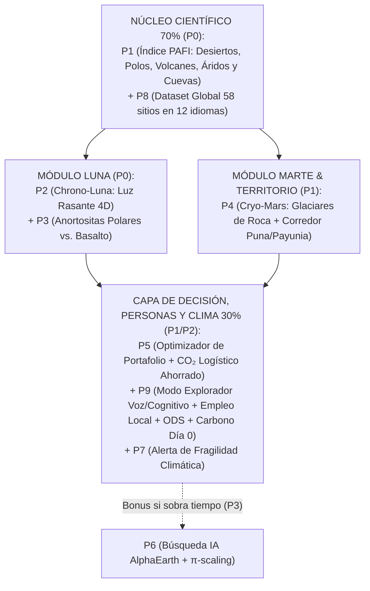

# 04.1 · Cartera de 9 Propuestas Innovadoras + Ensamble Maestro (Para Competir Local y Globalmente)

> **Rol activo:** *Partner de Innovación (McKinsey + MIT Media Lab + NASA Innovative Advanced Concepts [NIAC])*.
> Tal como pediste, **no nos cerramos a una sola idea**: diseñamos **9 propuestas diferenciadas** y al final mostramos cómo ensamblar la **Arquitectura Maestra Modular (*TERRA·TWIN 4D*)** según el equipo quiera maximizar victoria **Local (Chile)**, **Global (NASA Top 10)** o **Ambas a la vez**.

---

## Propuesta 1 — **PAFI Atlas** (*Planetary Analog Fidelity Index & Gap Engine*)
- **Concepto central:** El primer motor geoespacial abierto del mundo que reemplaza las descripciones subjetivas de sitios análogos por un **vector cuantitativo de 8 dimensiones satelitales** + cálculo explícito de la **Brecha Física Irreducible ($\Delta^{\text{irr}}$)** frente a las 9 regiones de *Artemis III*, *Shackleton/ILRS* y 8 zonas de Marte.
- **Innovación clave:** Separa rigurosamente *arquetipos físicos* (ej. **Tierras Altas Lunares Anortosíticas** vs. **Mares Basálticos** vs. **Tubos de Lava**; **Marte con Hielo Somero** vs. **Marte Evaporítico/Astrobiológico**) y se autovalida mediante *back-testing* ciego sobre 35 análogos internacionales.
- **Categorías donde brilla:** *Best Use of Data* · *Best Use of Science*.

---

## Propuesta 2 — **Chrono-Luna** (*Motor Espacio-Temporal de Luz Rasante del Polo Sur Lunar*) ⭐ *Alto Factor Wow*
- **Concepto central:** Resolver el desafío operativo más difícil de *Artemis III* y *Chang'e-7*: ¿dónde **y en qué semana exacta del año** en la Tierra el Sol rasante ($0.2^\circ\text{–}2.5^\circ$ de elevación) sobre terreno rocoso libre de nieve pesada imita las sombras kilométricas y el deslumbramiento horizontal de *Mons Mouton*, *Malapert* y *Shackleton*?
- **Innovación clave:** Cruza geometría astronómica esférica exacta (`skyfield`/`pvlib`) con DEM de $30\text{ m}$ (`hillshade` direccional con **Visor de Casco Lunar de cielo negro**) y máscara satelital de nieve (`MODIS MOD10A2`). Demuestra que el análogo lunar polar no es un punto $(x,y)$, sino una coordenada **4D $(x, y, z, t)$**.
- **Categorías donde brilla:** *Creativity* · *Best Use of Science* · *Presentation*.

---

## Propuesta 3 — **Highland Twin Discovery** (*El Giro Petrológico: Anortositas Polares vs. La Trampa del Basalto*) ⭐ *Golpe de Autoridad Científica*
- **Concepto central:** Desenmascarar un sesgo extendido: la mayoría usa volcanes negros basálticos para todo lo lunar, pero el **Polo Sur Lunar es corteza anortosítica clara ($\text{An}_{80\text{–}95}$)**. Este módulo cruza cartografía global de macizos anortosíticos desnudos con geomorfología glacial/periglacial y latitud polar.
- **Hallazgo estrella listo para presentar:** Identifica a **Fiskenæsset (Groenlandia Occidental, $63.1^\circ\text{N}$)**, **Lofoten (Noruega, $68.1^\circ\text{N}$)**, **Nain (Labrador, $56.5^\circ\text{N}$)**, **Kunene (Namibia/Angola)** y **Sittampundi (India)** como la red mundial definitiva de **Tierras Altas Lunares**, mostrando cuándo cada uno ofrece además ángulo solar tipo *Artemis*.
- **Categorías donde brilla:** *Best Use of Science* (imbatible ante geólogos de NASA/USGS).

---

## Propuesta 4 — **Cryo-Mars & El Corredor Andino-Asiático** (*Gemelos Accesibles de Hielo Enterrado para ISRU*) ⭐ *Arma Secreta Sede Local + Global*
- **Concepto central:** Las bases humanas en Marte (*Arcadia Planitia*, *Phlegra Montes*, *Deuteronilus*) dependen de perforar hielo enterrado bajo escombros secos. Ir a *University Valley* en la Antártida cuesta cientos de miles de dólares y permisos complejos. Este módulo cruza los mapas marcianos **SWIM** con inventarios terrestres de **permafrost árido y glaciares de roca cubiertos de detritos**.
- **Hallazgo estrella (Chile + Cono Sur + Global):** Posiciona a los **Glaciares Rocosos de Chile (Inventario DGA IPG2022 en Atacama, Coquimbo y Cajón del Maipo) y Argentina (IANIGLA San Juan/Mendoza)** junto con **Tso Kar / Ladakh (India)**, **Ngari / Qaidam alto (China)** y **Yakutia (Siberia)** en la cima mundial de la frontera Pareto **Fidelidad ISRU / Accesibilidad Logística**, integrado con el **Laboratorio Natural Chile 5-en-1** (**Salar ácido de Gorbea + Cráter Monturaqui + Cuevas de lava de Rapa Nui/Villarrica + Campo subpolar Pali Aike + Glaciar Unión INACH $79.8^\circ\text{S}$**) y el corredor **Puna/Socompa – Campo de Piedra Pómez – Ojos del Salado – Payunia**.
- **Categorías donde brilla:** Victoria en **Sede Local** + *Galactic Impact* + *Best Mission Concept*.

---

## Propuesta 5 — **Mission Portfolio Optimizer** (*Planificador Matemático de Campañas Multi-Sitio*)
- **Concepto central:** Como ningún sitio terrestre supera el $\sim 75\%$ de fidelidad simultánea en todas las disciplinas, el usuario ingresa los subsistemas de su misión (ej. *Rover + Taladro ISRU + EVA en Tubo de Lava + Astrobiología*), su región o presupuesto máximo, y un optimizador lineal entero (*Weighted Set Cover*) calcula la **combinación mínima de 2 a 4 sitios terrestres** que cubre el $>92\%$ de los requisitos técnicos.
- **Ejemplo real de salida:** *"Campaña Pre-Vuelo Artemis Sur Global: (1) Lofoten/Groenlandia en octubre para visión en anortosita con luz rasante + (2) Lanzarote o Payunia para tubos de lava y movilidad + (3) Glaciar de roca en San Juan/Ladakh para perforación criogénica en detritos"*.
- **Categorías donde brilla:** *Best Mission Concept* · *Relevance*.

---

## Propuesta 6 — **Morpho-Embed AI** (*Buscador Zero-Shot de Terrenos Gemelos con IA Geoespacial + $\pi$-Scaling*)
- **Concepto central:** Seleccionás cualquier recorte de cráter, campo de yardangs o llanura poligonal en Luna/Marte; el sistema aplica **escalamiento gravitacional $\pi$-scaling** ($D_{\text{Tierra}} = D_{\text{planeta}} \cdot g_p/g_T$), extrae invariantes morfométricos de DEM y expande la búsqueda en toda la Tierra usando los vectores de 64 dimensiones de **AlphaEarth (`GOOGLE/SATELLITE_EMBEDDING/V1/ANNUAL`)** con `FAISS` para hallar "clones geomorfológicos vírgenes".
- **Categorías donde brilla:** *Best Use of Technology* · *Creativity*.

---

## Propuesta 7 — **Endangered Planetary Twins** (*Atlas de Análogos en Peligro de Extinción Climática*)
- **Concepto central:** Cruzar nuestro mapa de mejores análogos criogénicos y evaporíticos de Marte/Luna con tendencias de calentamiento de **ERA5 / MODIS (2000–2026)** para calcular qué laboratorios naturales de la humanidad están desapareciendo por el deshielo del permafrost y la minería de salares/litio.
- **Impacto narrativo:** *"Si perdemos nuestros glaciares de roca y salares extremos en la Tierra, perdemos los libros de texto con los que aprenderemos a sobrevivir en Marte y buscar vida en el cosmos."*
- **Categorías donde brilla:** *Galactic Impact* · *Most Inspirational*.

---

## Propuesta 8 — **Polyglot Analog Knowledge Graph** (*Grafo Científico Sin Fronteras en 12 Idiomas*)
- **Concepto central:** Un pipeline de extracción estructurada que unifica literatura planetaria dispersa en ruso (*IKI-RAS / Tolbachik / Popigai*), chino (*CAS / Qaidam / Changbaishan*), indio (*ISRO / Sittampundi / Matanomadh / Ladakh*), japonés (*JAXA / Izu Ōshima*), europeo (*Europlanet / PANGAEA*) y latinoamericano (*CONICET / Puna / IANIGLA*) en el primer dataset abierto verdaderamente multipolar de análogos terrestres.
- **Categorías donde brilla:** *Global Connection* · *Best Use of Data*.

---

## Propuesta 9 — **Backyard Astronaut & Carbon-Zero Community Engine** (*Vocación STEM, Retención Cognitiva, Cero Barrera Digital, Inclusión Laboral y Carbono Día 0*) ⭐ *Tu Sello Personal Diferenciador*
- **Concepto central:** Una capa humana y climática acoplada directamente al motor científico **PAFI** (mismo dataset, cero relleno) con cinco innovaciones integradas:
  1. **De Influencers a Astronautas (*Modo Explorador 8–99 años*):** Conmutador instantáneo en la misma PWA multiplataforma que descubre el análogo nuevo más cercano al usuario y lo convierte en *Cadete/Observador Ciudadano* (inspirado en **NASA GLOBE Observer**) para ayudar a caracterizar los sitios que el prompt oficial marca como sub-caracterizados.
  2. **Alta Retención Cognitiva (MIT/Stanford):** Micro-retos activos de 15 segundos (*Retrieval Practice* + *Dual Coding* visual/auditivo + *Place-Based Learning*) en vez de muros de texto.
  3. **Cero Analfabetización Digital:** PWA *offline-first* ultraligera con navegación visual de 3 botones y lectura nativa por voz (*Web Speech API*) para comunidades rurales con baja conectividad.
  4. **Inclusión Laboral Espacial (*Modelo Hanle/Ladakh & Lanzarote*):** Cada nuevo análogo incluye rutas concretas para formar y emplear habitantes locales como **Custodios Comunitarios de Análogos, Técnicos de Sensores y Guías de Astro-Geoturismo**, mapeado a **UNOOSA Space4SDGs** (ODS 4, 8, 9, 10, 13, 15, 17).
  5. **Doble Huella de Carbono Día 0:** Diseño web limpio **ISO/IEC 21031 SCI** (modo oscuro OLED, estático serverless, $<0.05\text{ gCO}_2\text{e}$/sesión) + calculadora automática de **toneladas de $\text{CO}_2$ aéreo evitadas** cuando una agencia o universidad entrena en un nuevo análogo regional cercano descubierto por nuestra herramienta.
- **Categorías donde brilla:** **Sede Local (imbatible)** · *Galactic Impact* · *Most Inspirational* · *Global Connection*.

---

## 🏆 Cómo Ensamblar nuestra "Solución Maestra Ganadora" (*TERRA·TWIN 4D*)

En lugar de dispersar esfuerzos, combinamos las piezas bajo la **Regla 70 % Rigor NASA / 30 % Impacto Humano & Carbon-Zero** en **una sola PWA multiplataforma**:

- **Para arrasar en la Sede Local:** Ponés en primer plano el **Módulo 4** demostrado por el **Núcleo 1** (mostrando científicamente cómo tu región/país compite de igual a igual con los sitios de NASA/ESA y ahorra 80 % de costo logístico para universidades y agencias regionales).
- **Para entrar al Top 10 Global de NASA:** Ponés en primer plano la dupla **Núcleo 1 + Módulo 2/3 + Módulo 5** (rigor físico interplanetario, corrección anortosítica del Polo Sur Lunar, geometría solar 4D exacta, *back-testing* internacional sobre 35 sitios y optimizador de campañas).
