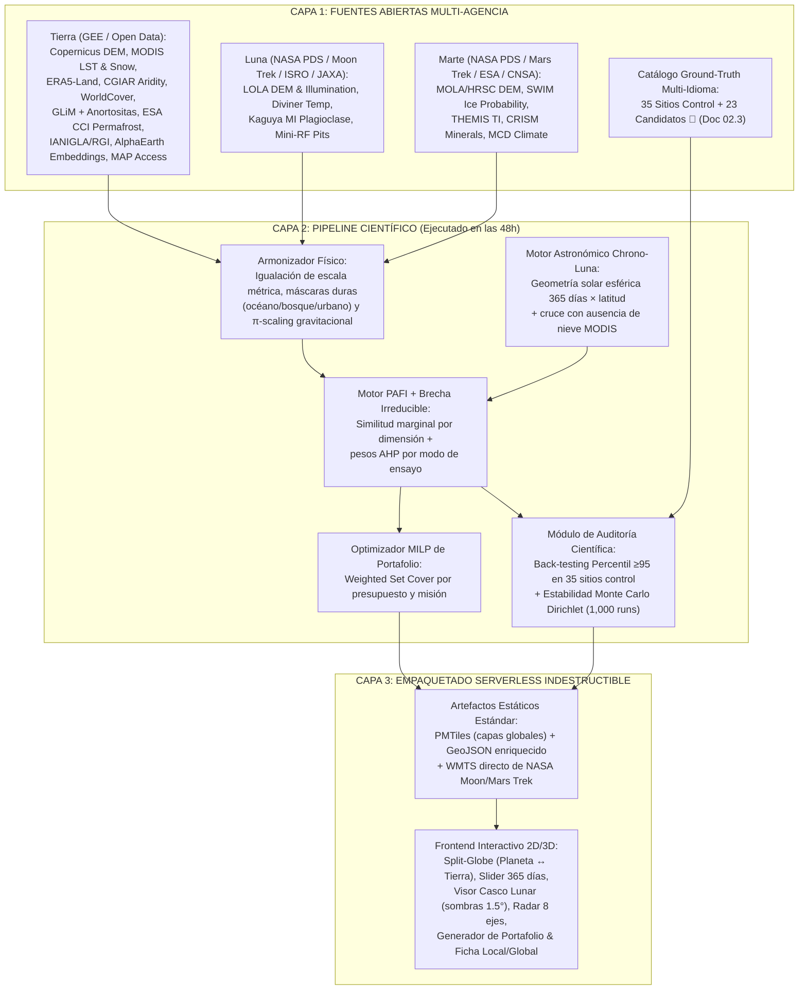

# 05.1 · Arquitectura Técnica de Ingeniería de Sistemas (*TERRA·TWIN 4D*)

> **Rol activo:** *Principal Systems Architect (NASA JPL Operations Lab + MIT Computer Science)*.
> **Principio de diseño para Hackathon:** *"Cómputo pesado offline/cloud durante el Día 1; artefactos estáticos ultra-rápidos (`PMTiles` + `GeoJSON` + `WebGL`) en el navegador durante la evaluación de jueces"*. Cero servidores frágiles que se caigan cuando un juez global abra el link un martes a las 3 a. m.

---

## 1. Diagrama de Arquitectura End-to-End

---

## 2. Especificación de las 8 Capas Operativas del Vector $\vec{x}(p)$

| Eje | Código | Rango / Unidades | Transformación de Normalización | Fuente Primaria |
|---|---|---|---|---|
| 1 | `topo_slope_tri` | Pendiente ($^\circ$) y TRI ($\text{m}$) | Diferencia absoluta a escala homologada ($\tau_{\text{slope}} = 5^\circ$) | `COPERNICUS/DEM/GLO30` / `GLO90` |
| 2 | `litho_affinity` | Afinidad $[0, 1]$ al arquetipo | Matriz petrológicaexperta (Anortosita $\to$ L1; Basalto $\to$ L3/M4; Evaporita/Sulfato $\to$ M3) | `GLiM` + complejos anortosíticos + `ASTER GED` |
| 3 | `thermal_regime` | $T_{\min}, T_{\text{mean}}, \Delta T_{\text{diurna}}$ ($\text{K}$) | Proyección a soporte terrestre $\tilde{r}_T$ + cálculo de $\Delta_T^{\text{irr}}$ ($\tau_T = 15\text{ K}$) | `MODIS/061/MOD11A2` + `ERA5_LAND` |
| 4 | `hyper_aridity` | $\text{AI} = P / \text{PET}$ (adimensional) | Transformación $\log_{10}(\text{AI} + 10^{-4})$ ($\text{AI} < 0.05$ hiperárido) | `CGIAR Global Aridity v3` |
| 5 | `bare_sterility` | Fracción desnuda $[0,1]$ y $\text{NDVI}$ | Penalización exponencial si $\text{NDVI}_{p90} > 0.12$ | `ESA/WorldCover/v200` + Sentinel-2/MODIS |
| 6 | `cryo_subsurface` | Fracción permafrost + glaciar detrítico | Coincidencia con probabilidad de hielo somero `SWIM` | `ESA CCI Permafrost` + `IANIGLA` / `RGI` |
| 7 | `solar_uv_4d` | Horas/día con $\alpha_s \in [0.2^\circ, 2.5^\circ]$ sin nieve pesada + índice UV | Exacta por día del año $d \in [1..365]$ | Ecuación esférica + `MOD10A2` + `TROPOMI`/altitud |
| 8 | `ops_isolation` | Tiempo a ciudad ($\text{min}$) y estatus legal | Modo *Hábitat* premia aislamiento alto; Modo *Ingeniería Universitaria* premia acceso vial $<8\text{ h}$ | `Oxford/MAP/accessibility_to_cities` + `WDPA` |

---

## 3. Matrices de Pesos por Modo de Ensayo (AHP Consistente, $\text{CR} < 0.05$)

| Modo de Ensayo de Misión ($m$) | `topo` | `litho` | `thermal` | `aridity` | `sterility` | `cryo` | `solar_uv` | `ops` |
|---|---|---|---|---|---|---|---|---|
| **M-L1 · Rover & EVA Cresta Polo Sur Lunar** (*Mons Mouton / Shackleton*) | 0.20 | **0.22** | 0.10 | 0.06 | 0.12 | 0.02 | **0.23** | 0.05 |
| **M-L2 · Perforación de Volátiles en Cráter Frío Lunar** (*Cabeus / Haworth*) | 0.12 | 0.10 | **0.22** | 0.10 | 0.10 | **0.26** | 0.05 | 0.05 |
| **M-L3 · Hábitat Subterráneo en Tubo de Lava / Mare** (*Tranquillitatis*) | 0.18 | **0.32** | 0.08 | 0.10 | 0.15 | 0.00 | 0.05 | 0.12 |
| **M-M1 · ISRU Hielo Somero para Starship / Marte** (*Arcadia / Phlegra*) | 0.12 | 0.08 | 0.18 | 0.14 | 0.10 | **0.30** | 0.03 | 0.05 |
| **M-M3 · Astrobiología, Sulfatos y Paleolagos** (*Jezero / Oxia / Meridiani*) | 0.08 | **0.28** | 0.08 | **0.22** | 0.12 | 0.02 | **0.15** | 0.05 |
| **M-H · Aislamiento Psicológico y Operaciones Humanas EVA** | 0.10 | 0.05 | 0.18 | 0.10 | 0.12 | 0.05 | 0.10 | **0.30** |

*(Cada suma de fila $= 1.00$ exacta).*

---

## 4. Diseño de Experiencia de Usuario (UX) Pensado para Jueces ocupados

1. **Vista Principal — Espejo Planetario (*Split Screen*):**
   - **Izquierda:** Selector de cuerpo (**Luna** o **Marte**) con capas oficiales **WMTS de NASA Moon Trek / Mars Trek** y pines sobre los 9 sitios *Artemis III*, *Shackleton/ILRS*, *Tranquillitatis Pit*, *Arcadia*, *Phlegra*, *Utopia*, *Jezero* y *Oxia Planum*.
   - **Derecha:** Mapa de la Tierra coloreado por $\text{PAFI}$ con los **Top Gemelos Globales** y botón **"Destacar Mi Región / Sede Local"**.
2. **Barra Inferior — Línea de Tiempo *Chrono-Luna* (Día 1 al 365):**
   - Al arrastrar la fecha, se iluminan en tiempo real las franjas polares y subpolares libres de nieve pesada que ese día tienen elevación solar máxima de $0.2^\circ\text{–}2.5^\circ$.
3. **Panel Lateral — Ficha Científica Comparativa (*Twin Card*):**
   - Gráfico radar superpuesto (Sitio Lunar/Marciano vs. Sitio Terrestre).
   - Alerta clara de **Brecha Física Irreducible** + equipo de compensación sugerido (ej. simulante `LHS-1`/`LSS-ISAC-1`, cámara TVAC, descarga gravitatoria).
   - Evidencia bibliográfica multilingüe y estado de fragilidad climática.
4. **Pestaña "Armar Mi Campaña" (*Mission Portfolio & Carbon-Zero Calculator*):**
   - Checkboxes de subsistemas + ubicación de origen del equipo $\to$ devuelve la ruta óptima de 2 a 4 sitios en el mapa **más las toneladas de $\text{CO}_2\text{e}$ aeronáutico evitadas** al entrenar en gemelos regionales cercanos.
5. **Conmutador Superior Dual + PWA Offline-First + Carbono Digital Día 0:**
   - **`[🔬 Modo Misión NASA]` ↔ `[🧑‍🚀 Modo Explorador Universal (8–99 años, Voz + Micro-Retos)]`**: sobre el mismo JSON satelital, activa lectura por voz nativa (*Web Speech API*, cero costo de servidor, apto para baja alfabetización digital y zonas rurales), micro-desafíos cognitivos de 15 s (*Retrieval Practice* + *Dual Coding*), filtros por los **5 entornos oficiales del prompt** (*Desiertos, Polos, Volcanes, Áridos, Cuevas*) y la tarjeta de **Inclusión Laboral Comunitaria (Custodios de Análogos) + UNOOSA Space4SDGs**.
   - **Telemetría Carbon-Zero Día 0 (`ISO/IEC 21031 SCI`)**: tema oscuro OLED `#05070D`, carga inicial $<500\text{ KB}$ sin GPUs ociosas, caché Service Worker offline y medidor transparente de $\text{gCO}_2\text{e}$ por sesión en barra inferior.
