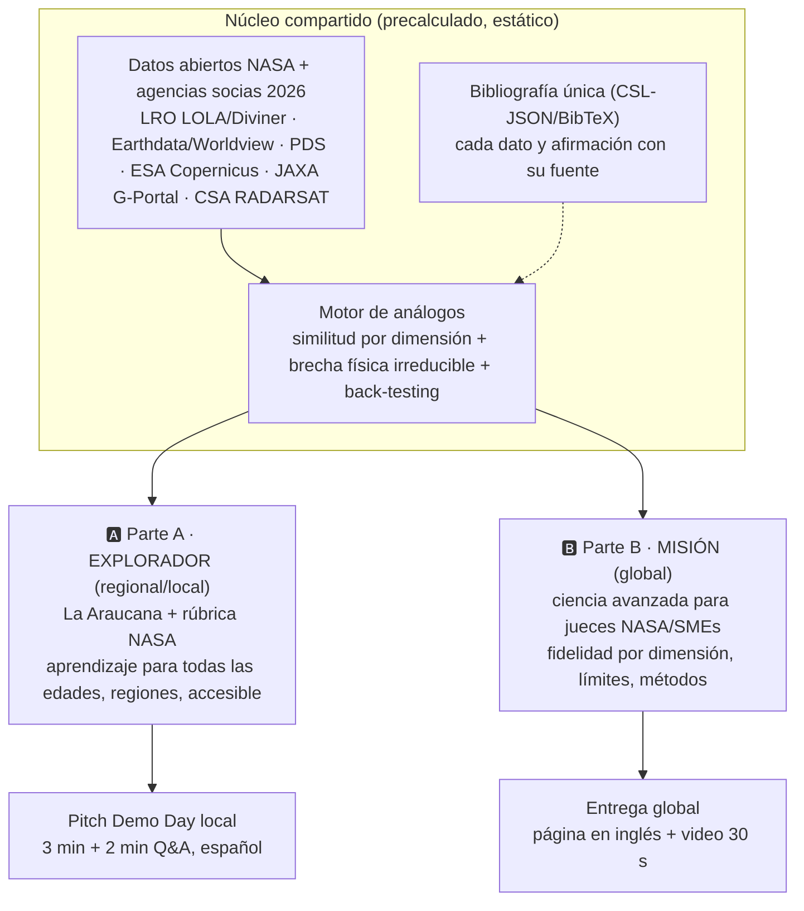

# 05.6 · Proyecto en Dos Partes + Stack Rápido + Motion + Identidad Visual Papel-Cartón

> **Estado:** propuesta de trabajo, **nada está definido aún**. Sirve para decidir rápido el sábado 14-nov por la mañana.
> **Restricciones aceptadas por el equipo (13-nov-2026):** no mostrar menores; **no guardar información de nadie** (sin base de datos, sin cuentas, sin formularios, sin analítica); solo **datos abiertos** y contenidos de aprendizaje abiertos; **trilingüe desde el día 1**; **citar fuentes desde el día 1**. La plataforma no es "para niños": el público infantil es solo un ejemplo de los productos posibles.

---

## 1. Dos partes, un mismo motor



| | 🅰️ **Parte A · Explorador** (gana la sede) | 🅱️ **Parte B · Misión** (gana el Top global) |
|---|---|---|
| Rúbricas | NASA (5 criterios) con lente La Araucana; formato de pitch tipo Nómada | NASA (5 criterios) con foco en *Validity* y *Relevance* |
| Público | Familias, estudiantes, docentes, adultos, adultos mayores de regiones | Planificadores de misión, científicos, jueces SMEs |
| Pregunta | "¿Qué tiene este lugar de la Luna o de Marte, y qué no?" | "¿Qué sitio terrestre sirve para probar *qué* operación, con qué fidelidad y qué brecha?" |
| Experiencia | Misiones cortas guiadas por capas de papel; cada capa revela un dato real | Mapa de fidelidad por dimensión, ranking, back-testing, exportable |
| Ciencia abierta | Módulo de aprendizaje enlazado a [`nasa-ciencia-abierta`](https://github.com/Delnr91/nasa-ciencia-abierta) (FAIR, citación, reproducibilidad) | Notebooks reproducibles + skill `revisar-ciencia-abierta` como control de calidad |
| Premios objetivo | Local Impact, Storytelling, Art & Technology, Most Inspirational | Best Use of Science, Best Use of Data |
| Riesgo principal | Leerse como "app educativa genérica" (*Relevance*) | Ser frío o inaccesible (*Presentation*) |

**Regla de unión:** las dos partes viven en **un solo sitio y un solo repo**. La página global de NASA presenta la Parte B y menciona la Parte A como canal de impacto; el pitch local abre con la Parte A y "aterriza" en la Parte B para mostrar el rigor.

---

## 2. Stack rápido recomendado (todo OSI, estático, sin base de datos)

Versiones verificadas en el registro npm el 13-nov-2026.

| Capa | Elección | Versión / licencia | Por qué |
|---|---|---|---|
| Sitio | **Astro** (salida estática) | 7.4 · MIT | Rutas i18n nativas (`/es/ /en/ /zh/`), *content collections* tipadas, HTML casi sin JS (bajo carbono) |
| Islas interactivas | **Svelte 5** vía `@astrojs/svelte` | 5.57 · MIT | Componentes livianos para mapas y misiones |
| Contenido | **MDX** (`@astrojs/mdx`) con esquema que **exige `sources`** en cada ficha | 8.1 · MIT | "Citar desde el día 1" lo garantiza el *build*: sin fuente, no compila |
| Citas | **rehype-citation** + archivo `references.bib`/CSL-JSON; **citation-js** para la UI | 2.3 · MIT / 0.9 · MIT | Bibliografía automática con formato estándar (APA/Chicago) |
| i18n | Rutas i18n de Astro + diccionarios por idioma (opción: **Paraglide JS**) | 3.2 · MIT | Mensajes tipados; nada de texto suelto sin traducir |
| Mapas 2D | **MapLibre GL JS** + **PMTiles** | 6.18 · BSD-3 / 4.5 · BSD-3 | Teselas en un archivo estático en GitHub Pages; sin servidor ni API key |
| Globo 3D (Parte B) | **CesiumJS** *o* **three.js** | 1.147 · Apache-2.0 / 0.187 · MIT | Terreno 3D Luna/Tierra/Marte |
| Gráficos | **Observable Plot** | 0.6 · ISC | Gráficos de fidelidad por dimensión en pocas líneas |
| Offline | **@vite-pwa/astro** | 2.0 · MIT | Funciona sin conexión tras la primera visita (brecha digital) |
| Carbono | **CO2.js** (`@tgwf/co2`) en el *build* | 0.19 · Apache-2.0 | Reporta gCO₂e estimados por visita, con supuestos visibles |
| Accesibilidad | **axe-core** en CI | 4.14 · MPL-2.0 | Bloquea errores de contraste y etiquetas |
| Tipografías | **Fontsource** autoalojadas | OFL-1.1 | Sin llamadas a Google Fonts (privacidad) |
| Ciencia | Python: `xarray`, `rioxarray`, `numpy`, `scikit-learn` en notebooks | BSD/Apache | Se **precalcula** todo a JSON/COG/PMTiles; el sitio no necesita servidor |
| Hosting | **GitHub Pages** + GitHub Actions | — | Público, sin login, gratis |
| Licencias del repo | Código **MIT** o **Apache-2.0** · contenidos **CC BY 4.0** | — | Exigencia OSI de Space Apps |

**Privacidad por diseño:** sin cookies, sin analítica, sin cuentas, sin formularios, sin base de datos. Si una misión guarda progreso, que sea en `localStorage` **del propio navegador**, opcional, borrable con un botón y nunca enviado a ningún servidor.

**Trilingüe desde el día 1 — DECIDIDO (13-nov-2026): español · inglés · chino simplificado**
| Código | Idioma | Rol |
|---|---|---|
| `es` | Español | Idioma de la sede, de La Araucana y del pitch local; **idioma fuente** de los contenidos |
| `en` | Inglés | **Obligatorio** para la página de proyecto y el material enlazado que ve NASA |
| `zh-Hans` | Chino simplificado (rutas `/zh/`) | Coherente con la guía en chino que ya tiene `nasa-ciencia-abierta`; amplía el alcance global (*Global Connection*) |

Reglas del idioma chino:
- Es un **idioma, no una afiliación**: no choca con la política China de NASA. Igual, **cero colaboración o coordinación con entidades chinas** (universidades, agencias o empresas) y nada de registrarse en portales de datos del gobierno chino para este proyecto.
- Tipografía: **Noto Sans SC** (Fontsource 5.3 · OFL-1.1), cargada **solo en `/zh/`** y con subconjunto de caracteres para no castigar el peso de las páginas en español e inglés (carbono).
- `lang="zh-Hans"` en el HTML, fechas y números con `Intl` según el idioma, y términos científicos con el original en inglés entre paréntesis la primera vez (p. ej. 斜长岩 (anorthosite)).
- La traducción hecha con IA se **declara** (regla "Super Intelligence") y la revisa una persona con buen nivel de chino antes de publicarla; si no hay revisor, la página lo indica.
- La demo de 30 s y la página para NASA siguen en **inglés**; el chino es parte del producto, no de la entrega.

---

## 3. Librerías de *motion* (animación) evaluadas

| Librería | Versión · licencia | Uso propuesto | Veredicto |
|---|---|---|---|
| **Motion** (`motion`, ex Framer Motion; API JS independiente del framework) | 14.14 · MIT | Paralaje de capas, resortes, animaciones al hacer scroll | ✅ **Principal** |
| **CSS 3D** (`perspective`, `translateZ`) + `prefers-reduced-motion` | nativo | Profundidad real de las capas de papel | ✅ Base sin dependencias |
| **View Transitions API** (cliente de Astro) | nativo | Transición entre Luna ↔ Tierra ↔ Marte como "pasar la página" | ✅ |
| **Lenis** | 1.3 · MIT | Scroll suave para el relato por capas | ✅ Opcional (se apaga con movimiento reducido) |
| **AutoAnimate** | 0.10 · MIT | Listas y rankings que se reordenan solos | ✅ Opcional |
| **Rive** (runtime) | 2.50 · MIT | Personaje guía de papel con estados (habla, señala, celebra) | ✅ Opcional, si hay diseñador |
| **anime.js v4** | 4.5 · MIT | Alternativa ligera a Motion | 🔁 Alternativa |
| **lottie-web** | 5.13 · MIT | Ilustraciones animadas exportadas | 🔁 Alternativa (archivos más pesados) |
| **Theatre.js** | 0.7 · Apache-2.0 (core) | Coreografías 3D | ⏸️ Sin release desde 2024 |
| **Atropos** | 2.0 · MIT | Tarjetas 3D con inclinación | ⏸️ Sin release desde 2023; replicar con Motion |
| **GSAP** | 3.15 · licencia "Standard no charge" | — | ❌ **Evitar:** gratis, pero **no es licencia OSI**, y Space Apps exige que los materiales de terceros sean libres sin restricción u OSI |

**Reglas de motion:** máximo ~300 ms por microinteracción; el movimiento **revela datos**, no decora; con `prefers-reduced-motion` el paralaje se desactiva y queda la versión estática completa.

---

## 4. Identidad visual "papel-cartón por capas" (global, educativa y científica)

**Concepto unificador: cada capa de papel es una curva de nivel real.** Las capas no son decoración: se recortan siguiendo **curvas de nivel del DEM** (LOLA para la Luna, MOLA para Marte, Copernicus GLO-30 para la Tierra). El estilo artesanal **es** el dato. Esto conecta a la vez con familias (Parte A) y con nerds de NASA (Parte B).

| Elemento | Parte A · Explorador | Parte B · Misión |
|---|---|---|
| Capas | 4–6 capas gruesas, bordes suaves, sombras cálidas | 10–20 capas finas = curvas de nivel cada *n* metros, rotuladas |
| Tipografía | **Atkinson Hyperlegible Next** (lectura fácil) + **Fraunces** para títulos | **Space Grotesk** para títulos + **IBM Plex Mono** para datos |
| Movimiento | Paralaje al inclinar el móvil o mover el cursor | Corte transversal: las capas se separan para mostrar perfil topográfico |
| Tono | Cálido, curioso, bilingüe en pantalla | Preciso, con unidades, fuente y error en cada dato |

**Paleta base (tokens con nombre físico):**
| Token | Hex | Referencia |
|---|---|---|
| `--papel-anortosita` | `#E9E4D8` | Tierras altas lunares claras |
| `--papel-basalto` | `#3B3A3F` | Mares lunares / tubos de lava |
| `--papel-oxido-marte` | `#C1440E` | Superficie marciana |
| `--papel-atacama` | `#D9A066` | Desierto / regolito terrestre |
| `--papel-hielo` | `#CFE3EA` | Hielo enterrado / glaciares rocosos |
| `--papel-cielo-noche` | `#0B1D3A` | Fondo nocturno |
| `--sombra-corte` | `rgba(0,0,0,.18)` | Sombra entre capas |

- Contraste mínimo **WCAG AA**; los colores nunca son el único código (siempre con etiqueta o patrón).
- **Prohibido:** insignia NASA, *worm*, banderas o identificadores de misión en arte propio o generado con IA. La imagen de cartón actual es **solo referencia**.
- Arte propio en **SVG** (liviano y accesible). Si se usa IA para alguna capa: marca de agua visible + declaración.
- Logos en pitch: ver [`00_desafio/07_pitch_storytelling_ganadores_y_logos.md`](../00_desafio/07_pitch_storytelling_ganadores_y_logos.md) §4.

---

## 5. Integración de nuestras plataformas
| Plataforma | Rol |
|---|---|
| [`nasa-ciencia-abierta`](https://github.com/Delnr91/nasa-ciencia-abierta) | Módulo "Ciencia abierta" de la Parte A (lecciones FAIR, citación, reproducibilidad, audios) y su skill `revisar-ciencia-abierta` como auditoría del repo antes de enviar |
| `hackanasa` (este repo) | I+D, rúbricas, motor científico, skills de validación y pitch |
| Assets Lattices Team | Identidad del equipo (sin marcas de terceros) |

---

## 6. Esqueleto de carpetas propuesto (para el sábado)
```
app/
  src/content/analogos/{es,en,zh}/*.mdx   # fichas con frontmatter: sources[], datasets[], dimensiones, brecha
  src/content/misiones/{es,en,zh}/*.mdx   # Parte A
  src/data/references.bib                 # bibliografía única
  src/i18n/{es,en,zh}.json
  src/components/PaperLayers.svelte       # capas desde curvas de nivel (SVG)
  src/components/AnalogMap.svelte         # MapLibre + PMTiles
  public/tiles/*.pmtiles                  # precalculado
science/notebooks/*.ipynb                 # Parte B, reproducible
LICENSE (MIT) · CONTENT_LICENSE (CC BY 4.0) · CITATION.cff · AI_DISCLOSURE.md
```
