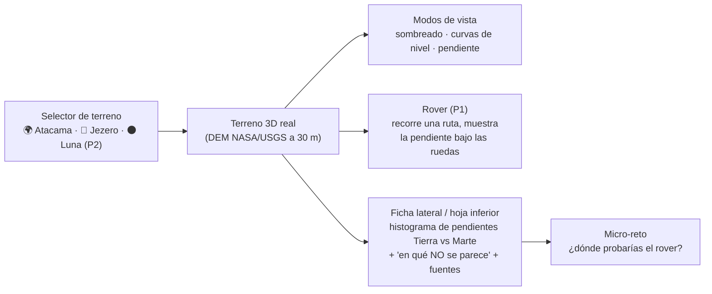

# 05.9 · Experiencia 3D interactiva, mobile-first (inspirada en ER-6 Terrain Explorer)

> **Referencia analizada el 14-nov-2026:** [fable-rover.vercel.app](https://fable-rover.vercel.app/) (*ER-6 Terrain Explorer*), una "hoja de ingeniería interactiva" con un rover de seis ruedas que recorre Marte en el navegador. Hecha con **Three.js r186** y Vite; no publica su código ni su licencia.
> **Regla:** se toma como **inspiración de patrones de interacción**, no se copian su código, sus modelos ni su diseño. Space Apps exige obra original y citar las referencias; se lista en *References* como inspiración.

---

## 1. Qué tiene la referencia y qué tomamos

| Patrón de ER-6 | Qué hace | ¿Lo usamos? | Versión para nuestro proyecto |
|---|---|---|---|
| **Estética de plano técnico** sobre papel crema, con acentos naranjos y cuadrícula | Parece una lámina de ingeniería | ✅ | Encaja con la identidad **capas de papel + naranja Atacama**: "plano técnico de campo" |
| **Selector de perfil de terreno** (rocas, dunas, hielo polar, costra, lava, yardangs, canal, salar, *lunar 1/6 g*) | Cambia el terreno que recorre el rover | ✅ **clave** | En vez de terrenos inventados: **terrenos reales** a partir de los DEM de NASA (Jezero y un sector de Antofagasta) |
| Rover que **recorre el terreno** y se inclina | Muestra pitch, roll, pendiente y holgura | ✅ P1 | Rover propio y simple, construido con primitivas; muestra **pendiente bajo las ruedas** |
| **Panel de suspensión** con valores en vivo | Ángulos y deslizamiento | ⚠️ | Solo pendiente y rugosidad medidas en el DEM; sin física de suspensión inventada |
| **Vistas ortográficas** (frente, lado, planta) | Varias cámaras en vivo | ⚠️ P2 | Un **perfil topográfico** 2D sincronizado con la cámara 3D |
| **Modos de render** (sombreado, línea, rayos X) | Cambia el estilo | ✅ | **Sombreado · curvas de nivel · mapa de pendiente** |
| **Hora del día (±1 h)** | Mueve el Sol | ✅ P1 | Sol rasante para la Luna (P2) |
| **En celular:** vista cenital, paneles colapsados en pestañas inferiores, controles al alcance del pulgar | Mobile real | ✅ **obligatorio** | Ver §3 |
| Lámina de "carga" con lista de módulos | Pantalla de carga con estilo | ✅ | Carga progresiva con los nombres reales de los datasets |

---

## 2. Nuestra experiencia: "Conduce en dos mundos"

**La idea en una frase:** el mismo rover sobre **dos terrenos reales a la misma escala**, la Cordillera de la Sal (Atacama) y el cráter Jezero (Marte), con la **pendiente medida bajo sus ruedas** y una ficha que dice en qué se parecen y en qué no.



| Prioridad | Qué entra |
|---|---|
| **P0.5** (después de la comparación real) | Terreno 3D de los dos DEM, intercambiables, con modo **mapa de pendiente** y la fuente visible |
| **P1** | Rover simple recorriendo una ruta; lectura de pendiente bajo las ruedas; exageración vertical **rotulada** |
| **P2** | Nodo lunar con LOLA; Sol rasante; perfil sincronizado |

**Lo que no se hace:** física de suspensión, "zonas seguras" o semáforo de transitabilidad (no certificamos rutas), ni terrenos inventados presentados como reales.

---

## 3. Diseño mobile-first

```
┌──────────────────────────┐
│ ▸ LUNARES · Jezero  [ES]│  barra superior: proyecto · terreno · idioma
│ pendiente bajo rover 12° │  lectura en vivo (texto grande)
│                          │
│        TERRENO 3D        │  un solo canvas a pantalla completa
│      (arrastrar, pellizcar)│
│                          │
│ Fuente: USGS CTX DEM 20 m│  fuente siempre visible
├──────────────────────────┤
│ [🌍 Atacama] [🔴 Jezero] │  selector al alcance del pulgar
│ [Sombra][Curvas][Pend.]  │  modos de vista
│ ▲ Ficha: comparar · reto │  hoja inferior deslizable (vaul)
└──────────────────────────┘
```

- **Un solo canvas**; en escritorio, la ficha pasa a un panel lateral.
- **Controles abajo**, en la zona del pulgar; botones de al menos 44 × 44 px.
- **Gestos:** arrastrar para orbitar, pellizcar para zoom, doble toque para centrar.
- **Texto legible** sobre el 3D: fondo papel semiopaco, contraste AA.
- **Accesibilidad:** con `prefers-reduced-motion` no hay autorotación; alternativa 2D (imagen de sombreado + histograma) si WebGL no está disponible.

### Presupuesto de rendimiento (celular de gama media)

| Recurso | Celular | Escritorio |
|---|---|---|
| Malla del terreno | 256 × 256 vértices (~65 mil) | 512 × 512 |
| Resolución del canvas | `dpr` máximo 1,5 | máximo 2 |
| Texturas | 1 de 1024 px (sombreado precalculado) | 2048 px |
| Peso inicial | < 1,5 MB antes de cargar el terreno | — |
| FPS objetivo | 30 estables | 60 |
| Batería | `frameloop="demand"`: dibujar solo cuando algo cambia | — |

---

## 4. Datos para el 3D (sale del mismo pipeline del P0)

1. Del paso ⑥ del [paper de datos](../02_investigacion_global/11_paper_datos_desafio.md): parche de **igual tamaño** en Tierra y Marte a **30 m** (p. ej. 256 × 256 px ≈ 7,7 km por lado).
2. Exportar por parche:
   - `height.bin`: alturas Float32 en metros (o PNG de 16 bits), relativas al mínimo del parche.
   - `slope.png`: mapa de pendiente coloreado por rangos.
   - `hillshade.png`: sombreado precalculado (`gdaldem hillshade`).
   - `meta.json`: tamaño de celda, origen, fuente, DOI, fecha y **exageración vertical usada**.
3. En el navegador: `PlaneGeometry` desplazada con las alturas (o malla RTIN con `@mapbox/martini` para menos vértices).

**Honestidad visual:** si se exagera la altura para que se vea el relieve, mostrar en pantalla "relieve exagerado ×2". La pendiente que se informa siempre se calcula **sin** exagerar.

---

## 5. Stack 3D (versiones y licencias verificadas en npm el 14-nov-2026)

| Necesidad | Librería | Versión · licencia | Nota |
|---|---|---|---|
| Motor 3D | **three** | 0.187 · MIT | La misma familia que usa la referencia (r186) |
| React + 3D | **@react-three/fiber** | 9.8 · MIT | Encaja con el stack React + Vite |
| Utilidades 3D | **@react-three/drei** | 10.7 · MIT | `OrbitControls`/`MapControls`, `Bounds`, `Html` |
| Malla eficiente | **@mapbox/martini** | 0.2 · ISC | Opcional: menos triángulos en terreno plano |
| Hoja inferior | **vaul** | 1.1 · MIT | Hoja deslizable mobile (release de 2024, estable) |
| Gestos | **@use-gesture/react** | 10.3 · MIT | Si hace falta un gesto propio |
| Medir rendimiento | **r3f-perf** | 7.2 · MIT | Solo en desarrollo |
| Movimiento de UI | **Motion** | 14 · MIT | Transiciones de la ficha |

---

## 6. Pedidos listos para los agentes (repo de construcción)

1. **Datos:** *"Extiende el script de preparación: para cada parche (Atacama y Jezero, 256×256 a 30 m) exporta height.bin (Float32, metros), hillshade.png, slope.png y meta.json con fuente, DOI, tamaño de celda y exageración. Agrega un test que falle si meta.json no tiene fuente."*
2. **Terreno 3D:** *"Con prototype, crea un componente React Three Fiber `<Terrain>` que lea height.bin y meta.json, desplace un PlaneGeometry y aplique hillshade o slope como textura. Mobile-first: dpr máx. 1,5, frameloop demand, 256×256 en pantallas < 768 px. Fallback 2D si no hay WebGL."*
3. **Interfaz mobile:** *"Pantalla a pantalla completa con selector Atacama/Jezero y modos sombreado/curvas/pendiente en la parte inferior, hoja deslizable (vaul) con el histograma de pendientes, 'en qué NO se parece' y fuentes. Textos con react-i18next (es/en/zh)."*
4. **Rover (P1):** *"Rover simple hecho con primitivas propias (caja + 6 ruedas) que sigue una ruta de puntos sobre el terreno, se apoya en la superficie y muestra la pendiente bajo las ruedas. Sin física de suspensión."*
5. **Revisión:** *"Usa webapp-testing en viewport 375×812, mide FPS con r3f-perf y corre impeccable critique y better-accessibility."*

---

## 7. Riesgos y cómo cortarlos

| Riesgo | Corte |
|---|---|
| El 3D se come el tiempo del P0 | **El 3D empieza solo después de tener la comparación real.** Si a las 18:00 del sábado no está, se muestra el sombreado 2D |
| Celulares lentos | Malla 256 × 256, sin sombras en tiempo real, sombreado precalculado |
| Parecer un juego sin ciencia | Fuente y escala siempre visibles; la lectura de pendiente sale del DEM real |
| Copiar la referencia | Diseño, modelo y código propios; la referencia se cita como inspiración |

---

## Referencias
- *ER-6 Terrain Explorer* (inspiración de interacción): https://fable-rover.vercel.app/ (consultado el 14-nov-2026).
- Datos: ver [`02_investigacion_global/11_paper_datos_desafio.md`](../02_investigacion_global/11_paper_datos_desafio.md).
