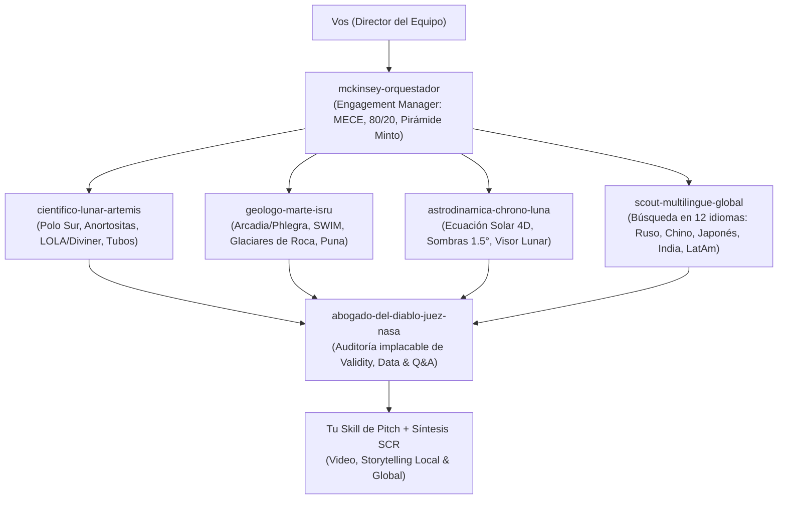

# 06.1 · Arquitectura de Agentes y Skills para Ejecutar el Hackathon en `agy`

> **Rol activo:** *Lead AI Agent Architect (Google DeepMind / Antigravity Customization System)*.
> **¡Ya están instalados y listos en esta carpeta!** Además de documentarlos aquí, creamos los archivos reales bajo `AGENTS.md`, `.agents/agents/` y `.agents/skills/` siguiendo el estándar oficial de **Antigravity CLI (`agy`)**, listos para combinarse con tu skill de pitch.

---

## 1. Cómo Activar tu Escuadrón Experto el Día del Hackathon

Cuando abras tu terminal dentro de `/home/dani/Escritorio/hackanasa` y ejecutes `agy`:
1. **`AGENTS.md`** se carga automáticamente como regla jerárquica del proyecto (obliga al agente a pensar siempre con rigor NASA/MIT/Stanford/McKinsey y respetar las 5 métricas de jueces de Space Apps).
2. Escribiendo **`/agents`** verás disponibles los **6 Agentes Especialistas** en `.agents/agents/`.
3. Escribiendo **`/skills`** verás cargados los **3 Skills Técnicos** en `.agents/skills/` (que se suman automáticamente a tus skills globales, como tu **skill de pitch**).
4. Para tareas intensivas durante las 48 h, podés combinar **`/boost`** o **`/goal`** con estos agentes y skills.

---

## 2. Mapa de Orquestación del Escuadrón `hackanasa`

---

## 3. Inventario de Archivos Instalados en `hackanasa/.agents/`

### Regla Maestra del Proyecto
- [`AGENTS.md`](../AGENTS.md) — Constitución científica, metodológica y competitiva del proyecto.

### Agentes Personalizados (`.agents/agents/<nombre>/agent.md`)
| Agente | Rol Experto Sostenido | Cuándo Invocarlo |
|---|---|---|
| [`mckinsey-orquestador`](../.agents/agents/mckinsey-orquestador/agent.md) | Engagement Manager de McKinsey + Systems Lead | Al arrancar cada bloque del hackathon, destrabar decisiones 80/20 o sintetizar hallazgos en Pirámide de Minto / SCR. |
| [`cientifico-lunar-artemis`](../.agents/agents/cientifico-lunar-artemis/agent.md) | Científico Lunar LPI / NASA Goddard (LRO & Artemis III) | Al modelar sitios del Polo Sur Lunar, anortositas vs. basaltos, PSRs o tubos de lava. |
| [`geologo-marte-isru`](../.agents/agents/geologo-marte-isru/agent.md) | Geólogo Marciano JPL / MEPAG / SWIM + Experto Andino | Al modelar Zonas de Exploración en Marte, hielo enterrado, glaciares de roca, sulfatos y corredor Puna/Payunia. |
| [`astrodinamica-chrono-luna`](../.agents/agents/astrodinamica-chrono-luna/agent.md) | Ingeniero de Iluminación Planetaria y Navegación Óptica | Al construir el motor 4D de ventanas solares rasantes y el simulador de sombras lunares sobre DEM. |
| [`scout-multilingue-global`](../.agents/agents/scout-multilingue-global/agent.md) | Investigador Políglota (Ruso, Chino, Japonés, Hindi, Europeo, Español) | Al buscar papers, coordenadas o validación bibliográfica fuera del inglés para descubrir nuevos sitios. |
| [`abogado-del-diablo-juez-nasa`](../.agents/agents/abogado-del-diablo-juez-nasa/agent.md) | Jurado Ejecutivo de NASA Space Apps (*Red Team*) | Antes de congelar el modelo y antes de grabar el pitch: audita errores físicos, links, permisos y prepara Q&A. |

### Skills Operativos (`.agents/skills/<nombre>/SKILL.md`)
| Skill | Propósito Procedimental |
|---|---|
| [`mckinsey-space-apps`](../.agents/skills/mckinsey-space-apps/SKILL.md) | Ejecuta el protocolo McKinsey de 7 pasos, auditoría MECE y empaquetado SCR listo para alimentar tu skill de pitch. |
| [`pafi-analog-engine`](../.agents/skills/pafi-analog-engine/SKILL.md) | Contiene las ecuaciones exactas de PAFI, Brecha Irreducible, pesos AHP, $\pi$-scaling, geometría solar esférica e IDs de Google Earth Engine. |
| [`multilingual-planetary-scout`](../.agents/skills/multilingual-planetary-scout/SKILL.md) | Ejecuta búsquedas estructuradas en 12 idiomas y devuelve fichas estandarizadas de sitios análogos con citas verificables. |
| [`impacto-humano-carbono-ods`](../.agents/skills/impacto-humano-carbono-ods/SKILL.md) | Integra la capa vocacional (niños/adultos), retención cognitiva (MIT/Stanford), PWA offline/voz contra analfabetismo digital, inclusión laboral local (modelo Hanle/Ladakh), UNOOSA Space4SDGs y doble huella de carbono Día 0 (`ISO 21031` + $\text{tCO}_2\text{e}$ aéreas evitadas). |
