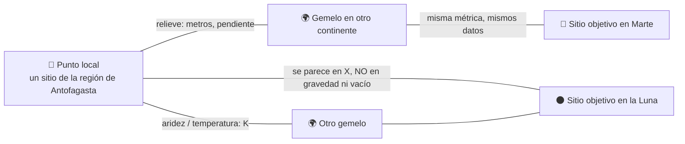

# 🚀 INICIO · Día 1 del Hackathon (sábado 14-nov-2026, Antofagasta)

> **Para qué sirve:** llegar, abrir este archivo y avanzar sin pensar en la logística. Todo lo demás del repo es respaldo.
> **Regla de oro:** si algo de aquí choca con la guía oficial de NASA, manda [`00_desafio/03_rubrica_oficial_global_2026.md`](00_desafio/03_rubrica_oficial_global_2026.md).
> **Nada está decidido todavía.** Lo que sigue es el camino recomendado; la idea final la elige y la redacta el equipo.

---

## 0. La idea-fuerza: una *lattice* que habla el idioma de la ciencia

La semilla es de ustedes (el nombre **Lattices Team** y la frase "la ciencia es un idioma mundial"). Aquí solo queda ordenada para que la decidan mañana.

**Una *lattice* es una red de puntos conectados.** En el proyecto:

- **Nodos:** lugares. Uno de la región de Antofagasta, sus "gemelos" en otros continentes y los sitios objetivo en la Luna y en Marte.
- **Enlaces:** cuánto se parecen dos nodos **en una dimensión física concreta** (relieve, temperatura, mineral, hielo, luz), medido con los mismos datos abiertos y las mismas unidades.
- **Idioma común:** un kelvin es un kelvin en español, inglés o chino. La interfaz se traduce a tres idiomas; **los números no necesitan traducción**.



**Por qué conecta lo local con lo global en un solo gesto:**

| Nivel | Qué ve la persona | Premio / criterio que toca |
|---|---|---|
| **Local** | "Un lugar de mi región es un nodo con valor científico para explorar la Luna y Marte" | *Impact* local, lente La Araucana, **Local Impact** |
| **Global** | "Ese mismo lugar tiene gemelos en India, Canadá o Groenlandia, medidos igual" | **Global Connection**, *Creativity* |
| **Método** | "Cualquier comunidad puede proponer su nodo con el mismo método abierto" (un *pull request*, sin base de datos) | *Validity*, **Best Use of Data** |

**Ejemplo para discutir** (datos de nuestro catálogo [`03_analogos_terrestres_global.md`](02_investigacion_global/03_analogos_terrestres_global.md); verificar con la fuente primaria antes de publicar):

- **Cráter Monturaqui** (Antofagasta, ~370 m de diámetro) ↔ **Cráter Lonar** (India, 1,83 km, en basalto) ↔ **Cráter Haughton** (Canadá, 23 km, desierto polar) ↔ cráteres simples lunares y marcianos.
- **Se parece en:** forma de cuenco de impacto, aridez extrema, ausencia de vegetación.
- **No se parece en:** tipo de roca (granito/ignimbrita, no anortosita ni basalto), tamaño, gravedad terrestre, atmósfera densa, radiación. **Decirlo es parte de la ciencia** y lo pide el desafío.

**Doble sentido que regala el nombre:** en mineralogía, *lattice* es la red cristalina. Las tierras altas lunares están dominadas por plagioclasa, la misma familia mineral de las anortositas terrestres. La red conecta lugares; la red cristalina conecta rocas. Úsenlo solo si la Parte B realmente muestra mineralogía.

**Frase candidata (borrador, reescríbanla con sus palabras):**
> *"Science is a language everyone can read. We connect one place in the Atacama to its twins on Earth, the Moon and Mars, one measured dimension at a time."*

⚠️ Recordatorio del desafío: **Atacama, Antártida, Islandia y Hawái figuran como "ya muy estudiados"**. El titular debe ser un sitio o proceso poco estudiado de la región; Atacama clásico queda como control.

---

## 1. Esta noche (20 min)

- [ ] **Todos** registrados en `spaceappschallenge.org`, en la **misma sede (Antofagasta)** y sin lista de espera. Equipo de 1 a 6 personas, creado y con todos en la pestaña *Members*.
- [ ] Desafío elegido en la plataforma: *Identify Earth Locations that Analog the Permanent Moon Base Locations and Mars*.
- [ ] Cuenta **NASA Earthdata Login** creada por quien maneje datos (la crea cada persona; es gratis).
- [ ] GitHub con **2FA**; `gh auth status` funciona; Node LTS reciente (22 o superior), Python 3 y Git instalados.
- [ ] Este repo clonado y actualizado: `git pull`.
- [ ] Cargadores, alargador, audífonos con micrófono (video de 30 s) y un celular para probar la demo.
- [ ] Leer **solo** esto: este archivo + [`03_rubrica_oficial`](00_desafio/03_rubrica_oficial_global_2026.md) §3 (puertas duras).

---

## 2. Al llegar (08:30–09:00): 7 preguntas a la Local Lead

1. ¿Hay rúbrica o bases propias de La Araucana además de los 5 criterios NASA? ¿Pesos?
2. ¿Siguen las categorías Principiante / Intermedio / Avanzado? ¿Cuál nos toca?
3. ¿Formato y hora exacta del Demo Day? ¿Minutos de pitch y de preguntas? ¿Pantalla para demo en vivo?
4. ¿Cuántos proyectos de la sede pasan a *Global Nominees*?
5. ¿Qué premios locales hay y con qué criterio?
6. ¿Podemos usar el logo de La Araucana / UCN / Space Apps en el pitch local? (pedir el sí **por escrito**)
7. ¿Hay mentores de geología o astronomía de la UCN? ¿Cómo se agenda uno?

---

## 3. Crear y conectar el repo nuevo (09:00, ≈10 min)

```bash
gh repo create <nombre-del-proyecto> --public --clone
```
```bash
cd <nombre-del-proyecto>
```
```bash
cp ../hackanasa/plantillas/repo-hackathon/{CLAUDE.md,AI_DISCLOSURE.md,CITATION.cff,SECURITY.md} . && ln -s CLAUDE.md AGENTS.md
```
```bash
bash ../hackanasa/plantillas/repo-hackathon/install-skills.sh .claude/skills
```
```bash
cp -R ../hackanasa/.agents/skills/validador-space-apps-2026 ../hackanasa/.agents/skills/pitch-storytelling-space-apps .claude/skills/
```

Luego, a mano: agregar `LICENSE` (MIT), activar **GitHub Pages**, protección de `main`, Dependabot y escaneo de secretos. El plugin de Google (EGM) se instala con los dos comandos que imprime el instalador.

**Mensaje de arranque para pegar en Claude Code dentro del repo nuevo:**

```text
Contexto: repo de construcción para NASA Space Apps 2026 (Lattices Team, sede Antofagasta).
Lee primero CLAUDE.md de este repo y, del repo vecino ../hackanasa, estos archivos:
INICIO_DIA_1.md, 00_desafio/03_rubrica_oficial_global_2026.md,
05_plan_ejecucion/06_dos_partes_stack_motion_identidad.md y
05_plan_ejecucion/07_plan_maestro_recursos_e_instalacion.md.
No propongas la idea: la decide el equipo. Tu primer trabajo es hacernos preguntas
(skill grill-me) hasta que el brief quede claro, y después ayudarnos a escribir la
especificación. No escribas código de la app hasta que aprobemos la especificación.
```

---

## 4. Decidir la idea (09:30–11:00): la decide el equipo, no la IA

Las reglas 2026 dicen que la IA no debe idear cómo resolver el desafío. Por eso:

1. **15 min sin pantallas:** cada persona escribe en una frase qué construiría. Votan.
2. Anotan la decisión, la hora y quiénes decidieron en `AI_DISCLOSURE.md` (§1).
3. Recién entonces: `grill-me` para afinar → EGM `egm-brainstorm` y `egm-draft` para la especificación → `egm-review` para que la revisen con ojos frescos.
4. Pasan la idea por `validador-space-apps-2026` (modo "valida la idea").

**Cinco preguntas que la idea debe responder antes de las 11:00:**
- ¿Qué sitio o proceso **poco estudiado** es nuestro titular?
- ¿Qué **dataset NASA exacto** está en el núcleo?
- ¿En qué **no** se parece a la Luna o a Marte?
- ¿Quién lo usa el lunes (Parte A) y quién en una misión (Parte B)?
- ¿Cuál es nuestro **recurso narrativo único**? (ver §7)

---

## 5. Capa de datos abiertos relacionada con el desafío

Fuente completa: [`04_datasets_recursos_libres.md`](02_investigacion_global/04_datasets_recursos_libres.md). Aquí va **lo mínimo para un P0**, organizado por dimensión de analogía. Los marcados ⭐ son los recursos que la propia página del desafío recomienda.

| Dimensión | 🌍 Tierra | 🌑 Luna | 🔴 Marte |
|---|---|---|---|
| **Relieve** (forma, pendiente, rugosidad) | NASADEM `NASA/NASADEM_HGT/001` · Copernicus GLO-30 (ESA ⭐) | **LRO LOLA** ⭐ (DEM polar, pendiente) | MGS **MOLA** (vía PDS ⭐) |
| **Temperatura** | MODIS LST `MOD11A2` (NASA Earthdata ⭐) | **LRO Diviner** ⭐ (mín/máx/media, polos) | THEMIS (inercia térmica, PDS ⭐) |
| **Superficie y minerales** | ASTER GED `NASA/ASTER_GED/AG100_003` · Landsat 9 / HLS | Mapa geológico unificado USGS · Kaguya MI (JAXA) | CRISM (PDS ⭐) |
| **Agua y hielo** | MODIS nieve `MOD10A2` · inventario de glaciares DGA (Chile) | LEND y zonas en sombra permanente (LRO ⭐) | **SWIM** (hielo subsuperficial) |
| **Luz** | Cálculo solar con `skyfield` sobre el DEM | Mapas de iluminación LOLA ⭐ | — |
| **Radar / rugosidad** | Sentinel-1 (ESA ⭐) · RADARSAT (CSA ⭐) | Mini-RF (LRO ⭐) | SHARAD (PDS ⭐) |

**Atajos para ganar tiempo:**
- **Mapas base sin procesar nada:** NASA **Worldview/GIBS** ⭐ (Tierra) y **Moon Trek / Mars Trek** (`trek.nasa.gov`) entregan teselas WMTS que MapLibre consume directo.
- **Precalcular, no servir:** un notebook de Python recorta cada sitio y guarda JSON pequeños + PMTiles. El sitio web solo lee archivos estáticos.
- **Empezar con 3 dimensiones** (relieve, temperatura, superficie) y 3 nodos. Agregar más solo si el P0 ya funciona.
- **Agencias socias 2026** suman en *Relevance*: ESA Copernicus, JAXA G-Portal ⭐ y CSA RADARSAT ⭐. **CNSA no** va en el núcleo (política de NASA con China).
- **Rótulo de fuente en cada pantalla** y entrada en `references.bib` en el mismo commit que agrega el dato.

**Fórmula simple y explicable de similitud** (para discutir, no impuesta): por cada dimensión, comparar la distribución del valor en el sitio terrestre contra la del sitio objetivo y obtener un puntaje 0–1; **no promediar todo en un solo número** sin mostrar el desglose, y listar aparte la **brecha irreducible** (gravedad 1/6 g o 0,38 g, vacío o CO₂ a ~0,6 kPa, radiación, 40–90 K en sombra permanente).

---

## 6. Qué construir y en qué orden

Detalle en [`07_plan_maestro`](05_plan_ejecucion/07_plan_maestro_recursos_e_instalacion.md) §6–7.

| Hora | Meta | Listo cuando… |
|---|---|---|
| 11:00–11:30 | Diagrama de arquitectura (Archify) + esqueleto Astro en 3 idiomas desplegado en Pages | la URL pública abre en ventana privada |
| 11:30–14:00 | **Datos P0:** 3 nodos × 3 dimensiones precalculados, con fuentes | hay JSON + `references.bib` en el repo |
| 14:00–18:00 | **P0 de producto:** Parte A (1 recorrido por capas de papel) + Parte B (mapa/lattice con desglose por dimensión y "en qué no se parece") | funciona en un celular |
| **18:00** | **Gate:** validador en modo pre-envío + **envío preliminar** de la página | botón *Submit* presionado una vez |
| Noche | P1: pictogramas Anatomy, más nodos, pulido | — |
| Dom 09:00–12:00 | Accesibilidad, rendimiento, back-testing con Atacama como control | axe sin errores críticos |
| Dom 12:00–15:00 | Video de 30 s + pitch de 3 min (`pitch-storytelling-space-apps`) | cronometrados |
| Dom 15:00–18:00 | Seguridad, links, textos en inglés, `AI_DISCLOSURE.md` | checklist §8 completo |
| **Dom ≤ 20:00** | **Envío final** (cierra 23:59 hora de Chile) | confirmación en pantalla |

**Si a las 18:00 del sábado el P0 no está:** se recorta todo P1/P2, sin discusión.

---

## 7. Ventaja aprendida de los ganadores 2025

Análisis completo: [`04_ganadores_2025`](00_desafio/04_ganadores_2025_global_y_chile.md) y [`07_pitch_storytelling`](00_desafio/07_pitch_storytelling_ganadores_y_logos.md).

1. **La página escrita pesa más que la demo.** Borrador del *Summary* el sábado en la mañana.
2. **Resumen en tres golpes:** qué construimos → cómo responde al desafío con el dataset NASA **exacto** → por qué importa, con una cifra.
3. **Un solo recurso narrativo.** Los ganadores usaron un narrador no humano (*A Solar Tale*), un personaje (*Henry*), una pregunta-amenaza (*PureFlow*), un índice con nombre propio (*Astro Sweepers*) o una cifra local brutal (*QUEÑARIS*). El nuestro puede ser **la lattice**: "un punto de Atacama conectado con el mundo, la Luna y Marte".
4. **Demo pública y desplegada**, sin login, que abre en el celular del juez.
5. **Local y global a la vez:** QUEÑARIS ganó *Local Impact* con un problema andino concreto y datos NASA. Tres de los diez ganadores fueron latinoamericanos.
6. **Lo educativo gana** cuando el contenido es ciencia real: dos de diez ganadores 2025 eran educativos.
7. **Un estilo visual coherente** (papel recortado), no cinco.
8. **Citar todo.** NASA puede retirar premios por fuentes sin citar.
9. **Mentor de dominio:** una conversación de 15 min con un geólogo o astrónomo de la UCN y nombrarlo (con su permiso) en el pitch local.
10. **Decir lo que no se parece.** Es *Validity* y es educación honesta.

---

## 8. Checklist de envío (domingo)

- [ ] Página **en inglés**, todos los campos completos; campo *NASA Data* con productos exactos.
- [ ] Demo: video **≤ 30 s** con subtítulos en inglés, o **≤ 7** diapositivas en inglés.
- [ ] Links probados en **ventana privada**, sin login.
- [ ] Ningún menor reconocible; ningún logo de NASA; imágenes de IA con marca de agua.
- [ ] `LICENSE`, `AI_DISCLOSURE.md`, `references.bib` y créditos de librerías en el repo.
- [ ] Todos los miembros figuran en el equipo y en la misma sede.
- [ ] Validador en modo pre-envío sin ninguna puerta en FALLA.
- [ ] *Submit for Judging* presionado y banner de confirmación visto. Captura de pantalla guardada.

---

## 9. Mapa rápido del repo de investigación

| Necesito… | Abrir |
|---|---|
| Reglas y rúbrica oficial | [`00_desafio/03`](00_desafio/03_rubrica_oficial_global_2026.md) |
| Qué valora La Araucana y el doble rol | [`00_desafio/05`](00_desafio/05_lente_la_araucana_y_estrategia_doble_rol.md) |
| Formato de pitch de 3 min (Nómada) | [`00_desafio/06`](00_desafio/06_rubrica_nomada_usqai_y_cruce.md) |
| Storytelling y logos | [`00_desafio/07`](00_desafio/07_pitch_storytelling_ganadores_y_logos.md) |
| Sitios análogos candidatos | [`02_investigacion_global/03`](02_investigacion_global/03_analogos_terrestres_global.md) · [`08`](02_investigacion_global/08_brechas_chile_y_oportunidades_globales.md) |
| Datos y APIs | [`02_investigacion_global/04`](02_investigacion_global/04_datasets_recursos_libres.md) · [`09`](02_investigacion_global/09_apis_multiagencia_recursos_construccion.md) |
| Stack, motion, identidad visual | [`05_plan_ejecucion/06`](05_plan_ejecucion/06_dos_partes_stack_motion_identidad.md) |
| Qué instalar y cronograma | [`05_plan_ejecucion/07`](05_plan_ejecucion/07_plan_maestro_recursos_e_instalacion.md) |
| Kit del repo nuevo | [`plantillas/repo-hackathon/`](plantillas/repo-hackathon/) |

**Pendientes que no dependen de nosotros:** bases propias de La Araucana (pedirlas en §2), la skill Nómada de GPT (carpeta de Drive con inicio de sesión) y el link de *text-to-card*.
