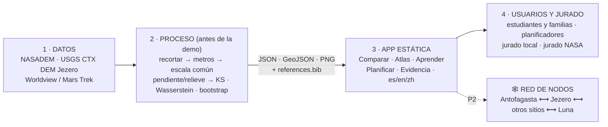

# 🧭 PIZARRA DEL EQUIPO · Plan maestro en competencia

> Hackathon en curso: **sábado 14 y domingo 15 de noviembre de 2026**. Fuente de las reglas: los PDF oficiales del 13-nov (*Judging & Awards Guide* y *Project Submission Guide*), que coinciden con [`00_desafio/03`](00_desafio/03_rubrica_oficial_global_2026.md).
> **Arquitectura visual:** [`05_plan_ejecucion/08_arquitectura_proyecto.excalidraw`](05_plan_ejecucion/08_arquitectura_proyecto.excalidraw) → descárgalo y arrástralo a [excalidraw.com](https://excalidraw.com) para verlo y editarlo.

---

## 1. LO QUE SÍ O SÍ HAY QUE CUMPLIR (copiar a la pizarra)

### 🌍 GLOBAL (NASA): si falla uno, no hay juzgamiento global
- [ ] Todos registrados en la **misma sede (Antofagasta)**, sin lista de espera, en la pestaña *Members* (máx. 6).
- [ ] Desafío oficial: *Identify Earth Locations that Analog the Permanent Moon Base Locations and Mars*.
- [ ] **Todos** los campos de la página de proyecto, **en INGLÉS**.
- [ ] Demo: **video ≤ 30 s** (puede hablarse en español **con subtítulos en inglés**) **o ≤ 7 slides en inglés**.
- [ ] Links públicos **sin login** (probar en ventana privada).
- [ ] Al menos **un dataset NASA** nombrado con precisión en el campo *NASA Data*.
- [ ] **Todas** las fuentes en *References* (datos, código, imágenes, tipografías, íconos).
- [ ] IA declarada; imágenes y video generados con IA **con marca de agua visible**; **cero logos NASA**.
- [ ] **Ningún menor reconocible** (cara, voz o nombre).
- [ ] Marcar las dos casillas y presionar **Submit for Judging** antes del **domingo 23:59** (meta: 20:00).

### 📍 LOCAL (jurado de la sede + La Araucana)
- [ ] Mismos **5 criterios NASA**, 1 a 5 cada uno: **Impact · Creativity · Validity · Relevance · Presentation**.
- [ ] **Demo en vivo** que funcione en un celular.
- [ ] Pitch ~**3 min + 2 min de preguntas**, una sola persona expone (confirmar formato con la Local Lead).
- [ ] Mostrar los **4 objetivos de La Araucana**: ciencia de frontera · STEAM y empleabilidad · aplicación local · red interregional.
- [ ] Metas ODS que declara La Araucana: **4.3 · 4.4 · 9.5 · 17.3 · 17.16 · 17.17** (sin cifras inventadas).
- [ ] Logos de La Araucana, UCN o Space Apps **solo con permiso escrito**.

### 🔬 CIENCIA (lo que más va a pesar con este jurado)
- [ ] **Una comparación real**, no maqueta: Jezero ↔ un sector de Antofagasta.
- [ ] **Misma escala** en Tierra y Marte (remuestrear a ≥ 30 m) y unidades en metros.
- [ ] Comparar **distribuciones** con una distancia definida (KS o Wasserstein) e **incertidumbre** (bootstrap).
- [ ] Decir **qué NO se parece**: gravedad 0,38 g · atmósfera de CO₂ ~0,6 kPa · **radiación** · temperatura.
- [ ] Atacama clásico (Yungay) como **control**; sumar un sector **poco estudiado**.
- [ ] **Nunca** "87 %", "idéntico a Marte" ni pendientes "seguras" universales.

---

## 2. Fases del proyecto y qué pedirle a cada agente

| Hora | Fase | Hecho cuando… | Pedido al agente (Claude Code) |
|---|---|---|---|
| **Ahora** | Nombre + idea decididos **por personas** | frase de una línea anotada en `AI_DISCLOSURE.md` | — (la IA no idea la solución) |
| +30 min | Repo creado + skills | `install-skills.sh` corrió; Pages/Vercel activo | *"Lee CLAUDE.md y PIZARRA.md de hackanasa. Haznos preguntas (grill-me) hasta cerrar el brief."* |
| +1 h | Especificación | `docs/spec.md` aprobado | *"Usa EGM: egm-draft y luego egm-review sobre docs/spec.md."* |
| +1 h → +5 h | **Datos (P0)** | JSON con histogramas de pendiente Jezero y sector, con fuente | *"Script Python: recorta, reproyecta a metros, remuestrea a 30 m, calcula pendiente y relieve, compara con KS y Wasserstein, bootstrap 95 %. Tests con tdd."* |
| +1 h → +5 h | **App (P0)** | pantalla Comparar desplegada, 3 idiomas | *"Crea con prototype la pantalla Comparar en React + Vite + TS con react-i18next (es/en/zh) que lea data/*.json."* |
| **Sáb 18:00** | **GATE P0** + envío preliminar | página guardada y *Submit* una vez | *"Usa validador-space-apps-2026 en modo pre-envío."* |
| Sáb noche | P1: Aprender, Planificar, Atlas, pictogramas | micro-reto funciona | *"Con anatomy, un pictograma de un rover probando pendientes."* |
| Dom AM | Pulido y accesibilidad | sin errores críticos de axe | *"Usa better-accessibility e impeccable critique."* |
| Dom 12:00 | Video 30 s + pitch 3 min | cronometrados | *"Usa pitch-storytelling-space-apps."* |
| **Dom ≤ 20:00** | **Envío final** | captura del banner de confirmación | *"validador modo pre-envío: cero FALLA."* |

**3D mobile-first** (inspirado en ER-6 Terrain Explorer): empieza **solo después** de tener la comparación real. Plan y pedidos para agentes en [`05_plan_ejecucion/09_experiencia_3d_mobile_first.md`](05_plan_ejecucion/09_experiencia_3d_mobile_first.md).

**Regla de recorte:** si a las 18:00 del sábado no hay P0, se elimina todo P1 y P2. Nunca se inventan datos.

---

## 3. Arquitectura (resumen; versión dibujada en Excalidraw)

---

## 4. Datos NASA disponibles para el desafío

> 📄 Documento completo (inventario, preparación, estadística, limitaciones y citas): [`02_investigacion_global/11_paper_datos_desafio.md`](02_investigacion_global/11_paper_datos_desafio.md)

| Para qué | Producto exacto | Dónde | Notas |
|---|---|---|---|
| **Tierra · relieve (núcleo)** | **NASADEM_HGT v001** | NASA Earthdata Search (LP DAAC) · Google Earth Engine `NASA/NASADEM_HGT/001` | Requiere cuenta Earthdata (gratis). ~30 m |
| **Marte · relieve (núcleo)** | **Mars 2020 Science Investigation CTX DEM Mosaic (Jezero)** | USGS Astrogeology | **20 m/píxel**, GeoTIFF |
| Marte · detalle (P1) | HiRISE DTM de Jezero | HiRISE / PDS | ~1 m; solo zonas pequeñas |
| Marte · contexto global | MOLA MEGDR | PDS Geosciences | ~463 m |
| Mapas base sin procesar | **NASA Worldview / GIBS** ⭐ · **Mars Trek / Moon Trek** | WMTS directo en MapLibre | sin login |
| Búsqueda general | **Earthdata Search** ⭐ · **PDS** ⭐ | recursos oficiales del desafío | — |
| Luna (P2) | **LRO LOLA** ⭐ (DEM polar) · **Diviner** ⭐ (temperatura) | PDS / LRO | nodo lunar |
| Agencias socias ⭐ | ESA Copernicus GLO-30 · JAXA G-Portal / ALOS AW3D30 · CSA RADARSAT | portales de cada agencia | suman en *Relevance* |

⭐ = recomendado en la pestaña *Resources* del desafío. CNSA no va en el núcleo (política de NASA con China).

**Plan B si Earthdata se cae o tarda:** usar NASADEM desde Google Earth Engine, o Copernicus GLO-30 (ESA, agencia socia) dejando NASADEM declarado como dataset objetivo.

---

## 5. Estudio del jurado (perfil profesional público)

> Solo información académica pública (perfiles institucionales, ANID). Nombres verificados: el jurado es **mayoritariamente de ciencias exactas**. Esto sube el peso real de *Validity*.

| Jurado | Perfil público | Qué le va a importar | Cómo ganarlo |
|---|---|---|---|
| **Dr. Sergio Curilef Huichalaf** (UCN, Física) | Profesor titular; doctor en Física (CBPF, Brasil); sistemas complejos y mecánica estadística; dirigió el Departamento de Física; analizó con datos la pandemia en la región | Que el resultado salga de **distribuciones**, no de un promedio o un porcentaje mágico; sensibilidad a la escala | Mostrar histogramas superpuestos y cómo cambia el resultado al cambiar la resolución |
| **Dr. Jorge Littin Curinao** (UCN, Matemáticas) | Probabilidad y modelación estocástica (cadenas de Markov, procesos de nacimiento y muerte, medidas de Gibbs); claustro del Doctorado en Matemática | **Definición matemática** de la similitud e **incertidumbre** | Nombrar la distancia (Kolmogorov-Smirnov o Wasserstein-1), dar **intervalo bootstrap** y advertir que píxeles vecinos no son independientes (bootstrap por bloques) |
| **Dr. Alessio Porcelli** (Universidad de Antofagasta, Astronomía) | Astropartículas: SWGO (observatorio de rayos gamma en Pampa La Bola, Atacama), antes Pierre Auger e IceTop; investigador principal en rayos cósmicos (*muon puzzle*); coordina divulgación de SWGO en Chile y Sudamérica | **Radiación** como brecha real; rigor de análisis; divulgación científica | Decir sin rodeos que la altura de Atacama **no** reproduce la radiación de la superficie marciana (Curiosity/RAD midió ~0,64 mSv por día; Hassler et al., 2014, *Science*). Valorará la capa educativa |
| **Dr. Wai-Houng Chou Kam** (UCN, Ciencias Farmacéuticas) | Químico farmacéutico, doctor en Ciencias Farmacéuticas (U. de Chile); nanomedicina, liberación de fármacos y medicina personalizada; comentarista en Congreso Futuro Antofagasta 2026 (origen de la vida y exploración del universo) | **Para qué le sirve a las personas**; claridad para no especialistas; límites en biología y habitabilidad | Explicar sin jerga; decir que el P0 trata de terreno para robots, no de vida ni de salud; mostrar el camino hacia ensayos que protegen a personas |

**Preguntas probables (respuesta en ≤ 20 s cada una):**
1. *¿Cómo definen "parecido"?* → Comparamos distribuciones de pendiente y relieve a la misma escala con KS/Wasserstein; mostramos el intervalo de confianza.
2. *¿Por qué esa resolución?* → El DEM de Marte es de 20 m y NASADEM de ~30 m; remuestreamos ambos a 30 m para no inventar detalle.
3. *¿Qué no reproduce Atacama?* → Gravedad, atmósfera, radiación y temperatura. Lo decimos en pantalla.
4. *¿Por qué no Yungay, si ya está estudiado?* → Es nuestro control: si el método no lo reconoce, el método falla. El aporte es el sector nuevo.
5. *¿Es seguro para un rover?* → No certificamos: preseleccionamos para un ensayo.
6. *¿Qué gana la región?* → Acceso gratis a ciencia de frontera en 3 idiomas y un método que otras sedes pueden replicar.
7. *¿Usaron IA?* → Para programar y traducir, declarada y revisada. La idea y los datos son nuestros y verificables.

**Cómo encantar al jurado (local y global):**
- Abrir con **un lugar real de la región** y su histograma junto al de Jezero, **en vivo**.
- **Un solo número bien definido**, con su incertidumbre, mejor que diez porcentajes.
- **La fuente visible** en cada gráfico ("NASA NASADEM · USGS CTX DEM").
- **Decir el límite antes de que lo pregunten** (radiación, gravedad): con este jurado eso suma más que cualquier efecto visual.
- Cambiar de idioma en vivo (es → en → zh): "la ciencia es un idioma mundial".
- Cerrar con la red: otra sede o país puede sumar su nodo con el mismo método.

---

## 6. Stack y librerías: qué usar para qué

| Necesidad | Usar (licencia) | Para qué | Alternativa | No usar |
|---|---|---|---|---|
| Leer y escribir DEM | **rasterio** (BSD) · **GDAL** `gdalwarp` (MIT) | abrir GeoTIFF, reproyectar a metros, remuestrear | QGIS a mano | — |
| Pendiente y relieve | **numpy** (BSD) | gradiente en metros → pendiente en grados; relieve = máx − mín en ventana | `gdaldem slope` | — |
| Estadística | **scipy.stats** (BSD): `ks_2samp`, `wasserstein_distance` | distancia entre distribuciones | — | porcentajes de "similitud" sin definir |
| Incertidumbre | numpy (bootstrap por bloques) | intervalo de confianza 95 % | — | — |
| Revisión visual | **QGIS** | verificar coordenadas y vacíos | matplotlib | — |
| App | **React 19 + Vite 8 + TypeScript** (MIT/Apache) | SPA estática | — | backend, base de datos |
| Idiomas | **react-i18next** (MIT) | es · en · zh | — | textos sueltos |
| Mapas | **MapLibre GL 6** (BSD-3) | sector terrestre + WMTS de Worldview | Leaflet | Mapbox con token |
| Gráficos | **Plotly.js** vía `react-plotly.js` (MIT) | histogramas y perfiles | Observable Plot (más liviano) | — |
| Movimiento | **Motion** (MIT) · **Hairline** (MIT) | capas de papel, figuras isométricas | CSS puro | GSAP (licencia no OSI) |
| Pruebas | **Vitest** (MIT) · Playwright vía `webapp-testing` | que cada dato tenga fuente; que la demo cargue | — | — |
| Publicar | **Vercel** o **GitHub Pages** | link público sin login | Netlify | — |

**Fuera del P0:** 3D, chatbot de IA, backend.

---

## 7. Lluvia de nombres con identidad andina y del desierto

**Criterios:** corto, pronunciable en español, inglés y chino; liga Atacama o los Andes con el desafío (análogo, camino, Luna o Marte); con significado verificable. **Las palabras de pueblos originarios se usan con respeto, explicando su significado y su origen**; si se usa una palabra kunza (lengua lickanantay), verificarla en una fuente lingüística antes de publicarla.

| # | Nombre | Origen y significado | Por qué calza con el desafío | Riesgo |
|---|---|---|---|---|
| ⭐ 1 | **APACHETA** | Andino (quechua/aymara): montículo de piedras que marca la ruta en pasos de altura; cada viajero agrega una piedra | Cada análogo es una **señal en el camino a Marte**, y cada comunidad agrega su piedra = **la red de nodos** y la "red interregional" de La Araucana | Bajo; explicarlo en el pitch |
| ⭐ 2 | **TAMBO** | Quechua: posada o estación en los caminos andinos | "Bases en la Tierra para bases en la Luna y Marte": responde a *Permanent Moon Base* | Bajo |
| 3 | **ATACAMA LOOP** | Propuesta de Isabeau: Atacama + el ciclo comparar → aprender → planificar | Claro y local | El desafío marca Atacama como "ya muy estudiado": el contenido debe ir más allá |
| 4 | **KILLA PACHA** | Quechua: *Killa* = Luna · *Pacha* = tierra / mundo | Literalmente "Luna-Tierra": un mundo leído con los datos del otro | Dos palabras; verificar la combinación |
| 5 | **PACHA TWIN** | Quechua *Pacha* (tierra, mundo) + inglés *twin* | Gemelos planetarios, bilingüe por diseño | Mezcla de idiomas |
| 6 | **CAMANCHACA** | Chilenismo del norte: la niebla costera de Antofagasta | Identidad 100 % local; metáfora de "ver a través de la niebla" con datos | No se liga directo con análogos |
| 7 | **CHAJNANTOR** | Topónimo del llano donde está ALMA; se cita como "lugar de despegue" en kunza | Despegue hacia otros mundos desde Atacama | Es un lugar real y famoso (ALMA): confusión |
| 8 | **WAYRA** | Quechua: viento | Procesos eólicos y polvo, comunes a Atacama y Marte | El P0 trata de relieve, no de viento |
| 9 | **CAICHI** / **PURI** | Kunza, según la investigación del repo: piedra / agua | Roca + agua oculta: la ecuación de una base permanente | **Verificar en fuente kunza antes de usar** |
| 10 | **HUELLA ANDINA** · *Andean Trace* | Español + inglés | Antes de dejar huellas en Marte, leemos las de los Andes | Genérico |

**Fórmula recomendada:** nombre propio + descriptor en inglés, por ejemplo **APACHETA · *Earth–Mars Terrain Analog Network*** o **TAMBO · *Earth Bases for Moon & Mars***. El nombre del repo, en minúsculas y sin tildes: `apacheta`, `tambo-analogs`, `atacama-loop`.

**Frase de pitch con APACHETA (borrador para que el equipo la reescriba):**
> *"Por siglos, quienes cruzaban los Andes dejaron una piedra en la apacheta para marcar el camino. Nosotros dejamos la primera piedra de un camino a Marte: un sector de Antofagasta comparado con Jezero, con datos abiertos de NASA. Cualquier comunidad puede agregar la suya."*

---

## Fuentes de esta pizarra
- *Judging & Awards Guide* y *Project Submission Guide* 2026 (PDF del 13-nov-2026 entregados por el equipo; [versión web](https://www.spaceappschallenge.org/resources/judging-awards-guide/)).
- Jurado (perfiles públicos): [ANID · Sergio Curilef](https://investigadores.anid.cl/es/public_search/researcher?id=3545) · [ANID · Jorge Littin](https://investigadores.anid.cl/en/public_search/researcher?id=36209) · [ResearchGate · Jorge Littin](https://www.researchgate.net/profile/Jorge-Littin) · [UA · Alessio Porcelli](https://astro.uantof.cl/nosotros/equipo-de-trabajo/alessio-porcelli/) · [UCN · Wai-Houng Chou Kam](https://facultadcienciasucn.cl/wai-houng-chou-kam/) · [ANID · Wai-Houng Chou Kam](https://investigadores.anid.cl/es/public_search/researcher?id=43869) · [Congreso Futuro Antofagasta 2026](https://investigacion.ucn.cl/el-origen-de-la-vida-y-la-exploracion-del-universo-en-congreso-futuro-antofagasta-2026/)
- Radiación en Marte: Hassler, D. M. et al. (2014). *Mars' Surface Radiation Environment Measured with the Mars Science Laboratory's Curiosity Rover.* *Science*, 343(6169).
- Objetivos de La Araucana: [Pacto Global Chile · Conecta](https://conecta.pactoglobal.cl/casos-de-empresas/nasa-space-apps-challenge-chile-ciencia-innovacion-y-colaboracion-global-desde-el-territorio/).
