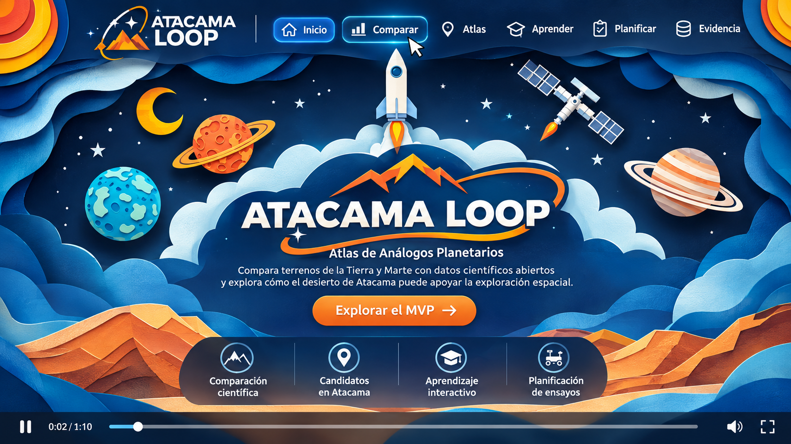
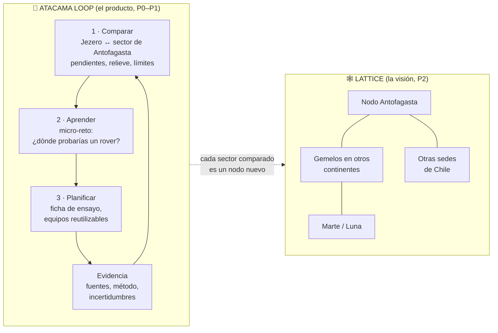
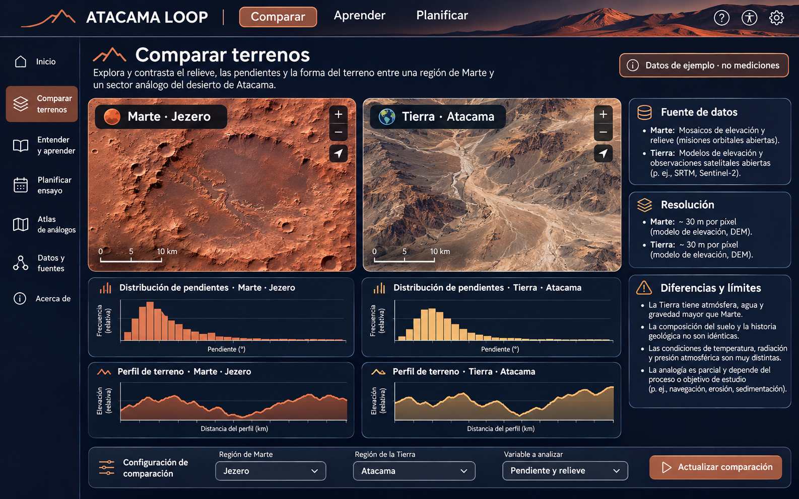
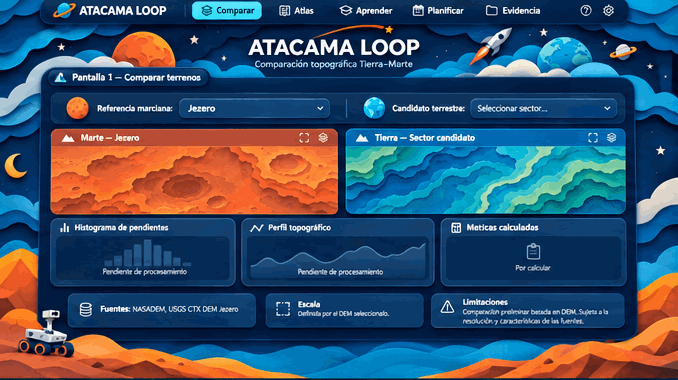

# 🛰️ Lattices Team · ATACAMA LOOP
### NASA International Space Apps Challenge 2026 · Sede Antofagasta (UCN) · Chile 🇨🇱
**Desafío:** *Identify Earth Locations that Analog the Permanent Moon Base Locations and Mars*

Maqueta conceptual generada con IA por Isabeau Valverde. Ilustrativa: no es la entrega ni muestra resultados.

**Comparar con evidencia → aprender con los resultados → planificar un ensayo.**
*La ciencia es un idioma mundial: un kelvin es un kelvin en español, inglés o chino.*

[**🚀 Empezar el Día 1**](INICIO_DIA_1.md) · [**📏 Rúbrica oficial 2026**](00_desafio/03_rubrica_oficial_global_2026.md) · [**🏛️ La Araucana**](00_desafio/05_lente_la_araucana_y_estrategia_doble_rol.md) · [**🧭 Plan maestro**](05_plan_ejecucion/07_plan_maestro_recursos_e_instalacion.md) · [**🧪 Aporte de Isabeau**](aportes/isabeau/REVISION.md)

---

## 📍 Estado (13-nov-2026, víspera del hackathon)

- **Investigación lista.** Este repo **no contiene código de la aplicación**: solo información, reglas, skills y plantillas. El código se escribe desde el **sábado 14-nov a las 09:00** en un repo nuevo.
- **Propuesta de producto:** *ATACAMA LOOP* (Isabeau Valverde) como núcleo construible, dentro de la visión de red *Lattice* del equipo. **La decisión final la toma el equipo el sábado**, sin IA, y se registra en `AI_DISCLOSURE.md`.
- **Entrega:** cierra el **domingo 15-nov a las 23:59** hora de Chile. Meta interna: enviar antes de las 20:00.

---

## 1. La propuesta en 30 segundos (SCR)

- **Situación:** la Luna y Marte se preparan con ensayos en la Tierra, en lugares que "se parecen".
- **Complicación:** dos paisajes pueden parecerse en una foto y ser muy distintos en sus propiedades. Además, Atacama ya es de los análogos más estudiados del mundo, y no está claro **qué** de él sirve para **qué** ensayo.
- **Resolución:** **ATACAMA LOOP** compara una zona de Marte (cráter **Jezero**) con sectores de la región de Antofagasta usando modelos de elevación abiertos de NASA y USGS. Muestra qué es comparable, **qué no**, y para qué ensayo preliminar de exploración robótica podría servir cada sector. Es una herramienta de **preselección**, no un certificado de rutas seguras.

> *«ATACAMA LOOP no dice que Atacama sea Marte. Demuestra qué aspectos de ciertos terrenos pueden compararse mediante datos y convierte esa evidencia en aprendizaje y planificación de futuros ensayos».* — Isabeau Valverde

---

## 2. Loop + Lattice: el producto y la visión

- **Loop:** el ciclo que el usuario recorre (comparar → aprender → planificar → evidencia → volver a comparar).
- **Lattice:** cada comparación terminada es un **nodo** de una red abierta. Otra sede, otro país u otra comunidad puede sumar el suyo con el mismo método, sin base de datos (un *pull request*). Es el puente **local → regional → global** y responde directamente al objetivo de La Araucana de **"consolidar una red interregional de innovación"**.

---

## 3. Cómo cumple las tres capas de evaluación

| Nivel | Quién evalúa | Qué pide | Cómo responde el proyecto |
|---|---|---|---|
| 🌍 **Global** | Jueces expertos y comité ejecutivo de NASA y agencias socias | 5 criterios, 1–5 cada uno: **Impact, Creativity, Validity, Relevance, Presentation**; datos NASA en el núcleo; página en inglés; demo ≤ 30 s o ≤ 7 slides | Comparación **real y reproducible** con NASADEM + USGS CTX DEM; límites visibles; método abierto replicable en cualquier lugar (*lattice*) |
| 🇨🇱 **Nacional / regional** | Caja La Araucana (organizador en Chile) | **4 objetivos oficiales:** democratizar la ciencia de frontera · competencias STEAM y empleabilidad · soluciones con aplicación local · red interregional de innovación. Metas ODS declaradas: **4.3, 4.4, 9.5, 17.3, 17.16, 17.17** | Plataforma gratuita y trilingüe · micro-reto que enseña a leer datos · sectores de Antofagasta · red de nodos abierta a otras sedes |
| 📍 **Local** | Jurado de la sede Antofagasta (UCN) en el Demo Day | Los mismos 5 criterios NASA; pitch en vivo (formato a confirmar; preparar **3 min + 2 min de preguntas**, como en Nómada) | Demo en vivo en celular · persona y territorio de la región · mentor de la UCN |

Detalle: [rúbrica NASA](00_desafio/03_rubrica_oficial_global_2026.md) · [La Araucana](00_desafio/05_lente_la_araucana_y_estrategia_doble_rol.md) · [Nómada](00_desafio/06_rubrica_nomada_usqai_y_cruce.md) · [ganadores 2025](00_desafio/04_ganadores_2025_global_y_chile.md).

---

## 4. El producto: cinco pantallas, tres funciones

| Función | Pantalla | Parte del proyecto | Muestra o permite |
|---|---|---|---|
| **Comparar** (núcleo científico) | 1 · Comparar terrenos | 🅱️ Misión (global) | Selector Jezero ↔ sector; mapas lado a lado; histogramas de pendientes; perfiles; indicadores calculados; fuentes, escala y límites |
| | 2 · Atlas de candidatos *(pestaña)* | 🅱️ | Hasta 3 sectores con ficha, ubicación verificada y utilidad **potencial** |
| | 5 · Evidencia científica *(pestaña)* | 🅱️ | Datasets, resoluciones, método, fecha de procesamiento, incertidumbres y código |
| **Aprender** (educación y accesibilidad) | 3 · Aprender | 🅰️ Explorador (local) | Micro-reto **"¿Dónde probarías un rover?"** con retroalimentación basada en los datos calculados |
| **Planificar** (versión sencilla) | 4 · Planificar ensayo | 🅰️ | Objetivo, terreno, equipos, préstamo o reutilización, acceso, costos por cotizar y riesgos |

  
  

Maquetas de Isabeau Valverde, rotuladas "datos de ejemplo · no mediciones". Demos conceptuales: <a href="aportes/isabeau/video/demo-conceptual-43s.mp4">43 s</a> · <a href="aportes/isabeau/video/demo-conceptual-70s.mp4">70 s</a> (la demo para NASA debe durar ≤ 30 s).

**Recorrido mínimo de la demo:** elegir Jezero y un sector → ver **una comparación realmente calculada** → explicar semejanzas y límites → resolver el micro-reto → ver la ficha del ensayo y las fuentes.

---

## 5. Alcance por prioridad (recortar, nunca inventar)

| Prioridad | Qué entra | Listo cuando… |
|---|---|---|
| **P0** · sáb 18:00 | **Una** comparación real Jezero ↔ un sector (Yungay o Cordillera de la Sal como **control** conocido) · pantalla Comparar con fuentes y límites · micro-reto · 3 idiomas · desplegado | abre en un celular, sin login, en ventana privada |
| **P1** · sáb noche | Atlas con hasta 3 sectores, **incluido uno poco estudiado** propuesto por el propio método en la región de Antofagasta · Planificar · pictogramas (Anatomy) | cada sector tiene ficha y fuente |
| **P2** · si sobra tiempo | La *lattice*: gemelos en otros continentes y un nodo lunar · capas de papel desde curvas de nivel reales | — |

**Por qué el sector poco estudiado importa:** la página del desafío dice que no basta con redescubrir análogos conocidos y nombra al **Desierto de Atacama** entre los "ya muy estudiados". Atacama clásico sirve como control; la sorpresa tiene que ser otra.

**Lo que nunca se hace:** inventar porcentajes de semejanza, resultados de aprendizaje, ahorro de carbono, empleos, permisos o alianzas; usar 15° de pendiente como regla universal de seguridad para rovers; decir que la Tierra reproduce la gravedad, la atmósfera o la radiación de Marte.

---

## 6. Datos abiertos del núcleo

| Cuerpo | Dataset | Resolución | Uso |
|---|---|---|---|
| 🌍 Tierra | **NASADEM** (NASA Earthdata) | 1 segundo de arco (~30 m norte-sur) | Pendientes y relieve local de los sectores |
| 🔴 Marte | **USGS CTX DEM Mosaic, Jezero** (Mars 2020) | **20 m/píxel** (no confundir con la resolución de las fotos CTX) | Pendientes y relieve de Jezero |
| 🌍 Apoyo | NASA Worldview / GIBS ⭐, Copernicus GLO-30 (ESA ⭐), JAXA G-Portal ⭐, CSA RADARSAT ⭐ | variable | Contexto visual y validación cruzada |
| 🔴🌑 P2 | MOLA, HiRISE, LRO LOLA y Diviner ⭐ (PDS) | variable | Nodos adicionales de la *lattice* |

⭐ = recurso recomendado en la página oficial del desafío. **Método:** delimitar áreas de extensión comparable → verificar proyecciones, unidades y vacíos → **armonizar a una escala común** (los dos DEM tienen distinta resolución) → calcular pendientes y relieve local → comparar distribuciones → explicar incertidumbres.

**Flujo:** `NASADEM + CTX DEM Jezero → Python/QGIS → JSON, GeoJSON y mapas preparados → app estática`. Todo se procesa **antes** de la demo; no hay servidor.

Catálogo completo: [`02_investigacion_global/04`](02_investigacion_global/04_datasets_recursos_libres.md) · [`09`](02_investigacion_global/09_apis_multiagencia_recursos_construccion.md).

---

## 7. Stack final (reconciliado: propuesta de Isabeau + requisitos del equipo)

Versiones y licencias verificadas en npm el 13-nov-2026. Todo con licencia OSI.

| Capa | Herramienta | Por qué |
|---|---|---|
| App | **React 19 + Vite 8 + TypeScript** | Lo propone Isabeau y lo domina el equipo; el ecosistema elegido (Hairline, Motion) es React |
| Idiomas | **react-i18next 18** (es · en · zh) | Trilingüe desde el día 1; el inglés es obligatorio para NASA |
| Mapas | **MapLibre GL 6** | Sectores terrestres; Marte en un visor raster aparte |
| Gráficos | **Plotly.js 4** (`plotly.js-dist-min`) | Histogramas y perfiles. Si pesa demasiado en celular: Observable Plot |
| Movimiento | **Motion 14** + **Hairline 0.5** | Capas de papel y figuras isométricas; se apagan con `prefers-reduced-motion` |
| Ciencia | **Python + NumPy + Rasterio**, **QGIS** | Procesar DEM y revisar calidad |
| Datos | **JSON / GeoJSON** + `references.bib` | Archivos estáticos; cada dato con su fuente |
| Publicación | **Vercel** o **GitHub Pages** | Link público sin login |
| Fuera del P0 | Sin chatbot de IA, sin backend, sin 3D | Simplicidad y cero datos personales |

Las decisiones anteriores (Astro, Tailwind, R3F) quedan como alternativas en [`05_plan_ejecucion/06`](05_plan_ejecucion/06_dos_partes_stack_motion_identidad.md) y [`07`](05_plan_ejecucion/07_plan_maestro_recursos_e_instalacion.md).

---

## 8. Equipo, roles y skills

| Rol (propuesta de Isabeau) | Responsable | Skills y herramientas que lo apoyan |
|---|---|---|
| **Datos:** procesar NASADEM y Jezero, entregar estadísticas y gráficos reales | Estudiante de informática + apoyo técnico | Python/QGIS · `tdd` · `diagnosing-bugs` |
| **Programación:** pantalla Comparar en React, integrar archivos, publicar | Programador | `prototype` · `frontend-design` · `webapp-testing` · `code-review` |
| **Validación científica:** lógica del ensayo, escala y límites de los cálculos | Estudiante de ingeniería civil + mentor | Google EGM (revisión con ojos frescos) · `validador-space-apps-2026` |
| **Coordinación:** micro-reto, accesibilidad, fichas, fuentes, validación y pitch | Información y control de gestión | `pitch-storytelling-space-apps` · `better-accessibility` · `impeccable` · `anatomy` |

**Skills del equipo** (instalador con commits fijados en [`plantillas/repo-hackathon/`](plantillas/repo-hackathon/)):
- **Propias:** [`validador-space-apps-2026`](.agents/skills/validador-space-apps-2026/SKILL.md) (puertas duras + rúbrica NASA + objetivos La Araucana) · [`pitch-storytelling-space-apps`](.agents/skills/pitch-storytelling-space-apps/SKILL.md) (patrones de los 10 ganadores 2025) · agente [`juez-validador-space-apps-2026`](.agents/agents/juez-validador-space-apps-2026/agent.md).
- **Externas, 16 fijadas:** EGM (plugin) · Matt Pocock (5) · Anatomy · Impeccable · jakubkrehel (4) · Archify · Anthropic `frontend-design` y `webapp-testing` · web-quality (2).
- **Experiencia previa que aplica:** 1.er lugar regional en **Nómada (USQAI-UCN)** → formato de pitch de 3 min + 2 min y estructura problema → solución → prototipo → modelo → comunicación.

---

## 9. Identidad visual

- **Capas de papel**, azul oscuro y celeste + **naranja Atacama** (aprobada en la propuesta de Isabeau). Navegación clara: `Comparar · Atlas · Aprender · Planificar · Evidencia`. **Legibilidad y accesibilidad antes que efectos.**
- **Las capas pueden ser curvas de nivel reales** del DEM: el estilo artesanal muestra el dato.
- **Credibilidad científica:** dibujar la Luna, la Tierra y Marte reales (sin anillos decorativos) y rotular escala y fuente en cada mapa.
- **Prohibido:** insignia o logotipo de NASA y logos de agencias o patrocinadores sin permiso escrito. Imágenes generadas con IA → marca de agua visible. Detalle en [`00_desafio/07`](00_desafio/07_pitch_storytelling_ganadores_y_logos.md) §4.

---

## 10. Reglas no negociables

1. Datos abiertos y **citados desde el día 1**; al menos un dataset NASA en el núcleo.
2. **Decir lo que no se parece** (gravedad 0,38 g, atmósfera de ~0,6 kPa de CO₂, radiación, temperatura).
3. Trilingüe: español, inglés y chino simplificado. Las traducciones con IA se declaran y las revisa una persona.
4. Sin base de datos, cuentas, cookies ni analítica. **Sin menores reconocibles** en imágenes, voces o video.
5. La IA ayuda a construir, **no inventa la idea** (regla "Super Intelligence" de NASA).
6. Ninguna colaboración con entidades chinas (política de NASA); el idioma chino sí está permitido.
7. Licencia OSI en todo; GSAP descartado.

---

## 11. Mapa del repositorio

| Carpeta / archivo | Contenido |
|---|---|
| [`INICIO_DIA_1.md`](INICIO_DIA_1.md) | **Paso a paso del sábado:** checklist, preguntas a la Local Lead, comandos del repo nuevo, cronograma y checklist de envío |
| [`aportes/isabeau/`](aportes/isabeau/) | Propuesta ATACAMA LOOP, maquetas, demos conceptuales y [revisión](aportes/isabeau/REVISION.md) |
| [`00_desafio/`](00_desafio/) | Desafío, rúbrica oficial 2026, ganadores 2025, La Araucana, Nómada, storytelling y logos |
| [`01_mckinsey/`](01_mckinsey/) | Estructuración del problema (SCQ, MECE, hipótesis) |
| [`02_investigacion_global/`](02_investigacion_global/) | Sitios lunares y marcianos, 64 análogos terrestres, datasets, APIs y bibliografía |
| [`03_lluvia_ideas/`](03_lluvia_ideas/) | Lluvia de ideas, impacto humano y ODS, identidad de marca |
| [`04_propuestas/`](04_propuestas/) | Las 9 propuestas previas y su matriz de evaluación |
| [`05_plan_ejecucion/`](05_plan_ejecucion/) | Arquitectura, roadmap, riesgos, dos partes y stack, plan maestro de recursos |
| [`plantillas/repo-hackathon/`](plantillas/repo-hackathon/) | `CLAUDE.md`, `AI_DISCLOSURE.md`, `SECURITY.md`, `CITATION.cff` e instalador de skills |
| [`.agents/`](.agents/) · [`.claude/`](.claude/) | Agentes y skills del equipo |
| [`README_INVESTIGACION.md`](README_INVESTIGACION.md) | El README anterior: *war room* TERRA·TWIN 4D, 9 propuestas y brechas Chile/mundo |
| [`99_fuentes/`](99_fuentes/referencias.md) | Trazabilidad de fuentes |

---

## 12. Pendientes que no dependen de nosotros

- **Bases o rúbrica propia del jurado local** de La Araucana y formato exacto del Demo Day → preguntar a la Local Lead al llegar.
- **Permiso escrito** si se quiere usar el logo de La Araucana, UCN o Space Apps en el pitch local.
- **Skill Nómada de GPT** (carpeta de Drive con inicio de sesión) y el link de *text-to-card*.

---

<b>Lattices Team</b> · Antofagasta, Chile · Propuesta ATACAMA LOOP e investigación de los objetivos de La Araucana: <b>Isabeau Valverde</b> · Investigación, estrategia y skills: <b>Delnr91</b> Ciencia abierta · Datos de NASA y agencias socias · Sin datos personales

