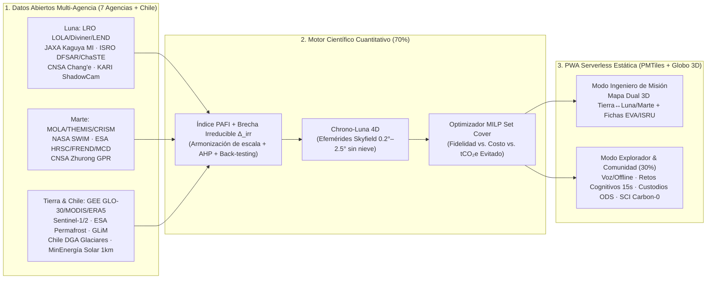

# 🛰️ TERRA·TWIN 4D — Planetary Analog Intelligence War Room
### **NASA International Space Apps Challenge 2026 · *"The Next Frontier"***
**Challenge:** *Identify Earth Locations that Analog the Permanent Moon Base Locations and Mars*

*Repositorio estratégico de investigación científica, estructuración McKinsey, catálogo global de APIs espaciales abiertas y cartera de **9 propuestas de solución** diseñado para alinear al equipo antes de las 48 horas de construcción.*

[**🎯 El Desafío**](00_desafio/01_brief_desafio.md) · [**🚀 Las 9 Propuestas**](04_propuestas/01_propuestas_solucion.md) · [**🎨 Nombre, Logo & UX Local**](03_lluvia_ideas/03_identidad_marca_logo_ux_ui.md) · [**🇨🇱 Brechas Chile & Global**](02_investigacion_global/08_brechas_chile_y_oportunidades_globales.md) · [**🇷🇺🇨🇳🇯🇵 Rusia/China/Japón**](02_investigacion_global/10_inteligencia_rusia_china_japon_simuladores.md) · [**🔌 APIs Multi-Agencia**](02_investigacion_global/09_apis_multiagencia_recursos_construccion.md) · [**⚠️ Desafíos Globales**](05_plan_ejecucion/04_desafios_globales_esperados.md)

---

## ⚡ Guía de Lectura en 15 Minutos para el Equipo

Si recién entrás al repositorio, **no hace falta leer los 37 documentos de golpe**. Seguí esta ruta rápida para alinearnos hoy mismo y elegir qué construimos:

1. **Minutos 0–3 (El Problema Exacto):** Leé [`00_desafio/01_brief_desafio.md`](00_desafio/01_brief_desafio.md) y cómo ganaron los campeones mundiales anteriores en [`00_desafio/02_anatomia_ganadores_globales.md`](00_desafio/02_anatomia_ganadores_globales.md).
2. **Minutos 3–8 (Las 9 Propuestas y la Matriz de Decisión):** Revisá la tabla resumen acá abajo y el detalle en [`04_propuestas/01_propuestas_solucion.md`](04_propuestas/01_propuestas_solucion.md) + [`04_propuestas/02_matriz_evaluacion.md`](04_propuestas/02_matriz_evaluacion.md).
3. **Minutos 8–12 (Nuestra Ventaja Injusta en Chile y el Mundo):** Mirá qué **nadie está abordando en Chile ni globalmente** en [`02_investigacion_global/08_brechas_chile_y_oportunidades_globales.md`](02_investigacion_global/08_brechas_chile_y_oportunidades_globales.md).
4. **Minutos 12–15 (Según tu Rol en el Equipo):**
   - **Data Science / GIS / Backend:** [`02_investigacion_global/09_apis_multiagencia_recursos_construccion.md`](02_investigacion_global/09_apis_multiagencia_recursos_construccion.md) + [`02_investigacion_global/05_estado_del_arte_metodos.md`](02_investigacion_global/05_estado_del_arte_metodos.md).
   - **Frontend / 3D / Marca / UX Inclusiva:** [`03_lluvia_ideas/03_identidad_marca_logo_ux_ui.md`](03_lluvia_ideas/03_identidad_marca_logo_ux_ui.md) + [`05_plan_ejecucion/01_arquitectura_tecnica.md`](05_plan_ejecucion/01_arquitectura_tecnica.md) + [`03_lluvia_ideas/02_evaluacion_vision_humana_educativa_ods_carbono.md`](03_lluvia_ideas/02_evaluacion_vision_humana_educativa_ods_carbono.md).
   - **Ciencia Planetaria / Pitch / Estrategia:** [`01_mckinsey/03_arbol_problemas_MECE.md`](01_mckinsey/03_arbol_problemas_MECE.md) + [`05_plan_ejecucion/04_desafios_globales_esperados.md`](05_plan_ejecucion/04_desafios_globales_esperados.md).

> **Garantía de Reglas Space Apps:** Este repositorio contiene **cero líneas de código de la aplicación final**. Reúne exclusivamente investigación científica abierta, ecuaciones físicas, catálogos de APIs públicas, bibliografía revisada por pares y agentes/skills de apoyo permitidos antes del inicio oficial del hackathon.

---

## 🎯 El Desafío Oficial Confirmado (NASA Space Apps 2026)

> *"Selecting future landing sites and lunar base locations depends on many factors, including topography, geology, environment, and available resources, to name a few. Places on Earth that have analogous characteristics to the Moon or Mars – the Atacama Desert, Haughton Crater, Death Valley – allow mission teams to test equipment and methods before they fly; however, such terrestrial analog sites are not entirely well characterized. **Your challenge is to use open Earth, Moon, and Mars data from NASA and other space agencies to identify and characterize new terrestrial analogs for future bases or landing sites, drawing on deserts, polar regions, volcanic and arid terrains, caves, and other environments that share conditions with the lunar or Martian surface, then present your findings as a map, visualization, or other tool.***"

### El Problema Real Visto con Método McKinsey (SCQ + MECE)
- **Situación:** La humanidad transita de misiones cortas de banderas y huellas a **bases permanentes** en el **Polo Sur Lunar** (*Artemis III*, *ILRS*, *LUPEX*) y **zonas ricas en hielo enterrado en Marte** (*Arcadia Planitia*, *Phlegra Montes*, *Oxia/Jezero*).
- **Complicación:** Los sitios análogos clásicos se eligen por costumbre institucional, sufren **sesgo petrológico** (usan volcanes negros basálticos cuando el Polo Sur Lunar es **anortosita clara de Tierras Altas**), son estáticos en 2D (ignoran cuándo ocurre la **iluminación solar rasante de $0.2^\circ\text{–}2.5^\circ$** sin nieve), generan altas emisiones de $\text{CO}_2$ por traslados intercontinentales innecesarios y dejan fuera a las comunidades y nuevas generaciones locales.
- **Pregunta Rectora:** *¿Cómo fusionar datos satelitales abiertos multi-agencia de Tierra, Luna y Marte para descubrir, validar matemáticamente y visualizar en 4D nuevos análogos terrestres en los 5 ambientes clave —optimizando fidelidad física, brecha irreducible, carbono Día 0 e impacto educativo/social?*

---

## 🚀 Cartera de 9 Propuestas + Arquitectura Campeona (`TERRA·TWIN 4D`)

No nos limitamos a una sola idea. Diseñamos **9 propuestas modulares** evaluadas bajo los 5 criterios oficiales del jurado de NASA (*Impact, Creativity, Validity, Relevance, Presentation*):

| ID | Propuesta | Qué Resuelve en una Frase | Fortaleza Competitiva | Score (`/5.0`) |
|---|---|---|---|---|
| **P1** | **PAFI Atlas & Gap Engine** | Índice cuantitativo multicriterio ($\text{PAFI} \in [0,100]$) + cálculo honesto de la **Brecha Física Irreducible ($\Delta^{\text{irr}}$: gravedad, vacío, $40\text{ K}$)** validado contra 35 sitios de control. | Cimiento obligatorio (*Validity 5.0*) | **4.54** |
| **P2** | **Chrono-Luna 4D** ⭐ | Motor astronómico + DEM $30\text{ m}$ + máscara de nieve MODIS que descubre **dónde y en qué semana exacta del año** la Tierra reproduce el **Sol rasante ($0.2^\circ\text{–}2.5^\circ$)** del Polo Sur Lunar. | Factor *Wow* Global (*Creativity 5.0*) | **4.83** |
| **P3** | **Highland Twin (Anortosita)** ⭐ | Corrige el error mundial del basalto cruzando mapas de plagioclasa de **JAXA Kaguya** con macizos de **anortosita polar/árida** (*Fiskenæsset, Lofoten, Sittampundi, Kunene, Nain*). | Autoridad científica ante JPL/USGS | **4.71** |
| **P4** | **Cryo-Mars & Chile 5-en-1** ⭐ | Cruza mapas de hielo marciano **NASA SWIM** con **Glaciares Rocosos (DGA Chile / IANIGLA)** + salares ácidos, impacto, cuevas de lava y polo interior chileno/global. | **Imbatible en Sede Local** + Marte ISRU | **4.68** |
| **P5** | **Mission Portfolio Optimizer** | Optimizador entero (*MILP Set Cover*) que calcula la combinación mínima de 2–4 sitios que cubre $>92\%$ de una misión minimizando presupuesto y $\text{tCO}_2\text{e}$ de aviación. | Ingeniería de Sistemas Aeroespacial | **4.57** |
| **P6** | **Morpho-Embed AI + $\pi$-Scaling** | Búsqueda *zero-shot* de terrenos gemelos con embeddings de 64 dimensiones (**AlphaEarth**) y escalamiento gravitacional de cráteres ($D_E = D_p \cdot g_p/g_E$). | Extensión ML (*Best Use of Tech*) | **4.26** |
| **P7** | **Endangered Planetary Twins** | Índice de riesgo climático (`ERA5` decadal) sobre glaciares rocosos y permafrost que se derriten, preservando digitalmente laboratorios marcianos en peligro. | Narrativa *Galactic Impact* | **4.49** |
| **P8** | **Polyglot Knowledge Graph** | Síntesis estructurada de literatura y parámetros geotécnicos en **12 idiomas** (Ruso *IKI-RAS*, Chino *CAS*, Indio *ISRO*, Japonés *JAXA*, Español, etc.). | Cobertura verdaderamente global | **4.36** |
| **P9** | **Backyard Astronaut, ODS & Carbon-0** ⭐ | Conmutador **Niños/Comunidad (de *influencers* a astronautas)**: ciencia cognitiva activa, PWA por voz/offline sin barrera digital, empleo de *Custodios Locales* y Carbono Día 0 (`ISO 21031`). | Multiplicador Humano, ODS y Local | **4.64** |
| 🏆 | **Ensamble `TERRA·TWIN 4D` (70/30)** | **70 % Núcleo Duro Planetario (`P1+P2+P3+P4+P5`) + 30 % Capa Humana, Cognitiva, Inclusiva y Carbono-Cero (`P9+P7`)** sobre una misma PWA serverless 3D. | **Diseñada para ganar Chile y Top 10 Global** | **4.94** |

---

## 🇨🇱 Ventaja Estratégica: Lo Que NO Se Está Abordando en Chile ni Globalmente

El **95 % de los equipos en Chile** se limita a mencionar *San Pedro de Atacama / Yungay*. Nuestra investigación demuestra con datos públicos abiertos que **Chile es uno de los únicos territorios del planeta que reúne los 5 ambientes textuales exigidos por NASA** (*desiertos, regiones polares, terrenos volcánicos, áridos y cuevas*) a lo largo de un mismo meridiano, junto con descubrimientos globales inéditos (ver [`02_investigacion_global/08_brechas_chile_y_oportunidades_globales.md`](02_investigacion_global/08_brechas_chile_y_oportunidades_globales.md)):

| Ambiente del Prompt NASA | Brecha Chilena Sub-Caracterizada (Ventaja Sede Local) | Descubrimiento Global Sub-Explotado (Ventaja Top 10 Mundial) |
|---|---|---|
| **1. Terrenos Áridos / Geoquímica Extrema** | **Salar de Gorbea & Salar Ignorado** ($25.4^\circ\text{S}$, Atacama): salmueras naturales **hiperácidas ($\text{pH } 1.8\text{–}4.0$)** que precipitan **jarosita y alunita** bajo UV extremo sin contaminación minera (gemelo prístino de *Meridiani Planum*), más costras naturales de **percloratos** en Atacama. | **Playa Dalangtan (Qaidam, China)** — sulfatos de Mg/percloratos; **Matanomadh (Kachchh, India)** — jarosita sobre basaltos Deccan; **Socompa (Puna Argentina)** — estromatolitos vivos en alto UV. |
| **2. Desiertos & Cráteres de Impacto** | **Cráter Monturaqui** ($23.93^\circ\text{S}$, Antofagasta): cráter hiperveloz simple ($\sim 370\text{ m}$) con vidrio de choque Fe-Ni en regolito hiperárido libre de vegetación, más atmósfera ultra-seca de **Chajnantor ($5{,}058\text{ m}$)**. | **Cráter Lonar (India)** en basalto puro; **Astroblema ártico Popigai (Rusia, $71.6^\circ\text{N}$)**; mega-yardangs de **Dasht-e Lut (Irán)**, **Lenghu (China)** y **Campo de Piedra Pómez (Argentina)**. |
| **3. Regiones Polares & Luz Rasante** | **Glaciar Unión — Estación Conjunta INACH ($79.77^\circ\text{S}$):** interior profundo antártico con pista de hielo azul, *nunataks* de roca desnuda y **geometría real de Sol rasante polar** para navegación óptica *Artemis*. | **Fiskenæsset (Groenlandia, $63.1^\circ\text{N}$)** y **Lofoten (Noruega, $68.1^\circ\text{N}$)**: **anortosita cálcica ($\text{An}_{80\text{–}95}$) + Sol invernal rasante** = gemelos #1 de Tierras Altas del Polo Sur Lunar! |
| **4. Criosfera Árida / Hielo Enterrado ISRU** | **Inventario Público DGA IPG2022 ($>26{,}000$ glaciares):** miles de **Glaciares Rocosos** con hielo bajo detritos secos en Huasco, Elqui, Aconcagua y **Cajón del Maipo** (a $<3\text{ h}$ de ruta pavimentada!), nunca antes cruzados con **NASA SWIM**. | **Ladakh / Tso Kar (India, $4{,}530\text{ m}$)**, **Ngari (Tíbet, $>4{,}800\text{ m}$)**, **Yakutia / Batagaika (Siberia, $-65^\circ\text{C}$)** y **Glaciares de Roca IANIGLA (San Juan/Mendoza)**. |
| **5. Cuevas & Terrenos Volcánicos** | **Tubos de Lava de Rapa Nui (*Ana Te Pahu / Roiho*)** y **cuevas basálticas del Volcán Villarrica**, más el **Campo Volcánico Subpolar Pali Aike ($52^\circ\text{S}$, Magallanes)** y **Ojos del Salado ($6{,}893\text{ m}$)**. | **Lanzarote (*Tubo de la Corona*, España)**, **Tolbachik (Kamchatka, Rusia — polígonos *Lunokhod*)**, **Izu Ōshima (Japón — JAXA)** y **La Payunia ($>800$ conos, Argentina)**. |

---

## 🌐 Arsenal Global de Datos Abiertos Multi-Agencia

Cumplimos al pie de la letra el requisito *"from NASA and other space agencies"* integrando fuentes abiertas programáticas de **7 agencias espaciales + infraestructura abierta chilena** (detalle técnico en [`02_investigacion_global/09_apis_multiagencia_recursos_construccion.md`](02_investigacion_global/09_apis_multiagencia_recursos_construccion.md)):

- 🇺🇸 **NASA & USGS (EE.UU.):** `stac.astrogeology.usgs.gov/api` (COGs listos para análisis de `LOLA`, `HiRISE`, `CTX`, `MOLA`), `trek.nasa.gov` (Moon/Mars Trek OGC WMTS), `swim.psi.edu` (hielo marciano SWIM), `LRO Diviner` y `NASA Earthdata / GEE`.
- 🇪🇺 **ESA & Copernicus (Europa):** `psa.esa.int` (EPN-TAP API con `HRSC`, `OMEGA`, `MARSIS`, `CaSSIS`), `Mars Climate Database v6.1`, `COPERNICUS/DEM/GLO30`, `WorldCover 10m`, `Sentinel-1/2` y `ESA CCI Permafrost`.
- 🇯🇵 **JAXA (Japón):** `darts.isas.jaxa.jp` — mapas cuantitativos globales de **plagioclasa/anortosita, piroxeno, olivino y FeO** del *Multiband Imager* de **SELENE (Kaguya)** + `SLDEM2015` + `ALOS AW3D30`.
- 🇨🇳 **CNSA / NAOC (China):** `moon.bao.ac.cn` (CLEP) — DEM global $7\text{ m}$ de *Chang'e-2*, perfiles de radar de regolito *Chang'e-4/5/6*, radar marciano *Tianwen-1 / Zhurong RoPeR* y *National Tibetan Plateau Data Center*.
- 🇮🇳 **ISRO (India):** `pradan.issdc.gov.in` — radar polarimétrico de doble banda L+S **`DFSAR`** (*Chandrayaan-2*, penetra cráteres en sombra perpetua PSRs!), hidratación `IIRS` y perfil térmico polar sur `ChaSTE` (*Chandrayaan-3*).
- 🌍 **IKI-RAS (Rusia) / KARI (Corea) / EAU:** mapas globales de hidrógeno/agua subsuperficial por neutrones **`LEND` (Luna)** y **`FREND` (Marte)** hospedados en PDS/PSA; imágenes dentro de PSRs de **`ShadowCam`** (*Danuri*); ciclos térmicos marcianos *Hope EMM*.
- 🇨🇱 **Datos Públicos Abiertos de Chile:** **DGA IPG2022** (Shapefiles de glaciares rocosos), **API Explorador Solar MinEnergía (`api.minenergia.cl`, $1\text{ km}$)**, **IDE Chile (`geoportal.cl`)**, **SERNAGEOMIN**, **CR2** e **INACH**.

---

## ⚠️ Los 7 Desafíos Globales Esperados que Nuestro Proyecto Resuelve

En [`05_plan_ejecucion/04_desafios_globales_esperados.md`](05_plan_ejecucion/04_desafios_globales_esperados.md) abordamos de frente las objeciones más duras de la ingeniería planetaria real:
1. **Brecha Física Irreducible ($0.16\,g / 0.38\,g$, vacío, $40\text{ K}$):** separada matemáticamente del índice PAFI para prescribir cámaras TVAC o escalamiento adimensional $\pi$.
2. **Toxicidad de Percloratos ($\text{ClO}_4^-$) y Polvo Electro-Abrasivo:** capa específica de reactividad oxidante/ácida y regolito cristalino fresco.
3. **Escalamiento ISRU de Perforación en Hielo con Escombros:** cruce directo `SWIM` / `DFSAR` $\leftrightarrow$ glaciares rocosos accesibles por camión.
4. **Protección Planetaria (*COSPAR*) y Fragilidad Ambiental Terrestre:** separación automática entre *Zonas Clase A (solo sensores no invasivos, ej. estromatolitos/cuevas)* y *Zonas Clase B (aptas para excavación pesada)*.
5. **Extinción Climática de Análogos Criogénicos:** alerta de degradación térmica decadal en permafrost y glaciares rocosos.
6. **Armonización de Resolución Multi-Sensor y Proyección Polar:** remuestreo a igual longitud de base (*baseline-matched*) y proyecciones polares reales (`EPSG:3031` / `EPSG:3995` / `IAU2015:30135`) sin distorsión Mercator.
7. **Huella de Carbono Aeroespacial, Brecha Digital y Crisis de Vocaciones:** arquitectura estática ultraligera medida desde el Día 0 (`ISO/IEC 21031`), modo voz/offline y formación de *Custodios Locales* alineada con **UNOOSA Space4SDGs**.

---

## 🗂️ Índice Completo Navegable del Repositorio

### `00_desafio/` — Reconocimiento del Desafío y Reglas de Juego
- [`01_brief_desafio.md`](00_desafio/01_brief_desafio.md) — Prompt oficial exacto, dimensiones de evaluación y límites físicos irreducibles.
- [`02_anatomia_ganadores_globales.md`](00_desafio/02_anatomia_ganadores_globales.md) — Ingeniería inversa de *Global Winners* recientes y estrategia dual Local + Global.

### `01_mckinsey/` — Estructuración Estratégica ("Afilar el Hacha")
- [`01_metodo_mckinsey.md`](01_mckinsey/01_metodo_mckinsey.md) — Proceso de 7 pasos McKinsey + Pirámide de Minto (SCR).
- [`02_definicion_problema_SCQ.md`](01_mckinsey/02_definicion_problema_SCQ.md) — Definición SMART, *Problem Statement Worksheet* y reencuadre de primeros principios.
- [`03_arbol_problemas_MECE.md`](01_mckinsey/03_arbol_problemas_MECE.md) — Árbol MECE completo de 3 niveles y auditoría de ortogonalidad.
- [`04_hipotesis_priorizacion.md`](01_mckinsey/04_hipotesis_priorizacion.md) — 6 hipótesis falsables *Day-One*, matriz 80/20 y protocolo de *back-testing*.

### `02_investigacion_global/` — Ciencia Planetaria, Brechas Chile/Mundo y APIs Abiertas
- [`01_sitios_objetivo_luna.md`](02_investigacion_global/01_sitios_objetivo_luna.md) — Regiones *Artemis III*, *Shackleton/ILRS*, *Shiv Shakti*, tubos de lava y anortosita vs. basalto.
- [`02_sitios_objetivo_marte.md`](02_investigacion_global/02_sitios_objetivo_marte.md) — *Exploration Zones* marcianas (*Arcadia, Phlegra, Deuteronilus, Utopia, Jezero, Oxia Planum*).
- [`03_analogos_terrestres_global.md`](02_investigacion_global/03_analogos_terrestres_global.md) — Enciclopedia global de **64 sitios análogos** (35 controles oficiales ✅ + 29 joyas sub-caracterizadas 💎).
- [`04_datasets_recursos_libres.md`](02_investigacion_global/04_datasets_recursos_libres.md) — Asset IDs exactos en Google Earth Engine y librerías open-source.
- [`05_estado_del_arte_metodos.md`](02_investigacion_global/05_estado_del_arte_metodos.md) — Ecuaciones matemáticas de `PAFI`, geometría solar esférica 4D, $\pi$-scaling y *Set Cover*.
- [`06_fuentes_multilingues.md`](02_investigacion_global/06_fuentes_multilingues.md) — Taxonomía de búsqueda científica en 12 idiomas.
- [`07_bibliografia_papers_clave.md`](02_investigacion_global/07_bibliografia_papers_clave.md) — 34 papers revisados por pares listos para respaldar el proyecto.
- [`08_brechas_chile_y_oportunidades_globales.md`](02_investigacion_global/08_brechas_chile_y_oportunidades_globales.md) — **Nuevo:** Las 7 brechas no abordadas en Chile + 7 puntos ciegos globales.
- [`09_apis_multiagencia_recursos_construccion.md`](02_investigacion_global/09_apis_multiagencia_recursos_construccion.md) — **Nuevo:** Endpoints STAC, WMTS, PDS4 y APIs de NASA, ESA, JAXA, CNSA, ISRO, IKI-RAS y Chile.
- [`10_inteligencia_rusia_china_japon_simuladores.md`](02_investigacion_global/10_inteligencia_rusia_china_japon_simuladores.md) — **Nuevo:** Recursos y simulantes traducidos de Rusia (`ВИ-75`, `ВИ-Т`, `ВИ-М1`, `LEND/FREND`, `Луна-27`), China (`嫦娥七号`, `NAO-1`, `TJ-M1`, `月壤砖`), Japón (`LUPEX`, `FJS-1`) + bases abiertas de regolito y 3D (`NASA glTF`, `NIST`).

### `03_lluvia_ideas/` — Ideación Multi-Agencia, Marca Local e Impacto Humano/Climático
- [`01_brainstorm_expertos.md`](03_lluvia_ideas/01_brainstorm_expertos.md) — Lluvia de ideas desde 6 mesas expertas (NASA, MIT, Stanford, Agencias Globales, Creativos, Red Team).
- [`02_evaluacion_vision_humana_educativa_ods_carbono.md`](03_lluvia_ideas/02_evaluacion_vision_humana_educativa_ods_carbono.md) — Viabilidad de vocación astronauta, retención cognitiva, inclusión digital/laboral, ODS y Carbono Día 0.
- [`03_identidad_marca_logo_ux_ui.md`](03_lluvia_ideas/03_identidad_marca_logo_ux_ui.md) — **Nuevo:** 7 opciones de nombre con raíz local chilena (*Kunza / Mapudungun / Andina* → `ÁHLAR 4D`, `HÔIRI`, `LIKANA`, `APACHETA`), diseño geométrico de logo, paleta OLED Carbon-Zero y arquitectura UX/UI.

### `04_propuestas/` — Portafolio de Soluciones y Matriz de Decisión
- [`01_propuestas_solucion.md`](04_propuestas/01_propuestas_solucion.md) — Las 9 propuestas detalladas + arquitectura combinada `TERRA·TWIN 4D`.
- [`02_matriz_evaluacion.md`](04_propuestas/02_matriz_evaluacion.md) — Evaluación cuantitativa ponderada y configuraciones para equipos de 2 a 6 personas.

### `05_plan_ejecucion/` — Blueprint Técnico, Roadmap 48h y Riesgos Globales
- [`01_arquitectura_tecnica.md`](05_plan_ejecucion/01_arquitectura_tecnica.md) — Pipeline serverless (`GEE/STAC` → `PAFI/Chrono-Luna` → `PMTiles` + `MapLibre/Cesium 3D`).
- [`02_roadmap_hackathon.md`](05_plan_ejecucion/02_roadmap_hackathon.md) — Cronograma operativo hora por hora para el fin de semana del hackathon.
- [`03_riesgos_y_mitigacion.md`](05_plan_ejecucion/03_riesgos_y_mitigacion.md) — Gestión de riesgos y defensa ante preguntas críticas del jurado.
- [`04_desafios_globales_esperados.md`](05_plan_ejecucion/04_desafios_globales_esperados.md) — **Nuevo:** Los 7 desafíos globales científicos, técnicos y socioambientales y cómo los resolvemos.

### `06_agentes_y_skills/`, `.agents/` y `99_fuentes/` — Escuadrón IA y Trazabilidad
- [`AGENTS.md`](AGENTS.md) & [`06_agentes_y_skills/01_agentes_skills_propuestos.md`](06_agentes_y_skills/01_agentes_skills_propuestos.md) — Manual de los **6 Agentes Especialistas** (`.agents/agents/*`) y **4 Skills** (`.agents/skills/*`) listos para invocar en terminal (`agy`).
- [`99_fuentes/referencias.md`](99_fuentes/referencias.md) — Registro maestro de fuentes verificadas.

---

## 🤝 Próximo Paso para el Equipo (Checklist de Alineación)

1. Revisar las **9 propuestas** en [`04_propuestas/01_propuestas_solucion.md`](04_propuestas/01_propuestas_solucion.md) y confirmar si vamos con el **Ensamble `TERRA·TWIN 4D` (70/30)** o una variante focalizada según cuántos seamos.
2. Asignar 1 responsable por frente antes del 14 de noviembre:
   - **Frente A (Datos Planetarios & Chile):** acceso listo a Google Earth Engine + descarga de catálogo DGA/SWIM.
   - **Frente B (Motor Matemático PAFI + Chrono-Luna 4D):** notebooks listos con librerías estándar (`rioxarray`, `skyfield`, `scipy`).
   - **Frente C (Experiencia 3D + Modo Explorador/Voz/Carbon-0):** esqueleto visual limpio e inclusivo.
   - **Frente D (Storytelling Científico & Validación):** casos estrella en Chile (*Gorbea, Monturaqui, Rapa Nui, Glaciares Rocosos, Glaciar Unión*) y el mundo (*Fiskenæsset, Lofoten, Qaidam, Ladakh*).

Construido con rigor de primeros principios para <b>NASA International Space Apps Challenge 2026</b> · Ciencia Abierta · Huella Consciente desde el Día 0

